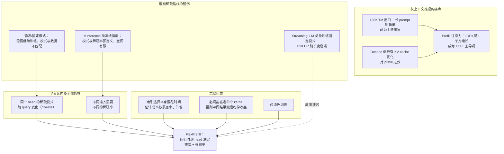
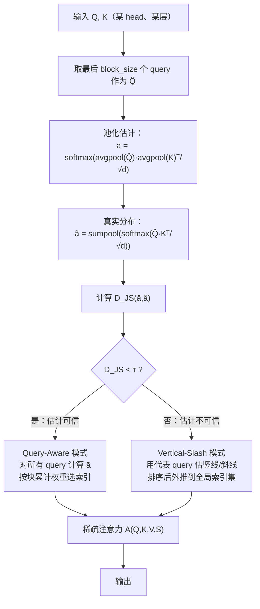
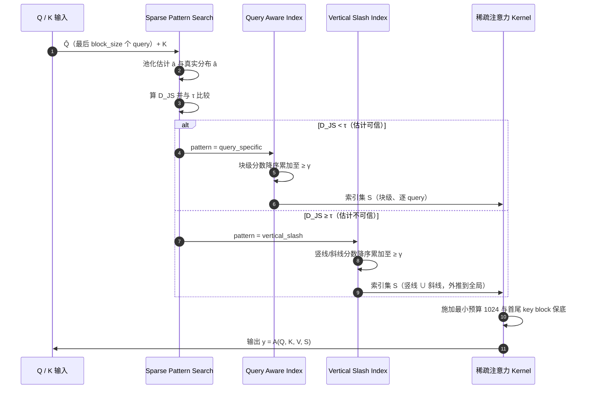
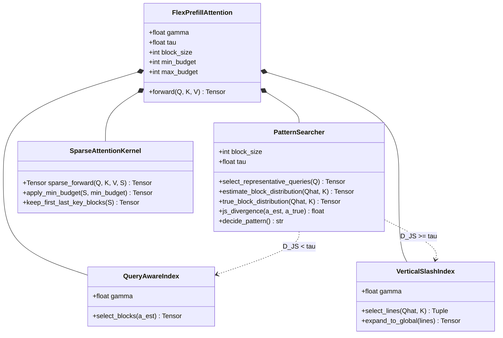
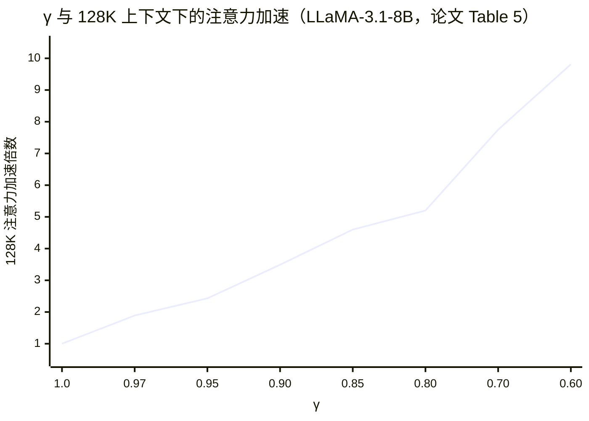
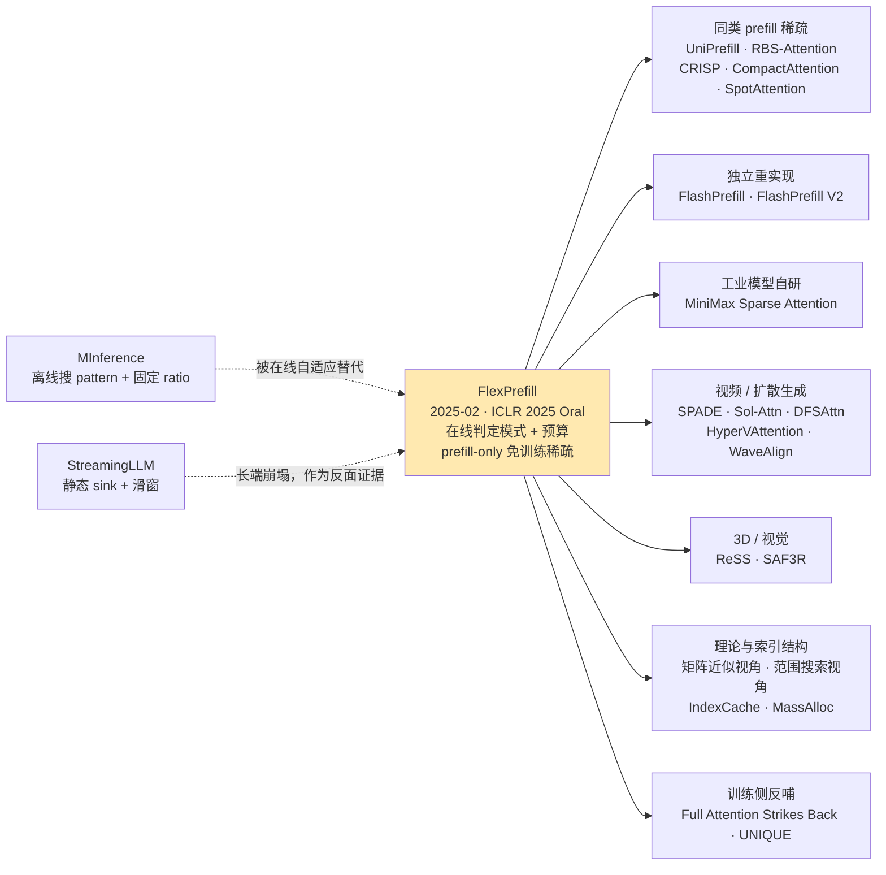

# ByteDance Seed FlexPrefill（"Flex Attention"）技术洞察

> **洞察对象**：*FlexPrefill: A Context-Aware Sparse Attention Mechanism for Efficient Long-Sequence Inference*
> **论文**：arXiv:2502.20766 ｜ **ICLR 2025 Oral（1.77%）** ｜ [OpenReview](https://openreview.net/forum?id=OfjIlbelrT)
> **代码**：[ByteDance-Seed/FlexPrefill](https://github.com/ByteDance-Seed/FlexPrefill)（Apache-2.0，172 stars）
> **作者**：Xunhao Lai（北大，第一作者）；Jianqiao Lu（港大）；Yao Luo、**Yiyuan Ma**、**Xun Zhou**（ByteDance Inc）
> **文档版本**：2026-10-14
> **系列关系**：本报告是"ByteDance Seed 技术洞察"系列的第 3 篇（前两篇：[VWN](Seed-VWN-技术洞察.md)、[Over-Encoding](Seed-OE-技术洞察.md)）。
> **⚠️ 术语澄清（重要）**：你说的"flex attention"存在两个可能的所指，本报告以字节的 **FlexPrefill** 为主，并在 §3.2 澄清二者区别与关系：
> ① **PyTorch `torch.nn.attention.flex_attention`**（PyTorch 2.5 引入的**可编程注意力 mask 框架**，是通用基础设施，不是字节的工作）；
> ② **FlexPrefill**（字节的**免训练上下文感知稀疏注意力算法 + Triton kernel**，ICLR 2025 Oral）——本报告对象。

> **目录与流程约定**：仓库根目录只放技术洞察文档，每个技术洞察一个文件夹；调研笔记统一收在对应文件夹的 `research/` 下，图表资产收在 `assets/` 下；调研完成后自动清理原始抓取件。

---

## 0. 结论速览（TL;DR）

| 维度 | 结论 |
| --- | --- |
| **技术定位** | **面向 prefill 阶段**的**免训练（training-free）动态稀疏注意力**：每次前向**按 head、按输入**实时决定"用哪种稀疏模式"与"稀疏到什么程度"；两种模式最终统一成**同一份 block 索引**，由**单个 FlashAttention 风格稀疏 kernel** 承载 |
| **核心洞察** | ①LLM 的注意力稀疏模式**不是单一形态**——既有跨 query 一致的**结构化模式**（vertical-slash：竖线 + 斜线），也有随 query 变化的**查询相关模式**（diverse）；②**每个 head、每个输入的稀疏率的最优值都不同**，固定稀疏率必然次优 |
| **两个关键机制** | ①**Query-Aware Sparse Pattern Determination**：用 **Jensen-Shannon 散度**比较"池化估计分布"与"真实分布"，小于阈值 τ 就用查询相关模式，否则回退到结构化的 vertical-slash 模式；②**Cumulative-Attention Based Index Selection**：以"累计注意力权重 ≥ γ"为约束，**最小化**被选中的 query-key 索引集合（式 3） |
| **效果（论文自报）** | RULER 平均分：LLaMA-3.1-8B **89.18 vs 全注意力 88.70 / MInference 85.42 / StreamingLLM 61.62**；Qwen2-7B **70.75 vs 68.83**；GLM-4-9B 89.34 vs 89.06；**在 128K 上下文下同时取得 2.43×（γ=0.95）~3.49×（γ=0.9）的注意力加速**，且 γ=0.95 时**精度反超全注意力** |
| **调参特性** | **γ 是"精度—速度"旋钮**：γ=0.97→1.89×、0.95→2.43×、0.9→3.49×、0.85→4.60×（128K，LLaMA-3.1-8B）；γ 越低越快、精度缓降 |
| **工程形态** | Triton kernel，`block_size=128`，`τ=0.1`，每个 head 至少计算 **1024 token**，保留首尾 key block；**仅支持 batch=1、bf16**（当前版本）；提供 `patch_model` 可挂到 HF transformers 模型上 |
| **生态位置** | 与 MInference（离线搜索模式 + 在线索引）同属"免训练动态稀疏"，但 FlexPrefill 的差异是**模式与预算都在线自适应**、且**在单 kernel 内完成**；ICLR Oral + 172 stars 说明其学术认可度较高 |
| **关键判断** | FlexPrefill 是**"用在线测量换掉离线搜索"**的路线：它证明了"稀疏模式可以按输入动态判定"这件事**代价很低**（一次代表查询的池化估计即可）。它的真正价值不是某个具体 kernel，而是**"把稀疏率从离线超参变成运行时决策"这一范式**——这与本系列前两篇（VWN 的"动态 r"、OE 的"条件记忆"）在方法论上同源：**把静态超参变成输入相关的动态决策** |

---

## 1. 技术背景：业界在什么场景下遇到什么问题

### 1.1 场景一：长上下文推理的瓶颈从 decode 转移到 prefill

长序列推理的成本结构在 2024–2025 年发生了一次反转：

| 阶段 | 计算特征 | 主要瓶颈 | 代表优化 |
| --- | --- | --- | --- |
| **Prefill**（首 token 前） | 对整个 prompt 做**全对全**注意力，FLOPs ∝ **L²** | **注意力本身的计算量**（compute-bound） | FlashAttention 系列、稀疏注意力（FlexPrefill 所处位置） |
| **Decode**（逐 token 生成） | 每步只算 1 个 query，但要把整个 KV cache 读一遍 | **显存带宽**（memory-bound），KV cache 随 L 线性增长 | PagedAttention、GQA/MLA、KV 量化、H2O/Quest 类 KV 淘汰 |

随着上下文窗口从 8K 提升到 128K/1M，"长 prompt + 短输出"成为主流用法（长文档问答、代码库理解、Agent 长轨迹），**prefill 的 L² 注意力成为首 token 延迟（TTFT）的主导项**——而 decode 侧已有的 KV cache 优化对 prefill 无效。这给"**prefill 阶段的稀疏注意力**"开出了一个独立且刚性的需求。

### 1.2 场景二：既有稀疏注意力路线各有硬伤

论文把此前的方法分为三类，并逐一点出问题：

| 路线 | 代表工作 | 核心做法 | 硬伤 |
| --- | --- | --- | --- |
| **静态/固定模式** | BigBird、Longformer、**SlidingWindowAttention**、LongLoRA | 预定义稀疏 mask（滑窗、全局 token、随机块） | **需要继续训练/微调**；模式与真实注意力分布不匹配 |
| **免训练固定模式** | **StreamingLLM**（attention sink + 滑窗） | 保留最初若干 token + 局部窗口 | 论文实测在 RULER 上**随长度急剧崩塌**（LLaMA 从 4K 的 95.43 掉到 64K 的 26.20） |
| **离线搜索模式** | **MInference** | 离线分析 LLM 的固有稀疏模式（A 型竖线 / B 型斜线），在线做稀疏索引搜索 | **依赖预定义的模式与稀疏率、搜索空间有限**；"无法应对真实输入序列的多样性与动态性"，因此在输入复杂度变化时**次优** |

论文用两句观察把矛头指向同一处：**(a) 注意力的稀疏模式本身就存在变异性（diverse）**——同一个 head 在不同 query 上可采用完全不同的稀疏结构；**(b) 不同样本需要不同的稀疏率**——用固定预算处理所有输入必然在"简单输入上算多了、复杂输入上算少了"。

### 1.3 场景三：稀疏率是个"看不见的旋钮"，固定值必然次优

即使选对了模式，**该稀疏到什么程度**仍是难题：

- 稀疏率太保守 → 加速有限（例如做 1.9× 的加速却损失 3 个点精度，不如不做）；
- 稀疏率太激进 → 关键 token 被丢，长程检索类任务直接失效（StreamingLLM 在 InfiniteBench 的 Retr.KV 上得 **0.00**）。

产业侧真正需要的是**"在给定精度预算下尽可能快，或在给定延迟预算下尽可能准"的可调旋钮**，而不是一个固定的稀疏率。FlexPrefill 的 γ（累计注意力阈值）正是这样一个**显式、可调、逐 head 生效**的旋钮。

### 1.4 场景四：prefill 稀疏的"决策开销"必须极低，否则加速被吃掉

一个容易被忽视的工程约束：**稀疏索引选择本身也要花时间**。如果为了决定"算哪些块"而先做一次全量注意力估计，那么 L² 的成本只是被搬了个位置，端到端加速会趋近于零。因此 prefill 稀疏算法必须满足：

1. **估计成本 ≪ 节省的计算**（FlexPrefill 的解法：只对**最后 `block_size` 个 query** 做估计，并且这份估计**同时用于模式判定与索引选择**）；
2. **选择结果必须能被一个 kernel 直接消费**（FlexPrefill 的解法：把两种模式的索引**统一物化成同一份 block-id 列表**，交给单个稀疏注意力 kernel——**决策本身仍是独立的前置算子，不是塞进注意力 kernel 里**，见 §2.6）；
3. **是免训练的**（否则长上下文模型的稀疏模式要先训练一遍，落地成本极高）。

### 1.5 问题图谱（汇总）



### 1.6 背景要点一览

| # | 场景 | 具体问题 | 既有对策 | 残留缺口（FlexPrefill 的切入点） |
| --- | --- | --- | --- | --- |
| 1 | 长上下文推理 | prefill 的 O(L²) 成为 TTFT 主导 | FlashAttention（不改变复杂度） | 需要**免训练**的稀疏化 |
| 2 | 稀疏模式选择 | 固定模式与真实注意力分布不匹配 | BigBird/Longformer/SWA（需训练） | 模式应**按输入在线判定** |
| 3 | 免训练方案 | StreamingLLM 在长上下文崩塌 | attention sink + 滑窗 | 需要**保留关键 token** 的机制 |
| 4 | 稀疏率 | 固定预算在简单/复杂输入上都次优 | MInference 离线搜索 | 稀疏率应**逐 head 在线分配** |
| 5 | 工程落地 | 索引选择的开销会吃掉加速 | 预计算 mask | 估计与选择必须**极廉价且单 kernel** |

---

## 2. 技术介绍

### 2.1 一句话定义与核心洞察

**FlexPrefill 是一个免训练的、上下文感知的稀疏 prefill 注意力机制**：每次前向时，它对每个 attention head 动态地回答两个问题——**"用哪种稀疏模式？"**（查询相关 vs 结构化）与**"稀疏到什么程度？"**（以满足累计注意力阈值 γ 为约束、最小化计算量），然后把两种模式的索引**合并成同一份 block-id 列表**，交给**一个 FlashAttention 风格的稀疏 kernel** 执行。

核心洞察可以浓缩为一句：**稀疏性不该是离线决定的超参，而应是运行时按输入测出来的量**；而"测"这件事可以做得极其便宜——**只用最后一个 block 的 query 做一次池化估计即可**。

> ⚠️ **一个容易说错的点**：论文所说的"单 kernel"是指**一个稀疏注意力 kernel 同时支持两种稀疏模式**（因为二者都被物化成块索引），**并不表示模式判定与索引选择也在同一个 kernel 里**——它们是前置的 Triton/Torch 算子（pooling、JSD、topk、直方图），有独立开销，见 §2.6。

### 2.2 机制一：Query-Aware Sparse Pattern Determination

#### 2.2.1 两类稀疏模式

论文先给出两条观察（Figure 2）：

| 模式 | 形态 | 特征 | 处理方式 |
| --- | --- | --- | --- |
| **Diverse / Query-Aware** | 稀疏结构**随 query 位置变化**，块级分布各不相同 | 需要按 query 单独估计 | 走 **Query-Aware Index** |
| **Structured / Vertical-Slash** | **竖线**（少数 key 对所有 query 都重要）+ **斜线**（局部对角带） | 跨 query 一致，可用少量代表 query 估出来再外推 | 走 **Vertical-Slash Index** |

#### 2.2.2 用 Jensen-Shannon 散度做自适应判定

判定"当前 head 属于哪类"的关键是：**能不能用便宜的池化估计替代真实的块级分布**。具体三步：

```
1) 代表查询选择：取最后 block_size 个 query 作为 Q̂（只算一次，模式判定与索引选择复用）

2) 块级分布估计（两种）：
   ā = softmax( avgpool(Q̂) · avgpool(K)ᵀ / √d )         ← 估计分布（池化后算，便宜）
   â = sumpool( softmax( Q̂ · Kᵀ / √d ) )                ← 真实分布（pooling kernel 大小 = block_size）

3) 分布比较：D_JS(ā, â) = sqrt( JSD(ā ‖ â) ) = sqrt( ½( D_KL(ā‖m) + D_KL(â‖m) ) )，m = ½(ā+â)

4) 自适应决策：
   D_JS < τ  → 估计足够准 → 对"所有 query"都算 ā，走 Query-Aware 模式
   D_JS ≥ τ  → 估计不可靠 → 只用一小部分 query 搜索，再按 vertical-slash 结构外推到全局索引集
```

**为什么用 JS 散度而不是 KL？** 论文明确给出的理由是**对称性与有界性**——这两条保证了判定的稳定与可靠（KL 不对称且无界，单个块的概率畸变就会主导判定）。

#### 2.2.3 判定流程图



> **工程要点**：`Q̂` **同时**服务两个目的（模式判定 + 竖线/斜线选择），因此"估计"这件事在整条流水线里只付一次成本——这是 FlexPrefill 能把在线决策做得便宜的关键设计。

### 2.3 机制二：Cumulative-Attention Based Index Selection

选定模式后，下一步是**在保证效果的前提下把要算的索引集合压到最小**。论文把它写成一个带约束的最小化问题（式 3）：

```
min_{S_i} Σ_i |S_i|
s.t.  Σ_{(i,j) ∈ S_i}  softmax(Q_i·K_jᵀ/√d)_j  ≥  γ ,   ∀ i ∈ [n]
```

即：**对每个 query 位置 i，选择一个尽量小的 key 索引子集，使其覆盖的归一化注意力权重之和不低于阈值 γ**。

两种模式下的求解策略：

| 模式 | 策略 |
| --- | --- |
| **Query-Aware head** | 用平均池化后的 Q/K 估出**块级**注意力分数 → **降序排列**块 → 依次累加直到超过 γ → 得到稀疏块集合 S |
| **Vertical-Slash head** | 用代表查询子集 Q̂ 算分数 → 分别求**竖线**与**斜线**的平均分 → 降序累加直到超过 γ → 把选中的线**外推**成整个注意力矩阵上的索引集 S |

#### γ 的语义

γ 是本方法唯一的"精度—速度旋钮"，且**逐 head、逐输入实时生效**：

- γ → 1：等价于趋近全注意力；
- γ 越小：保留的关键 token 越少、越快，精度缓降；
- 论文在 128K 上下文、LLaMA-3.1-8B 上给出完整的权衡曲线（见 §2.7）。

**两个保底设计**（防止个别 head 被"稀疏到失效"）：

1. **每个 head 至少计算 1024 个 token**（最小预算）；
2. **保留每个 query block 对应的首、尾 key block**。

### 2.4 算法总览（UML 时序图）



### 2.5 类图（UML）



> 对应论文 Algorithm 1 的三段结构：`Sparse Pattern Search(Q,K,τ)` → `Query Aware Index(Q,K,γ)` 或 `Vertical Slash Index(Q,K,γ)` → `A(Q,K,V,S)`。

### 2.6 实现细节与工程取舍

#### 2.6.1 完整流程（4 个算法 + 代码级细节）

论文给的是 **Algorithm 1 总控 + Algorithm 2 模式搜索 + Algorithm 3 Vertical-Slash 索引 + Algorithm 4 Query-Aware 索引**。关键流程（融合论文算法与官方实现 `flex_prefill/ops/flex_prefill_attention.py`）：

```text
Algorithm 1  FlexPrefill Sparse Attention
  输入: Q,K,V ∈ R^{S×d}, τ（模式阈值）, γ（累计注意力阈值）, block_size B=128
  # 短序列兜底（代码级）
  if q_len == 1:                        → 直接走 dense flash decode
  if q_len <= max(2B, ceil(min_budget/B)·B): → 直接走 dense causal flash attention
  S ← get_active_blocks(Q,K,B,γ,min_budget,max_budget,τ)   # 前置算子（Alg.2/3/4）
  O ← triton_block_wise_attention(Q,K,V,S,B)               # 唯一的稀疏注意力 kernel

Algorithm 2  Sparse Pattern Search
  Q̂ ← Q[:, -B:, :, :] / √d                # 代表性子集 = 最后 B 个 query，只算一遍
  P ← softmax(Q̂·Kᵀ)                        # 真实注意力（仅代表行）
  vertical ← mean_over_rep_queries(P)      # 每列均值 → 竖线分数
  slash    ← sum_over_diagonals(P) / B     # 对角线均值 → 斜线分数
  ā ← softmax(avgpool_B(Q̂)·avgpool_B(K)ᵀ/√d)   # 池化估计分布
  â ← sumpool_B(vertical)                       # 真实块级分布
  pattern ← (D_JS(ā,â) < τ) ? query_specific : vertical_slash     # 判定准则 ①

Algorithm 3  Vertical-Slash Index Search
  nv, ns ← score_cover_topk(vertical/slash, γ)/B + 1   # 线级累计覆盖到 γ（判定准则 ②）
  nv, ns ← clamp(nv, ns, min_budget, max_budget)
  vertical[..., :1] ← +inf ; slash[..., -1:] ← +inf   # 强制保留首个 key 块（sink）与最后一块（局部）
  S ← 竖线索引 ∪ 斜线索引 → 物化为块索引

Algorithm 4  Query-Aware Index Search（仅当 pattern == query_specific）
  attn ← softmax(avgpool_B(Q̂)·avgpool_B(K)ᵀ/√d)（下三角 mask）
  block_topk ← score_cover_idx(flatten(attn), γ · num_blocks)   # 块级累计覆盖到 γ
  S ← unique(S ∪ block_topk)          # ★ 与 Algorithm 3 的线索引取并集
```

**两个设计要点**：

1. **判"模式"与判"预算"是两级可分离的决策**：`τ` 管"这条 head 能不能信逐 query 估计"，`γ` 管"要保留多少注意力质量"。两者都**在线、按 head、按输入**计算——这就是论文所称的 context-aware。
2. **两种模式不是互斥的**：Query-Aware head 的最终索引是**块稀疏索引 ∪ 竖线/斜线索引**，只是把线稀疏的预算压到最小（`num_vertical/num_slash` 置为 `min_budget`），把剩余算力交给逐 query 块稀疏。

#### 2.6.2 关键超参（论文值 vs 代码默认值）

| 超参 | 论文实验值 | 代码默认值 | 作用 / 约束 |
| --- | --- | --- | --- |
| `block_size` | **128**（全部实验） | 128 | 消融 64 vs 128 **差异微小**（GLM 89.34/89.34，Qwen 70.75/71.35） |
| `τ` | **0.1**（全部模型） | 0.1 | LLaMA：τ=0→89.10、**0.1→89.18**、0.2→89.06、0.3→88.38 |
| `γ` | 0.9（Yi、Qwen）/ **0.95**（LLaMA、GLM） | 0.9 | 唯一的速度—精度旋钮（见 §2.7.3） |
| `min_budget` | 每 head ≥ **1024 token** | `None` | **γ=0.9 时极关键**：无下限 84.78 → 1024 得 **88.38（+3.6 分）** → 2048 得 88.82 |
| `max_budget` | 主结果未设上限 | `None`→∞ | 对 LLaMA **有害**（加 32K 上限 89.18→88.82）、对 GLM 有利 |
| 保底块 | 每 query 块保留**首、尾 key 块** | `vertical[...,:1]=inf; slash[...,-1:]=inf` | 等价于 attention sink + 局部窗口 |
| 代表性子集 | 最后 `block_size` 个 query | 同 | 消融：**对 V-S 索引极关键**——改用中间 query 会让 LLaMA 从 89.18 **崩到 38.18**（128K 仅 10.58） |

#### 2.6.3 Kernel 实现

| 项 | 做法 |
| --- | --- |
| 唯一的计算 kernel | `block_wise_prefill_attention_kernel`（Triton）：grid = `(batch×heads, #q_blocks)`，kernel 内遍历 block-id 列表，对每个激活的 K 块做 FlashAttention-2 式在线 softmax |
| 块索引的加速结构 | 先把排序后的 `block_idx` 转成 **`idx_bins` 直方图**（`triton_column_count_cumsum`，需 Triton ≥3；否则退化为 torch 实现并告警） |
| 分块参数 | `BLOCK_SIZE_K = 128`（固定）；`BLOCK_SIZE_D = next_pow2(head_dim)`；`num_warps/num_stages` 按 **GPU 型号（H100/A100/4090/default）× head_dim>64 × block_size>64** 查表 |
| 前置算子 | `bnhd_pool_kernel`（avgpool，kernel_size ∈ {16…512}）、`bhn_sumpool_kernel`（sumpool）、JSD、topk、直方图——**均为独立开销** |
| 解码路径 | 存在 `decode_kernel` / `block_wise_decode_attention_kernel`，但主接口在 `q_len == 1` 时**直接走 dense flash decode** |

#### 2.6.4 复杂度分解（附录 G）

FlexPrefill 的总开销拆成 4 块：

| 组件 | 量级 |
| --- | --- |
| 代表行注意力打分 | ≈ `O(B·d·S)` |
| 模式搜索（池化 + JSD） | ≈ `O(S·d)` |
| 稀疏索引构建（排序 + 建索引） | ≈ `O(S log S)` |
| **稀疏注意力本身** | ≈ `O(ρ·S²·d)`，ρ 为稀疏因子 |
| （对比）dense | `O(S²·d)` |

论文称额外开销约 `O(S log S + B·d·S)`，**被稀疏节省显著覆盖**；附录 G 实测显示**输入越长，稀疏注意力本身占比越高、其余组件占比递减**，而短输入时非注意力开销占比更高。（注：论文 HTML 中复杂度公式被 MathJax 折叠，上式量级为按语义复原，标记为**推测-量级**。）

#### 2.6.5 工程边界

| 项 | 取值 |
| --- | --- |
| 硬件（论文实验） | 单张 **A100 80GB** |
| 精度 | **bf16** |
| batch | **仅 batch=1**（README 明示） |
| 阶段 | **prefill-only**；decode 切回 dense（论文 §4.1 明示，仓库 issue [#1](https://github.com/ByteDance-Seed/FlexPrefill/issues/1)、[#2](https://github.com/ByteDance-Seed/FlexPrefill/issues/2) 也在追问 decode 支持） |
| 显存 | **不减少** KV cache（只跳过 QK 计算），论文未报告显存数字 |

### 2.7 实验与调参：γ 作为"精度—速度旋钮"

#### 2.7.1 RULER（长上下文综合基准，平均分）

| 模型 | 全注意力 | StreamingLLM | MInference | **FlexPrefill** |
| --- | --- | --- | --- | --- |
| LLaMA-3.1-8B | 88.70 | 61.62 | 85.42 | **89.18** ✅ |
| GLM-4-9B | 89.06 | 65.91 | 89.18 | **89.34** ✅ |
| Yi-9B-200K | 79.49 | 61.22 | 76.00 | 76.32 ⚠️ |
| Qwen2-7B | 68.83 | 52.96 | 66.07 | **70.75** ✅ |

**三个关键读法**：①StreamingLLM 在长上下文上**全面崩塌**（如 LLaMA 128K 仅 30.77，而全注意力 78.13）；②MInference 在长端退化（LLaMA 128K 58.17）；③FlexPrefill 在 3/4 个模型上**平均分超过全注意力**（稀疏化反而抑制了长上下文噪声），仅 Yi 上小幅落后。

#### 2.7.2 Infinite Bench（平均分）

| 模型 | 全注意力 | StreamingLLM | MInference | **FlexPrefill** |
| --- | --- | --- | --- | --- |
| LLaMA-3.1-8B | 48.06 | 14.72 | 34.06 | **47.14** |
| GLM-4-9B | 41.98 | 27.16 | 44.56 | 44.83 |
| Yi-9B | 37.69 | 17.29 | 37.44 | 36.18 |
| Qwen2-7B | 29.53 | 23.24 | 22.65 | **30.07** |

在合成检索任务（Retr.PassKey、Retr.Number）上 FlexPrefill 与全注意力基本持平（LLaMA 98.64/99.83 vs 99.15/99.66），而 MInference 在该项大幅落后（56.78/77.12）——**说明"在线自适应"确实保住了检索能力**。

#### 2.7.3 128K 上下文下的"精度 vs 加速"权衡

| γ | RULER 平均分（LLaMA-3.1-8B） | **128K 注意力加速** |
| --- | --- | --- |
| 1.0（全注意力） | 88.70 | 1.00× |
| 0.97 | 89.34 | **1.89×** |
| **0.95** | **89.18** | **2.43×** |
| 0.90 | 88.38 | **3.49×** |
| 0.85 | 87.10 | **4.60×** |
| 0.80 | 86.78 | 5.20× |
| 0.75 | 85.94 | 6.75× |
| 0.70 | 85.38 | 7.75× |
| 0.65 | 84.09 | 8.79× |
| 0.60 | 83.25 | **9.81×** |



**这张表是全文最有产业价值的部分**：γ=0.95 时**精度还比全注意力高 0.48 分、同时快 2.43×**——对线上服务几乎是"免费的加速"；γ=0.9 时仍有 88.38（仅比全注意力低 0.32 分）却快 3.49×；即使压到 γ=0.6（83.25，掉 5.45 分）也能拿到 **9.81×**。

#### 2.7.5 端到端时延（单次 attention 调用，附录 C Table 3）

| 模型 | 方法 | 64K (ms) | 128K (ms) | 平均值 (ms) | RULER Avg |
| --- | --- | --- | --- | --- | --- |
| LLaMA-3.1-8B | Full-attn | 157.88 | 658.83 | 144.97 | 88.70 |
| LLaMA-3.1-8B | MInference | 152.56 | 215.53 | 116.63 | 85.42 |
| LLaMA-3.1-8B | **Ours (γ=0.9)** | **61.92** | **185.75** | **50.66** | 88.38 |
| LLaMA-3.1-8B | **Ours (γ=0.95)** | 85.40 | 271.07 | 70.61 | **89.18** |
| GLM-4-9B | Full → **Ours (0.95)** | 267.26 → **120.07** | 1066.21 → **408.74** | 237.65 → **100.75** | 89.06 → **89.34** |
| Yi-9B-200K | Full → **Ours (0.95)** | 243.17 → **102.32** | 1018.07 → **319.43** | 223.53 → **83.30** | 79.49 → 76.32 |
| Qwen2-7B | Full → **Ours (0.95)** | 137.53 → **61.51** | 569.86 → **173.00** | 125.67 → **47.62** | 68.83 → **70.75** |

> 由 Table 3 换算（**非论文原值**，引用请注明换算）：GLM ≈ **2.61×**、Yi ≈ **3.19×**、Qwen ≈ **3.29×**（128K、γ=0.95），与论文 Table 4 中 LLaMA 的 2.43×/3.49× 同量级。

#### 2.7.6 论文"没有做"的评测（避免误引）

- **未在 LongBench 上评测**（论文仅将其引为背景）；
- **未单独给出 Needle-in-a-Haystack 曲线**（RULER 内含 NIAH 子类，但只报聚合分，未给 13 个子任务拆分）；
- **未报告显存 / KV cache 数字**——FlexPrefill **不减少 KV cache**，显存与 dense 相同；
- **未给出相对 FlashAttention-2 的独立命名加速比**（baseline 写作 "FlashAttention (Dao, 2024)"）。

#### 2.7.4 与其他免训练稀疏基线的对比（128K 加速）

| 方法 | 128K 加速 | 备注 |
| --- | --- | --- |
| **FlexPrefill** | **1.89×（γ=0.97）~ 4.60×（γ=0.85）** | 可调 |
| MInference | 1.89× | 离线搜索模式 |
| InfLLM | 1.51× | — |
| MoA | 1.31× | — |
| LM-Infinite | — | **128K OOM** |

### 2.8 论文自陈与代码可见的局限

1. **只解决 prefill**：decode 阶段所有方法（含 FlexPrefill）都切回全注意力，未触及 decode 的 KV cache 带宽瓶颈；
2. **当前版本仅支持 batch=1 与 bf16**（README 明示），限制了线上批量服务的直接可用性；
3. **需要自定义 Triton kernel 与模型 patch**（`patch_model`），不是即插即用；
4. **阈值需要人工设定**（τ=0.1、γ 按模型给 0.9/0.95），论文未给出自动调 τ/γ 的方法；
5. **γ 的加速比是"注意力算子层面"的加速**，端到端 TTFT 收益会被 FFN、KV 写回等非注意力部分摊薄；
6. **稀疏化的可解释性与安全影响未被讨论**：动态丢掉一部分 key 是否会系统性地影响某些能力（如长程事实检索的边界情况），缺少针对性评测。

---

## 3. 技术影响：对业界意味着什么，会不会出现变种技术

### 3.1 影响力的坐标系

| 维度 | 事实 | 判断 |
| --- | --- | --- |
| **同行评审** | **ICLR 2025 Oral（1.77%）**（[OpenReview](https://openreview.net/forum?id=OfjIlbelrT)） | ✅ 学术认可度高（Oral 比例极低） |
| **学术引用** | **138 篇**（Semantic Scholar，2026-10-14；其中 influential **35** 篇；venue = ICLR） | ✅ 影响力大，且 **2026 年仍在高频被引** |
| **开源与热度** | `ByteDance-Seed/FlexPrefill`，**172★ / 11 fork**，Apache-2.0，纯 Triton（约 1915 行）；HF Transformers 官方支持 | ✅ 可复现性较好 |
| **维护强度** | 最后 push 2025-10-13，但**功能提交停在 2025-05**；**未上 PyPI 官方** | ⚠️ 低强度维护 |
| **推理栈集成** | **vLLM 为实验性**（README 自述未充分测试）；**SGLang PR [#6867](https://github.com/sgl-project/sglang/pull/6867) 仍为 Open**（来自 `bytedance-iaas/sglang` 分支，32 个 commit；PR 描述称在 **32K 输入、RULER 任务上相对 FlashAttention 后端有 34% 提升**，引入 `*_FLEXPREFILL` 环境变量开关，关联 2025Q3 路线图 issue #7736） | ⚠️ 尚未成为服务栈的标准组件 |
| **第三方生态** | 除官方仓库外，GitHub 上仅 2 个 **0-star** 的个人复现仓库；**无社区移植生态** | ⚠️ 生态薄弱 |
| **扩散范围** | 引用者中**大量是 2026 年的稀疏注意力与视频/扩散生成工作**（见 §3.4） | ✅ 已从"LLM 推理优化"扩散为**通用注意力加速范式** |

> **与系列前两篇的对比**：VWN 是"高工程相关性、低引用"；OE 是"高引用、无官方代码"；**FlexPrefill 是本系列里"学术认可 + 开源可复现"最平衡的一篇**——但它的短板在**工程边界**（batch=1、bf16、prefill-only、不支持 MLA）与**维护强度**。

### 3.2 术语澄清：PyTorch `flex_attention` ≠ FlexPrefill

这是本报告开篇提到的重要澄清，两者**不是同一个东西**：

| | **PyTorch `torch.nn.attention.flex_attention`** | **FlexPrefill（本报告对象）** |
| --- | --- | --- |
| 是什么 | PyTorch 2.5 引入的**可编程注意力 API**：用户用 Python 函数定义 score/mask 修改，编译器把它**融合成高效 kernel**（支持块稀疏） | 一个**具体的稀疏注意力算法 + Triton kernel**：动态判定模式与预算 |
| 层次 | **通用基础设施 / DSL** | **算法 + 实现** |
| 谁做的 | PyTorch 社区/官方 | ByteDance（Seed 组织下开源），北大 + 港大参与 |
| 是否互相依赖 | FlexPrefill **自带 Triton kernel**（`flex_prefill/ops/flex_prefill_attention.py`），依赖 `triton==3.0.0`，**并不依赖 PyTorch 的 flex_attention** | — |
| 关系 | **理念上的表亲**：都依赖"块稀疏 + mask 可编程"；如果要用一句话概括，**flex_attention 是"让稀疏可编程"，FlexPrefill 是"让稀疏可自适应"** | — |

> **给落地的建议**：如果诉求是"自定义 mask / 快速实验注意力变体"，用 PyTorch `flex_attention`；如果诉求是"长上下文 prefill 免训练提速且要可调旋钮"，看 FlexPrefill。两者也可以共存（未来把 FlexPrefill 的索引选择结果喂给 flex_attention 作为 mask 是自然的组合方向，**但当前无公开实现**——推测）。

### 3.3 影响一：把"稀疏率"从离线超参变成运行时旋钮

FlexPrefill 最被继承的不是 kernel，而是**两级在线决策的结构**：

1. **模式级决策**（τ）：用 JS 散度判断"便宜的池化估计能不能代表真实注意力分布"，能则用逐 query 细粒度稀疏，不能则回退到稳健的结构化稀疏——**这是一种"按 head 的可信度路由"**；
2. **预算级决策**（γ）：以"累计注意力质量下限"为约束、**最小化计算量**；论文附录用**对偶与 KKT 条件**证明 γ 恰好是这一约束优化问题的**拉格朗日乘子阈值**——即 γ 不是拍脑袋的超参，而是"精度约束"的显式对偶变量。

这两点合起来确立了一个范式：**稀疏率应由运行时测得的注意力集中度决定，而不是由离线统计决定**。它直接对标并超越了 MInference 的"离线搜 pattern + 固定 ratio"。

### 3.4 影响二：从 LLM 推理扩散为通用注意力加速范式

**≥60 篇引用中，2026 年的工作占了绝对多数，且已明显溢出 LLM 推理场景**（下列均取自 Semantic Scholar 引用列表，即"确实引用了 FlexPrefill"的工作）：

| 方向 | 代表性引用工作（2026） |
| --- | --- |
| **长上下文 prefill 稀疏（直接同类）** | UniPrefill（[arXiv:2605.06221](https://arxiv.org/abs/2605.06221)）、RBS-Attention: Radius-Bounded Sparse Prefill（[2609.20971](https://arxiv.org/abs/2609.20971)）、CRISP: Input-adaptive Sparse Prefilling（[2609.01925](https://arxiv.org/abs/2609.01925)）、CompactAttention: Chunked Prefill with Block-Union KV Selection（[2605.16839](https://arxiv.org/abs/2605.16839)）、SpotAttention: Plug-In Block-Sparse Routing（[2606.22874](https://arxiv.org/abs/2606.22874)） |
| **"另起炉灶"式重实现** | **FlashPrefill: Instantaneous Pattern Discovery and Thresholding for Ultra-Fast Long-Context Prefilling**（[2603.06199](https://arxiv.org/abs/2603.06199)）与 **FlashPrefill V2: Block-Sparse Prefill Attention for Long-Context LLM Serving**（[2608.19758](https://arxiv.org/abs/2608.19758)）——名字上就是"Flash 版 FlexPrefill"，说明**"阈值化 + 即时模式发现"这条路线被独立重做** |
| **工业模型自研稀疏注意力** | **MiniMax Sparse Attention**（[2606.13392](https://arxiv.org/abs/2606.13392)） |
| **视频 / 扩散模型** | SPADE: Input-Adaptive Sparse Attention Engine for **Video Diffusion**（[2608.03335](https://arxiv.org/abs/2608.03335)）、Sol-Attn: On-the-Fly Attention Sparsification for **Video Generation**（[2607.24027](https://arxiv.org/abs/2607.24027)）、DFSAttn: Dynamic Fine-grained Sparse Attention for Video Generation（[2605.23445](https://arxiv.org/abs/2605.23445)）、HyperVAttention: Spatio-Temporal Clustering for Video Diffusion（[2607.03012](https://arxiv.org/abs/2607.03012)）、WaveAlign: Cache-Aware Query-Row Scheduling for Long-Video Generation（[2609.34814](https://arxiv.org/abs/2609.34814)） |
| **3D / 视觉 Transformer** | ReSS: Residual-Restoring Sparse Attention for 3D ViT（[2609.35593](https://arxiv.org/abs/2609.35593)）、SAF3R: Dynamic Sparse Attention for Feed-Forward 3D Reconstruction（[2607.03612](https://arxiv.org/abs/2607.03612)） |
| **理论与索引结构** | Sparse Attention Is Matrix Approximation, Not Choosing from a Bag of Values（[2610.10871](https://arxiv.org/abs/2610.10871)）、Sparse Attention as a Range Searching Problem（[2605.06763](https://arxiv.org/abs/2605.06763)）、IndexCache: Cross-Layer Index Reuse（[2603.12201](https://arxiv.org/abs/2603.12201)）、MassAlloc Attention: Let Attention Allocate Its Own Compute（[2609.32712](https://arxiv.org/abs/2609.32712)） |
| **训练侧反哺** | Full Attention Strikes Back: Transferring Full Attention into Sparse within Hundred Training Steps（[2605.16928](https://arxiv.org/abs/2605.16928)）、UNIQUE: Universal Top-k Sparse Attention for Training-free Inference **and Sparsity-aware Training**（[2605.27740](https://arxiv.org/abs/2605.27740)） |



**两个值得注意的信号**：

1. **"阈值化 + 即时发现模式"成为公共配方**：FlashPrefill / FlashPrefill V2 直接沿用"instantaneous pattern discovery and **thresholding**"的表述——说明 FlexPrefill 的 γ/τ 思路已经成为这条线的通用语汇。
2. **溢出到视频生成是本方法最出人意料的扩散**：视频扩散模型的注意力同样存在"块稀疏 + 强局部性 + 输入相关"的特征，且序列更长（时空 token 数万级），因此 FlexPrefill 式的**免训练、运行时自适应**方案在视频上比在 LLM 上可能更有价值。

### 3.5 变种技术（一）：已经出现

| 变种 | 与 FlexPrefill 的差异 | 证据 |
| --- | --- | --- |
| **FlashPrefill / V2** | 把"模式发现 + 阈值化"做成更快的独立实现。**V2 走向生产**：均值修正项、PackGQA 访存、warp specialization、pingpong 流水，对齐 **FlashAttention-3/4**，支持 **FP8 / PagedKV / continuous batching**，可作为 **SGLang** 注意力后端；H20 上 128K + FP8 **最高 47.26× vs FA2** | [2603.06199](https://arxiv.org/abs/2603.06199)｜[2608.19758](https://arxiv.org/abs/2608.19758) |
| **FAST-Prefill**（FPGA） | 首个**FPGA 上的动态稀疏 prefill 加速器**：TTFT **2.5×**、能效 **4.5×** | [arXiv:2602.20515](https://arxiv.org/abs/2602.20515) |
| **昇腾 NPU 上的稀疏 prefill 算子** | 社区已出现面向 Ascend NPU 的稀疏 prefill 算子仓库（原型阶段） | [ackerm0n/Sparse-attention-op-for-Ascend-NPU-](https://github.com/ackerm0n/Sparse-attention-op-for-Ascend-NPU-) |
| **UniPrefill** | 面向"通用长上下文 prefill"的块级动态稀疏 | [2605.06221](https://arxiv.org/abs/2605.06221) |
| **CRISP** | 引入"结构性质量"（structural mass）驱动的路由，替代纯累计阈值 | [2609.01925](https://arxiv.org/abs/2609.01925) |
| **IndexCache** | **跨层复用稀疏索引**——直接攻击 FlexPrefill 的"前置算子开销" | [2603.12201](https://arxiv.org/abs/2603.12201) |
| **MassAlloc Attention** | "让注意力自己分配算力"——把 γ 的思想推广为可学习/自分配的预算 | [2609.32712](https://arxiv.org/abs/2609.32712) |
| **UNIQUE** | 统一 top-k 稀疏，同时服务免训练推理**与稀疏感知训练** | [2605.27740](https://arxiv.org/abs/2605.27740) |
| **Full Attention Strikes Back** | 反向路线：用**百步训练**把全注意力模型转成稀疏模型（免训练 → 轻训练） | [2605.16928](https://arxiv.org/abs/2605.16928) |
| **SPADE / Sol-Attn / DFSAttn** | 把同一范式搬到**视频扩散**（时空块稀疏、逐帧输入的动态预算） | [2608.03335](https://arxiv.org/abs/2608.03335)｜[2607.24027](https://arxiv.org/abs/2607.24027)｜[2605.23445](https://arxiv.org/abs/2605.23445) |
| **MiniMax Sparse Attention** | 工业侧自研的模型级稀疏注意力 | [2606.13392](https://arxiv.org/abs/2606.13392) |

### 3.6 变种技术（二）：可能的下一批方向（分析推测）

| # | 方向 | 核心想法 | 支撑证据 | 受益场景 | 风险 |
| --- | --- | --- | --- | --- | --- |
| 1 | **稀疏索引跨层/跨 step 复用** | 索引选择的前置开销在短输入时占比最高，可复用上一步/相邻层的索引 | IndexCache 已在做跨层复用（[2603.12201](https://arxiv.org/abs/2603.12201)） | 短输入、连续对话 | 复用会削弱"随输入自适应"这一核心优势 |
| 2 | **把 τ/γ 变成可学习或自动搜索** | 当前 τ=0.1、γ 按模型手调；可学习或按精度预算自动求解 | 附录 A/B 已把 γ 解释为对偶变量；MassAlloc 在做自分配 | 多模型统一部署 | 自动调参会引入训练/校准成本 |
| 3 | **免训练稀疏 + 轻训练稀疏合流** | 推理期用 FlexPrefill 定位重要块，再用少量训练把稀疏模式固化 | Full Attention Strikes Back（百步转换）、UNIQUE（稀疏感知训练） | 长期部署、专用加速器 | 训练-推理一致性维护复杂 |
| 4 | **与 decode 侧稀疏统一** | FlexPrefill 只管 prefill，decode 回 dense；可把"块稀疏"延伸到 decode | 论文自陈 prefill-only；仓库 issue #1/#2 在追问 decode | 端到端 TTFT+TPOT 双降 | decode 是 memory-bound，省算力不等于省时间 |
| 5 | **支持 MLA / GQA 等异构 KV 结构** | 当前不支持 MLA，且 head_dim/block_size 白名单受限 | issue #18 明确要求 MLA 与 batch>1 | DeepSeek 系模型、工业部署 | MLA 的潜在 KV 结构破坏块稀疏假设 |
| 6 | **batch>1 与 continuous batching** | 当前 batch=1 硬 assert，无法直接进入线上批量服务 | 代码 assert + issue #18 | 生产级服务 | 逐样本不同稀疏模式会破坏 kernel 的整齐并行 |
| 7 | **视频/扩散模型的专用版本** | 时空块稀疏 + 逐帧动态预算 | 已有多篇引用工作（SPADE/Sol-Attn/DFSAttn） | 视频生成、世界模型 | 时空稀疏的最优块形状与 LLM 不同 |
| 8 | **稀疏化的可解释性与安全评测** | 动态丢弃 key 是否系统性影响特定能力（长程事实、多跳） | 当前无针对性评测（论文未做） | 高可靠场景 | 稀疏带来的失效模式可能难以事后发现 |

### 3.7 风险与不确定性

1. **工程边界硬**：**batch=1 硬 assert、仅 bf16、prefill-only、不支持 MLA**、head_dim/block_size 有白名单——离"线上服务可用"还有距离（[issue #18](https://github.com/ByteDance-Seed/FlexPrefill/issues/18) 在申请 MLA/batch>1）。
2. **维护强度低**：功能提交停在 2025-05，SGLang 集成 PR 未合并；社区已有 [issue #12](https://github.com/ByteDance-Seed/FlexPrefill/issues/12) 报告"看不到性能提升"、[issue #8](https://github.com/ByteDance-Seed/FlexPrefill/issues/8) 在 4090 上 shared memory 溢出——**跨硬件泛化性存疑**（论文只在 A100 实测，H100 仅有调参提交而无数字）。
3. **不省显存**：FlexPrefill 只跳过 QK 计算，**KV cache 不减少**，显存与 dense 相同——对显存受限的长上下文服务没有帮助。
4. **收益是"注意力算子级"**：端到端 TTFT 会被 FFN、KV 写回、采样等摊薄；且论文未报告端到端数字。
5. **评测面窄**：只有 RULER + InfiniteBench，**未做 LongBench、未单列 NIAH**；评测集中在长上下文检索/聚合，缺少推理类（GSM8K/MATH）与代码任务的稀疏影响分析。
6. **超参依赖**：τ 调大即掉点（τ=0.3 时 128K 仅 75.96）；min_budget 不可省（γ=0.9 时无下限 84.78 → 加 1024 变 88.38）。
7. **引用生态已高度拥挤**：2026 年同类工作（FlashPrefill/UniPrefill/CRISP/…）大量涌现，**先发优势正在被稀释**；工程侧的集成与维护反而成为差异化关键。
8. **"学术影响"与"工程落地"必须分开陈述（本报告结论性判断）**：FlexPrefill 的影响**主要发生在学术与方法论层面**——它被 2025–2026 大量 prefill 稀疏工作当作**基线与出发点**，形成了一条"动态稀疏 prefill"支线；但**工程落地仍处早期**：SGLang PR 未合并、**没有任何已发布模型或产品声明使用 FlexPrefill**（本次调研明确未找到）。**警惕把它说成"已在生产环境验证的方法"**。

### 3.8 对研发团队的启示

> 结合本仓库上下文（Ascend/NPU、TorchTitan、Qwen 实验、长上下文与投机解码方向）。

| 优先级 | 建议 | 理由 |
| --- | --- | --- |
| **P0** | 先做**离线复现**：在 A100/等效卡上用 `patch_model` 跑通 LLaMA-3.1-8B 的 128K RULER，复现 γ=0.95 的 2.43× 与精度不降 | 论文给足了超参与代码，验证成本低；这是判断"是否值得投入"的最短路径 |
| **P0** | 明确**适用边界清单**再谈落地：batch=1、bf16、prefill-only、无 MLA | 这四条决定了它**不能**直接用于现有在线批量服务 |
| **P1** | 评估**"γ 旋钮"接入自有服务的形态**（按 SLA 动态设 γ，而非固定值） | 这是本方法最有复用价值的抽象；即使不用它的 kernel，也值得移植这套"累计注意力预算"逻辑 |
| **P1** | 关注 **IndexCache 类"索引复用"** 与**前置算子开销** | 论文附录 G 显示短输入时非注意力开销占比高，这正是自研优化空间 |
| **P1** | 若做视频/多模态，重点评估**时空块稀疏版本** | 引用生态显示视频扩散是本方法扩散最快的领域 |
| **P2** | 评估 **NPU 侧可行性**：Triton 在 Ascend 上的支持度 + 动态索引 gather 的效率 | 本方法是"随机访问块"型 kernel，对硬件 gather 效率敏感；vllm-ascend 生态已有 Triton-distributed-ascend 等先例可参考（见后续洞察） |
| **P2** | 跟踪 **MLA/GQA 适配**与 **batch>1** 的上游进展 | 这两条是它进入主流服务栈的前置条件 |

---

## 附录 A. 参考资料

**一手资料**

| # | 资料 | 链接 |
| --- | --- | --- |
| 1 | FlexPrefill 论文（arXiv:2502.20766，ICLR 2025 Oral） | https://arxiv.org/abs/2502.20766 ｜ https://arxiv.org/html/2502.20766v1 |
| 2 | OpenReview（ICLR 2025 Oral） | https://openreview.net/forum?id=OfjIlbelrT |
| 3 | 官方仓库 ByteDance-Seed/FlexPrefill（Apache-2.0，172★） | https://github.com/ByteDance-Seed/FlexPrefill |
| 4 | ICLR 2025 proceedings | https://proceedings.iclr.cc/paper_files/paper/2025/hash/03645743ea35690f30d795d6bac149a5-Abstract-Conference.html |
| 5 | Hugging Face Papers 页面 | https://huggingface.co/papers/2502.20766 |
| 6 | Semantic Scholar 引用列表（≥60） | https://api.semanticscholar.org/graph/v1/paper/arXiv:2502.20766/citations?fields=title,year,externalIds&limit=60 |
| 6b | Semantic Scholar 元数据（**citationCount = 138，influential = 35**） | https://api.semanticscholar.org/graph/v1/paper/arXiv:2502.20766?fields=title,citationCount,influentialCitationCount,venue |
| 6c | SGLang PR #6867（未合并；32K/RULER 相对 FA 后端 +34% 的说法来自 PR 描述） | https://github.com/sgl-project/sglang/pull/6867 |

**谱系与相关技术**

| # | 资料 | 链接 |
| --- | --- | --- |
| 7 | MInference（离线搜 pattern + 在线索引，主要对标对象） | https://arxiv.org/abs/2407.02490 |
| 8 | StreamingLLM（attention sink + 滑窗，反面证据） | https://arxiv.org/abs/2309.17453 |
| 9 | Longformer（局部窗口注意力） | https://arxiv.org/abs/2004.05150 |
| 10 | BigBird（稀疏注意力 + 需训练） | https://arxiv.org/abs/2007.14062 |
| 11 | FlashAttention-2 | https://arxiv.org/abs/2307.08691 |
| 12 | H2O（decode 阶段 KV 淘汰，与本法正交） | https://arxiv.org/abs/2306.14048 |
| 13 | Quest（decode 阶段 KV 选择） | https://arxiv.org/abs/2406.10774 |

**引用生态（2026 年代表工作）**

| # | 资料 | 链接 |
| --- | --- | --- |
| 14 | FlashPrefill: Instantaneous Pattern Discovery and Thresholding | https://arxiv.org/abs/2603.06199 |
| 15 | FlashPrefill V2: Block-Sparse Prefill Attention for Serving | https://arxiv.org/abs/2608.19758 |
| 16 | UniPrefill: Universal Long-Context Prefill Acceleration | https://arxiv.org/abs/2605.06221 |
| 17 | CRISP: Input-adaptive Sparse Prefilling | https://arxiv.org/abs/2609.01925 |
| 18 | RBS-Attention: Radius-Bounded Sparse Prefill | https://arxiv.org/abs/2609.20971 |
| 19 | IndexCache: Cross-Layer Index Reuse | https://arxiv.org/abs/2603.12201 |
| 20 | MassAlloc Attention: Let Attention Allocate Its Own Compute | https://arxiv.org/abs/2609.32712 |
| 21 | UNIQUE: Universal Top-k Sparse Attention | https://arxiv.org/abs/2605.27740 |
| 22 | Full Attention Strikes Back（百步转稀疏） | https://arxiv.org/abs/2605.16928 |
| 23 | MiniMax Sparse Attention | https://arxiv.org/abs/2606.13392 |
| 24 | SPADE（视频扩散稀疏注意力引擎） | https://arxiv.org/abs/2608.03335 |
| 25 | Sol-Attn（视频生成在线稀疏化） | https://arxiv.org/abs/2607.24027 |
| 26 | SpotAttention: Plug-In Block-Sparse Routing | https://arxiv.org/abs/2606.22874 |

**仓库 issue（工程现状证据）**

| # | 资料 | 链接 |
| --- | --- | --- |
| 27 | issue #1 / #2：为何只在 prefill 使用 / decode 阶段有无加速 | https://github.com/ByteDance-Seed/FlexPrefill/issues/1 ｜ https://github.com/ByteDance-Seed/FlexPrefill/issues/2 |
| 28 | issue #18：请求 MLA 与 batch>1 支持 | https://github.com/ByteDance-Seed/FlexPrefill/issues/18 |
| 29 | issue #12 / #8：用户报告无性能提升 / 4090 shared memory 溢出 | https://github.com/ByteDance-Seed/FlexPrefill/issues/12 ｜ https://github.com/ByteDance-Seed/FlexPrefill/issues/8 |

## 附录 B. 术语表

| 术语 | 英文 / 缩写 | 含义 |
| --- | --- | --- |
| 上下文感知稀疏注意力 | context-aware sparse attention | 稀疏模式随输入动态变化的注意力 |
| 免训练稀疏 | training-free sparsity | 不需要微调模型即可生效的稀疏化 |
| 查询相关模式 | Query-Aware / Diverse pattern | 稀疏结构随 query 位置变化 |
| 竖线-斜线模式 | Vertical-Slash pattern | 少数关键 key（竖线）+ 局部对角带（斜线）构成的结构化稀疏 |
| 代表查询 | representative queries, `Q̂` | 用于廉价估计的最后 `block_size` 个 query |
| JS 散度 | Jensen-Shannon divergence | 对称、有界的分布距离，用于判定估计是否可信 |
| 累计注意力阈值 | `γ` | 选中索引覆盖的注意力权重下限；越小越快 |
| 模式判定阈值 | `τ` | 判定"估计是否可信"的 JS 散度阈值 |
| 稀疏预算 | computational budget | 每个 head 实际计算的 token 数 |

## 附录 C. 事实、推测与资料核查

### C.1 事实与推测的分界

| 类别 | 内容 |
| --- | --- |
| **已证实事实（一手）** | §2 的全部机制、公式（含 γ 的对偶/KKT 解释）、算法四步、超参与代码级细节，以及 §2.7 的全部实验数字（Table 1/2/3/4/5 与附录 C/D/E/F）均取自 arXiv:2502.20766v1 原文与官方实现；仓库信息（172★/11 fork/Apache-2.0/推送时间）取自 GitHub API；**引用数为 138（influential 35，venue = ICLR）**取自 Semantic Scholar 元数据接口；SGLang PR #6867 的状态与其"34% 提升"说法取自 PR 页面；引用生态取自 Semantic Scholar 引用列表（均已核实"确实引用了 FlexPrefill"） |
| **原文口径红旗（不得误引）** | ①论文**未做 LongBench**、未单列 NIAH；②**"相对 FlashAttention-2 的 N×"** 不是论文原始说法（baseline 写作 "FlashAttention (Dao, 2024)"）；③**SeerAttention / NSA / MoBA 在论文中完全未出现**，任何对比表都不可标为论文出处；④GLM/Yi/Qwen 的加速比论文未直接给出，本报告的 ≈2.61×/3.19×/3.29× 是**由 Table 3 时延换算**并已标注 |
| **作者归属提醒** | 第一作者 Xunhao Lai 属**北京大学**，Jianqiao Lu 属**香港大学**；Yao Luo / Yiyuan Ma / Xun Zhou 属 **ByteDance Inc**。论文正文只写 "ByteDance Inc"，"Seed" 体现在开源组织名（ByteDance-Seed）。**不可说成"作者全是字节"** |
| **分析推测（文中已标注）** | §3.6 的 8 个演进方向；§3.7 风险权重；§3.8 建议优先级；复杂度公式的"量级复原"（论文 HTML 中公式被 MathJax 折叠）；"flex_attention 与 FlexPrefill 可组合"的说法 |
| **明确未找到** | 论文的 LongBench/NIAH 数字、显存/KV cache 数字、H100 上的实测数字（仅有调参提交）、端到端 TTFT 数字 |

### C.2 需要澄清的一处术语（重要）

用户所说的 "flex attention" 在 2025–2026 年有**两个不同所指**：**PyTorch 的 `flex_attention` API**（可编程 mask 的通用框架）与**字节的 FlexPrefill**（论文与 kernel）。本报告以 FlexPrefill 为对象，二者关系的澄清见 §3.2。

### C.3 调研支撑文件（工作区内）

| 路径 | 内容 |
| --- | --- |
| `FP-FlexPrefill/research/` | 本次调研的笔记（机制精读 / 背景与影响） |
| `FP-FlexPrefill/assets/` | mermaid 图表产物（`*.svg` / `*.png` / `mmd/*.mmd`）与预览页 |
