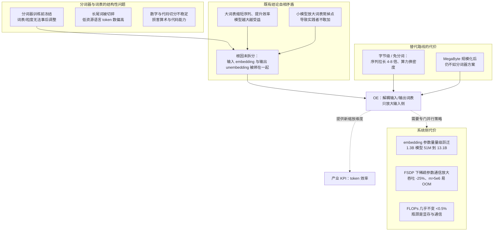
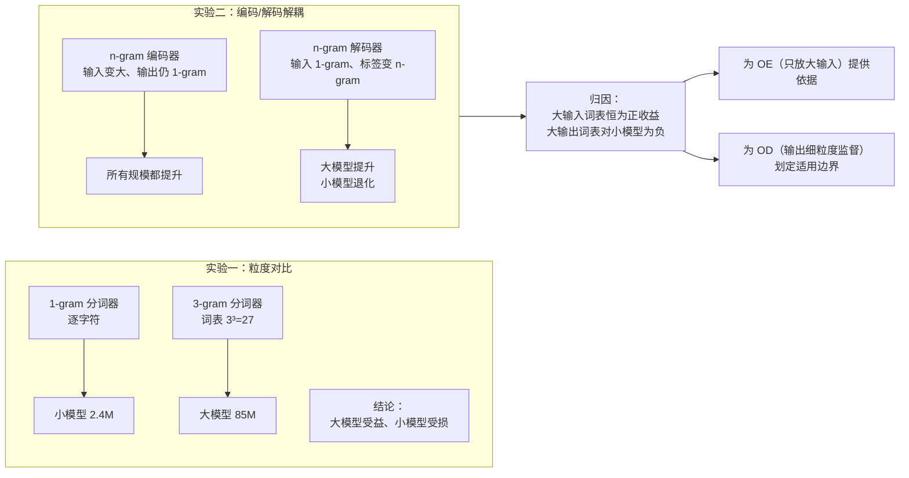
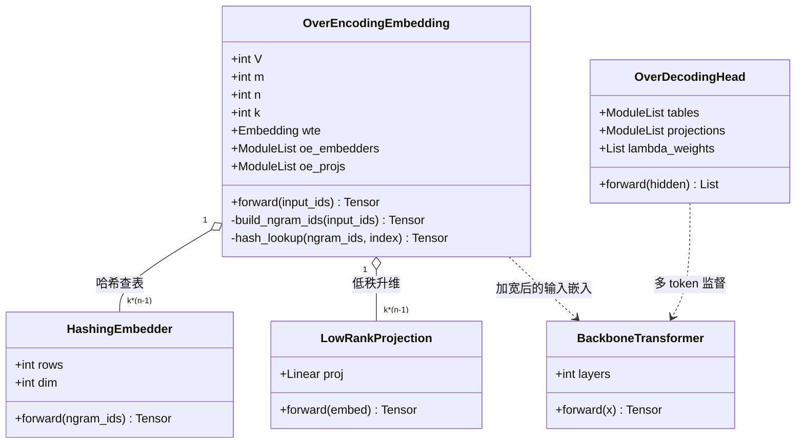
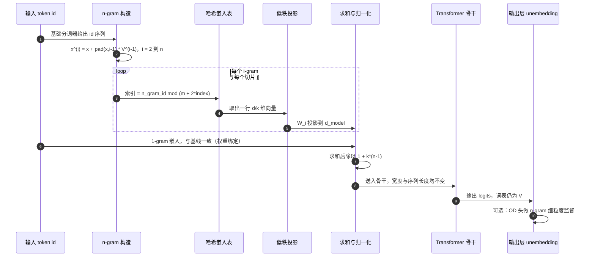
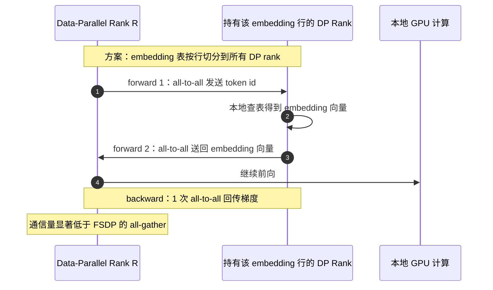
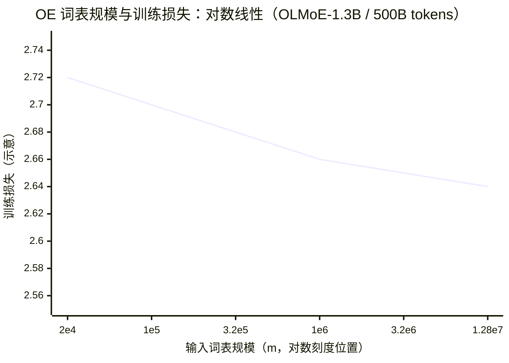
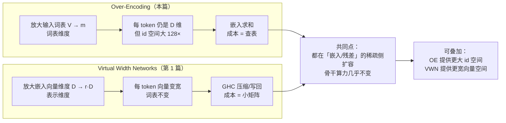
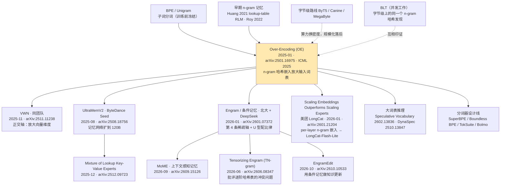
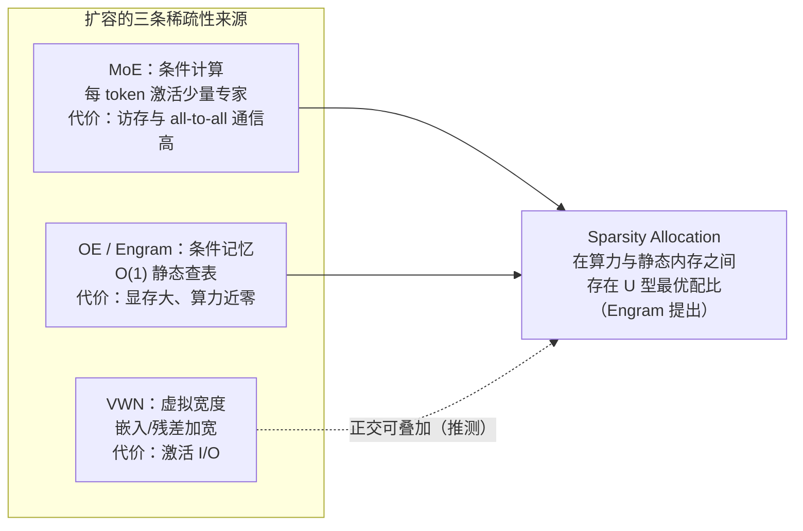
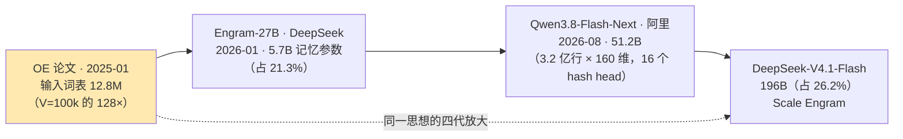

# Seed 团队 Over-Encoding（OE）技术洞察

> **洞察对象**：ByteDance Seed 论文 *Over-Tokenized Transformer: Vocabulary is Generally Worth Scaling*（arXiv:2501.16975，v1 2025-01-28，v2 2025-05-23，**ICML 2025**）
> **核心机制**：**Over-Encoding（OE，超编码）** = 用层次化 n-gram 哈希嵌入把**输入词表**放大到百万级；**Over-Decoding（OD，超解码）** = 用乘积分解把**输出监督**细粒化为 n-gram；二者合称 **Over-Tokenized Transformer（OT）**
> **文档版本**：2026-10-14
> **关键词**：tokenization、词表缩放、n-gram 嵌入、哈希嵌入、低秩切片、softmax 瓶颈、MTP、输入/输出词表解耦
> **系列关系**：本报告是"Seed 扩容新维度"系列的第 2 篇。第 1 篇为 [Seed-VWN-技术洞察.md](Seed-VWN-技术洞察.md)（**VWN 放大"每 token 的向量维度"**，本篇 OE **放大"输入词表的规模"**，两者正交且论文间互相引用）。

> **目录与流程约定**：本仓库根目录只放技术洞察文档，每个技术洞察一个文件夹；调研笔记统一收在对应文件夹的 `research/` 下，图表资产收在 `assets/` 下；**调研完成后自动清理原始抓取件**，只保留笔记中的来源链接与附录参考资料。

---

## 0. 结论速览（TL;DR）

| 维度 | 结论 |
| --- | --- |
| **技术定位** | 把**输入词表**与**输出词表**解耦，只放大输入词表：用 1/2/3-gram 哈希嵌入把词表从 100K 级扩到 **1280 万级（128×）**，而输出层保持原大小 |
| **核心洞察** | **输入词表只花"查表"成本，输出词表要花"softmax"成本**——所以输入词表可以几乎免费地放大，输出词表在小模型上放大反而有害。通过 CFG 合成实验把两者分离验证 |
| **效果（论文自报）** | OLMo2：**400M 的 OE 模型匹配 1B 基线**的训练损失（2.5×"等效模型规模"，无额外训练成本）；OLMo2-1B 上 loss **5.7×** 收敛加速，下游 2.6–3.9×；内部 MoE（400M 激活/4B 总参，m=36M）知识类基准大涨（TriviaQA 39.7→**49.0**、MMLU-Pro 21.1→**24.1**、GSM8K 40.6→**46.2**） |
| **缩放律** | 输入词表与 loss 呈**对数线性**：`L = 2.6754 − 0.0256·log₁₀ m`（OLMoE-1.3B，500B tokens）；**m 每放大 4×，loss 降 0.015** |
| **代价（论文自报）** | FLOPs 增加 **< 0.5%**（实测 GFLOPs/token +0.35%~0.38%）；训练吞吐 **−4.63%（1.3B）/ −8.3%（7B，未充分优化）**；推理吞吐影响"可忽略"（嵌入可卸载到 CPU）；**真正的代价是 embedding 显存与 all-to-all 通信，而非算力** |
| **工程关键** | 必须给 embedding 层单独做**张量并行 + 行切分 + all-to-all**（forward 2 次、backward 1 次）；否则 FSDP 下 **吞吐 −25%**，m>5×10⁶ 时**容易 OOM** |
| **学术影响** | **ICML 2025 接收**（有同行评审）；**45 篇引用**（Semantic Scholar，2026-10-14）——是 VWN（3 篇）的 15 倍；HF Papers 2025-01-29 **当日 #3 / 34 upvotes**；**无官方开源代码/权重**（已核实 HF `ByteDance-Seed` 组织下无相关产物） |
| **后继生态** | 已形成独立赛道"**条件记忆 / 嵌入缩放**"：**Engram**（北大+DeepSeek，27B，U 型稀疏配比律）、**UltraMemV2**（ByteDance Seed，120B）、**LongCat-Flash-Lite**（美团，68.5B/~3B，含 per-layer n-gram 嵌入）、**SCONE**（Google，频次选择 + 外存卸载）、MoME、TN-gram 等 |
| **关键判断** | OE 是**"零算力扩容"里性价比最高的一条**：只改 embedding 层与并行策略，就能拿到"等效模型规模 ×2.5"的收益（FLOPs +<0.5%），且与 MoE、MTP、VWN 正交。**但它已经不是最新方案**：SCONE 与 Engram 都把 OE 当作 baseline 并超越；Engram 更明确指出其在**稀疏 MoE 骨干上无显著提升**。所以正确的用法是**继承其"输入/输出词表解耦 + 条件记忆"的框架，而不是照搬 2025 年初的实现** |
| **设计规则（可直接用）** | ①必须**层次化**（1+2+3-gram 同时用，只用 2-gram 会显著退化）；②**切片低秩**（令每个切片维度 ≈256，见 §2.4 的公式口径说明）；③`m ≫ V` 且 **m 与 V 互质**（否则哈希冲突吃掉收益）；④多个 embedder 的 `m` 要错开（`m+2i`）；⑤模型要**训练足够久**才能兑现大词表的收益 |
| **真实门槛** | 不在算法，而在**词表并行的工程实现**（专用 TP + all-to-all）与**大 embedding 的显存/通信账**；算法侧论文已给出完整超参与伪代码 |

---

## 1. 技术背景：业界在什么场景下遇到什么问题

### 1.1 场景一：分词器是"训练前定死、之后无法改"的隐形超参

BPE 与 Unigram LM 是当前事实标准，它们在"序列长度"与"词表规模"之间做取舍。一旦预训练开始，分词器就被冻结——**词表大小、合并规则、粒度全部固化**，后续无法通过继续训练补救。而分词器对模型的影响并不小，且**可以量化**：

| 病症 | 量化证据 |
| --- | --- |
| **跨语言不公平** | 同一语义的 token 数在不同语言间差异最高达 **15×**（[Petrov et al., NeurIPS 2023, arXiv:2305.15425](https://arxiv.org/abs/2305.15425)）；非洲语言相对英语的中位倍数为 **1.88×**，N'Ko 高达 **8.92×**（[arXiv:2606.24460](https://arxiv.org/abs/2606.24460)） |
| **成本被 token 数放大** | **token 数翻倍 → 训练成本约 4×**；且"fertility（每个词被切成几个 token）"能相当准确地预测下游准确率（[Token Tax, arXiv:2509.05486](https://arxiv.org/abs/2509.05486)） |
| **英语中心 tokenizer 用于多语模型** | 严重性能退化，训练成本最高 **+68%**；要让多语表现追平，词表需约 **3×** 规模（[Ali et al., arXiv:2310.08754](https://arxiv.org/abs/2310.08754)） |
| **数字与算术** | 数字的切分方向直接决定算术能力：**从右到左切分（按逗号位）显著提升算术性能**，从左到右的错误呈系统性模式（[Singh & Strouse, "Tokenization counts", arXiv:2402.14903](https://arxiv.org/abs/2402.14903)） |
| **代码** | tokenizer 规模、预分词正则与语料显著影响生成速度、有效上下文、内存与下游性能（[Dagan, arXiv:2402.01035](https://arxiv.org/abs/2402.01035)） |
| **字符级任务结构性失败** | 数单词里有几个字母这类任务在分词模型上系统性失败（[Strawberry Problem, arXiv:2505.14172](https://arxiv.org/abs/2505.14172)）；此外 glitch / 欠训练 token 普遍存在（[Fishing for Magikarp, arXiv:2405.05417](https://arxiv.org/abs/2405.05417)） |

**关键点**：分词器决定的是"每个 token 携带多少信息"，这是一个**与模型架构正交、却被长期当作超参而非设计对象**的维度。这正是 OE 说"Vocabulary is Generally Worth Scaling"的立足点：**把词表规模从"分词器的副产物"提升为"可缩放的维度"**。

> ⚠️ 一处**不得臆造**的否定结论：调研中未找到任何给出"分词导致下游性能差 X 个百分点"总括数字的论文（网络流传的 "The Tokenizer Parakeet" 在 arXiv 全库检索为 **0 条**，不可引用）。本章统一改用上述可核验的**训练成本 / token 数 / 跨语言倍数**类证据。

### 1.2 场景二：大词表对小模型是负担——因为输入与输出词表被绑在一起

业界此前对"要不要放大词表"的结论是**分裂的**：

- 一方面，更大的词表缩短序列、提升训练效率，且模型越大越受益。**Tao et al. 给出了定量形式**：最优词表参数量随算力按幂律增长 `N_v = 0.20·C^0.42`（对比非词表参数 `N_nv = 0.08·C^0.50`），即指数比 `γ = 0.42/0.50 ≈ 0.84 < 1`——**词表参数应比模型参数增长得慢，但最优词表仍随算力持续增长**；其可操作预测是 **Llama2-70B 的最优词表至少 216K（约为其 32K 的 7 倍）**，且 32K→43K 在同等 2.3e21 FLOPs 下把 ARC-Challenge 从 29.1 提到 32.0（[Tao et al., NeurIPS 2024, arXiv:2407.13623](https://arxiv.org/abs/2407.13623)）。
- 另一方面，在**小模型**上放大词表经常掉点，导致实践者不敢加。

OE 的贡献是**把这个问题归因清楚**：所谓"大词表的收益/代价"其实是两件不同的事被混在一起：

| | 输入侧（embedding） | 输出侧（unembedding） |
| --- | --- | --- |
| 访问模式 | **稀疏**（每 token 查表 O(1)） | **稠密**（每次都要过整个词表的 softmax） |
| 成本随词表增长 | 几乎不变（只增加参数量与访存） | **线性增长**（logits + softmax + 采样） |
| 作用 | 把上下文**编码**成特征，词表越大表达能力越强 | 决定**预测任务的粒度**，越细粒度监督越难学 |
| 对模型规模的要求 | 任何规模都受益 | 小模型欠拟合，**只有大模型受益** |

**参数量视角：小模型的 embedding 已经"占比过高"**——这从另一个角度解释了为什么小模型加词表容易掉点：

| 模型 | 词表 × 维度 | embedding 参数量 | 占模型总参数 |
| --- | --- | --- | --- |
| Llama-3（配置值） | 128,256 × 8,192 | **≈1.05B**（若 untied 则 ≈2.10B） | 8B 模型 **≈13.1%** |
| Gemma 2 **2B** | 256,128（继承 Gemini 词表） | — | **≈22.6%** |
| Gemma 2 **9B** | 同上 | — | ≈9.9% |
| Gemma 2 **27B** | 同上 | — | ≈4.3% |
| Qwen2.5-**0.5B** | 151,646 | — | **≈27.6%** |

（Gemma 2 的官方论文**明确把大 embedding 占比归因于继承的 256k 词表**；数据引自 [Gemma 2 技术报告](https://arxiv.org/abs/2408.00118) 与各模型 config。）

也就是说：**小模型的参数预算本就被 embedding 吃掉两成以上，再放大词表就会挤占真正做计算的层**。OE 的解法是把这部分预算的**性质**变掉——从"稠密参与计算的参数"变成"稀疏查表的静态内存"。

**词表规模的产业演进**也印证了"词表值得放大、但受成本约束"这一张力：Llama-2 **32,000** → Llama-3 **128,256**（100K tiktoken + 28K 非英语，压缩率从 3.17 提升到 3.94 chars/token）→ Gemma **256,128** → Qwen2 **151,646** / Qwen3 **151,936** → DeepSeek-V3 **129,280**。

论文用 CFG 合成实验把这个假设做了干净的因果验证（见 §2.2）：**3-gram 编码器在所有模型规模上都提升，3-gram 解码器只在大模型上提升、在小模型上退化**。这一条"归因"本身就是本工作最有价值的部分——它把一条含混的经验规则变成了可操作的设计原则。

输出层之所以"加不起"，还有一层建模上的原因：把语言建模写成矩阵分解后，softmax 的表达能力受 `d_model` 秩的限制（**softmax bottleneck**），要提升它就得加宽 `d_model` 或改用混合 softmax——而**单纯把输出词表做大并不能解决秩瓶颈，只会让监督任务更难学**（[Yang et al., 2018, ICLR Oral, arXiv:1711.03953](https://arxiv.org/abs/1711.03953)）。这为"输入侧可放大、输出侧需谨慎"提供了一个独立于实验的机理解释。

工程侧同样如此：输出层的 `d_model × V` 投影与 logits 是稠密计算，在张量并行下需要词表维度的 all-gather/切分通信，词表越大通信与显存占用越高——这正是 OE 论文选择**只动输入侧、冻结输出侧**的现实理由。

### 1.3 场景三：字节级/免分词路线证明了方向，但算力效率太差

为了绕开分词器，业界长期存在字符/字节级路线：ByT5、Canine、MegaByte 等。但 OE 论文明确引用的事实是：**MegaByte 在规模化后性能仍不如基于分词器的方法**（[OE §2.1](https://arxiv.org/html/2501.16975v2)）。

两篇关键工作的定位需要写清：

- **MegaByte**（[arXiv:2305.07185](https://arxiv.org/abs/2305.07185)，NeurIPS 2023）：把序列切成 patch，patch 内用局部子模型、patch 间用全局模型，是"tokenization-free 可行"的早期证据，但规模化后仍落后于分词器方案；
- **BLT / Byte Latent Transformer**（[arXiv:2412.09871](https://arxiv.org/abs/2412.09871)）：按下一字节的熵动态切 patch，是**首个在规模上追平分词器**的字节级架构；OE 把它列为**并发工作**，并明确二者机制相近——"**BLT also has the same finding on byte-level models**"，BLT 同样采用 n-gram 哈希嵌入。

原因是字节级模型把序列拉长了 4–8 倍，注意力与 FFN 成本随序列长度增长——**用"算力换信息密度"**。而 OE 走的是相反的路：**不改变序列长度、不改变骨干算力，只在输入嵌入层把"有效词表"做大**，把信息密度做上去。两条线（字节级、n-gram 记忆）在 2025 年前后**独立收敛到同一个发现**，这本身就是该方向有效性的强证据。

### 1.4 场景四：词表已经是显存与通信问题，而不只是准确率问题

当词表从 10 万扩到 1280 万，embedding 参数量会出现量级跃迁。以论文口径为例：

| 模型 | 基线 embedding 参数 | +OE-12.8M 后 |
| --- | --- | --- |
| OLMoE-1.3B（260M 激活） | 51M | **13.1B**（≈10× 密集参数） |
| OLMoE-7B（1.3B 激活） | 102M | **26.3B**（≈3.7×） |

（[OE Table 1](https://arxiv.org/html/2501.16975v2)）

这些参数**极其稀疏地被访问**，因此 FLOPs 几乎不变（<0.5%），但会带来两类系统问题：

1. **显存压力**：embedding 表本身要占显存（论文的解法是推理时卸载到 CPU）；
2. **通信放大**：在 FSDP 这类参数分片策略下，稀疏参数的 all-gather 会严重拖慢训练——论文实测**吞吐 −25%**，且 m>5×10⁶ 时**容易 OOM**；
3. **输出侧是另一笔独立且更硬的账**（这正是 OE 选择冻结输出词表的原因）：
   - vLLM 的实测口径：logits 峰值显存 = `tokens × vocab × (2B bf16 + 4B fp32)`，**8192 token × 152K 词表 ≈ 7.5 GiB**，而且这块开销**不会被常规 profiling 观测到**（[vLLM PR #52054](https://github.com/vllm-project/vllm/pull/52054)）；logits 维度还随投机解码的 `num_spec_tokens` 成倍增长，采样（top-k/top-p）本身会成为 TPOT 瓶颈（[vLLM PR #50465](https://github.com/vllm-project/vllm/pull/50465)）；
   - Megatron-LM 原文：输出 embedding 为 `H × v`，其 all-gather 通信量为 `b × s × v`，**"huge due to vocabulary size being large"**（[Megatron-LM, arXiv:1909.08053](https://arxiv.org/abs/1909.08053)）；
   - 投机解码侧，**草稿模型与主模型必须共享词表**，否则"SGLang PR #23838：**every accepted draft token is silently wrong**"（真实反例：gemma-2-9b + tiny_starcoder_py）。

> **本节要回答的问题**：能不能让词表规模像"深度/宽度/数据"一样成为一个**可缩放、可规划、且几乎不花算力**的维度？

### 1.5 场景五：产业 KPI 从"参数规模"转向"token 效率"

- Chinchilla 把 token 效率变成与参数量并列的核心指标（compute-optimal 约为 **20 tokens/param**，[Hoffmann et al., 2022](https://arxiv.org/abs/2203.15556)）；
- 产业界主动偏离 compute-optimal 以换取推理预算下的更优表现："**we also train our smaller models for much longer than is compute-optimal. The resulting models perform better than compute-optimal models at the same inference budget.**"（[Llama 3](https://arxiv.org/abs/2407.21783)）；
- Kimi K2 把 token 效率称为缩放的关键系数（如"elevating **token efficiency**—learning signal per token—as a **critical scaling coefficient**"，[Kimi K2](https://arxiv.org/abs/2507.20534)；两处措辞略有出入，此处按其技术报告大意转述）；
- **token 数直接换算成推理成本**：KV cache 随 token 数线性增长——Llama-3.1-8B 的 KV cache 从 1K 上下文的 **0.125 GB** 涨到 128K 上下文的 **15.62 GB**（[HF 官方博客](https://huggingface.co/blog/llama31)）；API 侧普遍按 **per 1M tokens** 计费，token 数即账单。

OE 的定位恰好是"**不改模型、不改数据、不改序列长度，只改输入表示**"的效率杠杆——对已有训练配方是**加法而非替换**：它不缩短序列（那是更大分词器的收益），但它让每个位置上的输入**携带更多信息**，从而在同等 token 预算下收敛更快。

### 1.6 问题图谱（汇总）



### 1.7 背景要点一览

| # | 场景 | 具体问题 | 业界既有对策 | 残留缺口（OE 的切入点） |
| --- | --- | --- | --- | --- |
| 1 | 分词器设计 | 训练前冻结、长尾切碎、跨语言不均 | BPE / Unigram 调参、数字逐位切分 | 缺"训练后可扩"的表示维度 |
| 2 | 词表规模 | 大词表对小模型有害的结论自相矛盾 | 按经验选 32K~256K | 未拆分"输入/输出"两种成本 |
| 3 | 免分词路线 | 字节级序列变长、算力效率低 | ByT5/Canine/MegaByte/BLT | 缺"保持序列长度"的扩容方式 |
| 4 | 训练系统 | embedding 巨大、FSDP 通信放大 | 参数分片、CPU offload | 需要专为稀疏大表设计的并行 |
| 5 | 产业 KPI | token 效率、推理成本 | Chinchilla 式缩放定律 | 缺"几乎零算力"的扩容维度 |

---

## 2. 技术介绍

### 2.1 一句话定义与核心洞察

**Over-Encoding（OE）把 Transformer 的输入嵌入从"1-gram 查表"改成"1+2+…+n-gram 哈希嵌入的加权和"**，从而把输入词表从 `V`（约 10⁵）放大到 `m`（可配置，论文用到 **1.28×10⁷**），而**模型骨干、序列长度、输出层全部不变**。

核心洞察有两句：

1. **输入词表与输出词表的成本结构完全不同**：输入是稀疏查表（几乎免费），输出是稠密 softmax（随词表线性变贵）。因此应当**解耦**，只放大输入侧。
2. **放大输入词表的正确做法不是"训练一个更大的分词器"，而是"在既有分词器之上叠加 n-gram 嵌入"**——因为 `Vⁿ` 的完整词表不可行（`V=10⁵` 时 `V²` 就是 10¹⁰），必须用**哈希 + 低秩分解**把它近似成"可配置规模"的小表。

### 2.2 先做合成实验：把"输入/输出"两种影响分离

论文最有方法论价值的部分是 CFG（上下文无关文法）合成实验：语言由 3 个终结符按已知文法生成、序列长度可达 729、**真实分布完全已知**，因此可以精确度量。



工程上还有一个必须写清的细节：**n-gram 解码模型在推理时只取回预测出的第 1 个 token**，丢弃其余预测，从而保持推理成本与基线完全一致（[OE Fig.3](https://arxiv.org/html/2501.16975v2)）——这是"训练时细粒度监督、推理时不加成本"的关键技巧。

### 2.3 机制一：n-gram 索引与哈希嵌入

**n-gram 索引**：给定分词器给出的 id 序列 `x₁…x_t`，第 i 个位置的 n-gram 输入 token 定义为

```
x_i^(-n) = f(x_i, x_{i-1}, …, x_{i-n+1}) ,   f(z_1,…,z_n) = Σ_i z_i · p^(i-1)     (p ≥ V，通常取 p = V)
    越界位置补 0 token；n = 1 时退化为标准 Transformer 输入
```

**哈希嵌入（tiled matrix parameterization）**：完整 `Vⁿ × d` 表不可行，于是用一张 `m × d` 的小表 + **取模**近似：

```
h = E( x^(n) mod m )        E ∈ R^{m×d}，m 可配置
```

这一"n-gram 哈希"技巧在早期工作中已有使用（Huang et al. 2021 的 lookup-table RLM、Roy et al. 2022），OE 的贡献是把它放进**层次化 + 低秩切片 + 缩放律**的框架里。

### 2.4 机制二：层次化 Over-Encoding 与低秩切片

**层次化**：不只用 n-gram，而是把 **1-, 2-, …, n-gram 的嵌入相加**：

```
OE(x) = E^{V×d}(x^(-1))  +  Σ_{i=2..n}  E^{m×(d/n)|k}( x^(-i) )
         └ 1-gram，与原模型一致（对齐权重绑定） ┘   └ 2..n-gram，哈希 + 低秩切片 ┘
```

**低秩切片 `|k`**：把一张 `m × d` 表切成 `k` 个 `m × (d/k)` 子表，各自过一个投影矩阵 `W_i ∈ R^{(d/k)×d_model}` 再相加：

```
E^{m×d|k}(x) = Σ_{i=1..k} E_i^{m×(d/k)}(x) · W_i
```

论文的实测结论是：**同等 embedding 参数量下，切片比不切片更好**，原因是**减少访存**——切片后每 token 只访问 `k·(d/k)=d` 量级的行，而单表大 `m` 方案在同一预算下要访问更多参数（论文 C-3 每 token 访问 1.5·d_model，C-4 访问 2·d_model，后者更优）。

**关键超参**：论文默认 `n=3, m=1.28×10⁷`，并按 `d_model/(n·k) ≈ 256` 反推 `k`。

> ⚠️ **原文一处内部不一致（值得复现者注意）**：正文写的是 `d_model/(n·k) ≈ 256`，但**附录 A 的伪代码用的是 `D // (k*(n-1))`**（少一个 n→n−1）。用代码口径验证：OLMoE-7B 的 `d_model=2048, n=3, k=4` 时 `2048/(4×2)=256` **恰好成立**，而按正文口径 `2048/12≈170.7` 对不上。因此**更可能是正文公式少减了 1**（分析推测）。复现时建议以"每个切片的维度 ≈256"为准。

**哈希冲突的规避**（一个容易被忽略的工程细节）：

- 多个 embedder 的模数必须**错开**（用 `m + 2i`），否则切片技巧毫无意义；
- `m` 不能是 `V` 的整数倍——论文实测把 `m` 取成 `V` 的整数倍会显著削弱收益（Table 4：`m=64V≈3.218M` 时 loss 2.702，而取 `m=3.2M` 时为 2.678）。**实践建议：$m$ 与 $V$ 互质**。

### 2.5 机制三：Over-Decoding（OD）与乘积分解

OD 的目标是"**细粒度输出监督**"，但直接预测 `Vⁿ` 类会带来 `Vⁿ` 规模的 softmax。论文的解法是**乘积分解**：用 n 张 `V × d` 的表来表达 `Vⁿ` 的 logits

```
ẽ_x = Σ_{j=1..n} E_j^{V×d}( x / V^{j-1} ) = Σ_j E_j(z_j)

L = Σ_j λ_j · CE( ĥ · W_j · E_j^T , z_j )        λ₁ = 1，λ_{i>1} ≤ 1
```

要点：

- **解码词表从 `Vⁿ` 降回 `n·V` 量级**，避免输出层爆炸；
- 损失被**分解为 n 个交叉熵项**，可分别加权；
- 对稠密激活的 unembedding，可选用低秩投影 `W_j` 降维；
- 论文明确把 **MTP（含 DeepSeek-V3 的条件递归式 MTP-DS）视为 OD 的近似（approximation）**——注意原文用词是"近似"，"MTP 是 OD 的有效实例"这一更强的表述出自 **VWN 论文**的转述；
- **训练动态有个"交叉点"**：OD 在训练早期明显落后于基线，**超过 200B tokens 后才反超**（权重 `λ₂ ∈ {0.1, 0.2, 0.5, 1.0}`、`n=2`；下游任务上更小的权重更好）。这与"大输出词表只对大模型且需要充分训练才有效"的结论一致。

> 这是本论文中最"被低估"的一部分：它给"多 token 预测"提供了一个统一的解释框架（**细粒度输出监督**），并给出了 MTP 之外的另一种实现路径（乘积分解）。

### 2.6 机制四：Over-Tokenized Transformer = OE + MTP-DS

把 OE 与 MTP-DS 组合即得 **OT（Over-Tokenized Transformer）**。机制上的协同是双向的：

- OE 让嵌入具有更强表示能力，且**直接参与未来 token 的预测**（未来 token 的嵌入被拼接为下一头的条件）；
- MTP 的辅助监督给了 OE 更多的梯度信号，使**大 embedding 表被更充分地训练**（大词表本来就需要更长训练才收敛）。

论文的实现很小：在 OLMoE-1.3B 上**只加一个额外头预测下一个第 2 个 token，权重 0.1**。

### 2.7 类图（UML）



> 与论文附录算法 1 的 PyTorch 伪代码一一对应：`n_gram_ids` 用 `V^(i-1)` 累加构造，查表时 `% (m + 2*index)`，最后 `x /= 1 + k*(n-1)` 做归一化。

### 2.8 前向传播（UML 时序图）



### 2.9 训练工程：embedding 层专用张量并行



**实测对比**（论文 §3.3）：

| 方案 | m=10⁷ 时训练吞吐影响 | 备注 |
| --- | --- | --- |
| FSDP（未优化） | **−25%** | m>5×10⁶ 时**容易 OOM** |
| embedding 专用 TP + all-to-all | **< −5%** | forward 2 次 + backward 1 次 all-to-all |

论文还指出当前实现远未到极限，并给出两条优化路线：①在流水线并行中**为 embedding lookup 设一个专用 stage**，把它的通信与当前 micro-batch 的 Transformer 前向重叠，可做到**零吞吐损失**；②把 OE 参数**卸载到 CPU**，彻底消除显存压力。

### 2.10 缩放律与实验结果

#### 2.10.1 词表—损失对数线性律

```
L = 2.6754 − 0.0256 · log₁₀ m        （OLMoE-1.3B，500B tokens，n=2, k=1，m 从 20K 到 12.8M）
等价说法：m 每放大 4×，训练损失下降 0.015
输入词表规模的度量：V + m（1-gram 表与 2-gram 表之和）
```



> ⚠️ 上图为按论文拟合式绘制的**示意曲线**（论文 Figure 5 给出拟合式与数据点，本图用于表达"对数线性"这一形态，非逐点复刻）。

一个重要限定：**更大的词表需要更长的训练才能兑现收益**（论文 Figure 9 显示大词表的 loss 下降更慢但最终更低，且差距在充分训练后稳定保持）。这意味着 OE 在小 budget 实验中容易被低估。

#### 2.10.2 关键实验数字

| 实验 | 配置 | 结果 |
| --- | --- | --- |
| 等效模型规模 | OLMo2，400B tokens | **OE-12.8M 的 400M 模型匹配 1B 基线**，无额外训练成本。⚠️ **口径不一**：摘要/引言写 "comparable to **double-sized** baselines"，而 §4.1 写 "**2.5 times larger** in model scale"——本报告采用 §4.1 的 2.5× 口径 |
| 1B 模型训练动态 | OLMo2-1B，1T tokens | loss 增益从 400B 时的 0.12 扩大到 1T 时的 **0.14**；loss 收敛加速 **5.7×**；下游加速 MMLU-Var 3.2×、Hellaswag 3.0×、ARC-C 2.6×、ARC-E 3.1×、PIQA 3.9× |
| MoE 架构 | OLMoE-1.3B / 7B，500B tokens | loss −0.082 / −0.076；下游 +0.014 / +0.007（**下游增益小于 dense**，论文归因于 MoE 的稀疏参数与稀疏 embedding 收益重叠） |
| 层次化消融（m=3.2M，50B） | 1-gram only / 2-gram only / 1+2 / 1+2+3（k=4） | loss 2.714 / **2.785（更差）** / 2.670 / **2.667**；→ **只用 2-gram 会退化，必须层次化** |
| 哈希冲突（≈3.218M 词表） | 基线 / `E^{64V×d}` / `E^{3.2M×d}` | loss 2.714 / 2.702 / **2.678**；→ **m 应为 V 的互质值** |
| OT（OE+MTP-DS） | OLMoE-1.3B，500B tokens | 基线 loss 2.554 / 下游 0.510；OE-12.8M 2.472 / 0.524；**OT-12.8M 2.481 / 0.537**（下游比 OE 再 **+1.3%**，loss 略让） |
| 内部 MoE（m=36M） | 400M 激活 / 4B 总参，600B tokens | 知识类提升最大：TriviaQA 39.7→**49.0**、C-Eval 61.3→**68.3**、MMLU-Pro 21.1→**24.1**、AGIEval 39.1→**43.2**；推理类 ARC-C 65.7→67.9、BBH 37.1→39.5；数学 GSM8K 40.6→**46.2** |

#### 2.10.3 速度账（论文自报）

| 指标 | OLMoE-1.3B | OLMoE-7B |
| --- | --- | --- |
| 训练吞吐（M tokens/s） | 1.211 → 1.155（**−4.63%**） | 0.494 → 0.453（**−8.3%**，未充分优化） |
| GFLOPs / token（前向） | 0.5409 → 0.5430（**+0.38%**） | 2.3578 → 2.3662（**+0.35%**） |

推理侧：把 OE 参数卸载到 CPU 后**无额外 GPU 显存开销**，prefill/decode 吞吐影响很小，且**模型越大、batch 越大影响越小**。论文还给了一个有洞见的对比：MoE 引入的稀疏参数在推理时面临严重访存瓶颈（需要极大 batch 才能追平同激活量的 dense 模型），而**OE 的稀疏参数本质上只是"查表"，访存代价低得多**。

> ⚠️ **口径提示**：摘要与 §1 声称"额外训练开销 < 5%"，而 Table 6 的实测是 OLMoE-1.3B **−4.63%**、OLMoE-7B **−8.3%**（后者论文自述"未仔细优化工程配置"）。引用时建议以实测表为准。
>
> 📌 **版本差异**：本报告依据 **v2（2025-05-23）**。相对 v1（2025-01-28），v2 新增了 **§4.4 Speed Analysis** 与 **Table 6–9**（训练吞吐 / 推理速度 / GFLOPs / 内部实验），并改写了 Related Work；附录 C 的 OD 在 v1 已存在。

### 2.11 可操作的设计规则

| 规则 | 内容 | 依据 |
| --- | --- | --- |
| ✅ 必须层次化 | 同时使用 1-, 2-, …, n-gram（默认 n=3） | Table 3：只用 2-gram 明显退化；跳过 2-gram 不如全用 |
| ✅ 用低秩切片 | `k` 按 `d_model/(n·k) ≈ 256` 设定 | 同等参数量下切片更优，且减少访存 |
| ✅ m ≫ V 且互质 | m 取 1.2M / 12.8M / 36M；**避免 m 是 V 的整数倍** | Table 4：`m=64V` 的收益大幅缩水 |
| ✅ 各 embedder 模数错开 | 用 `m + 2i` | 否则切片无意义（哈希映射重合） |
| ✅ 训练要够久 | 大词表收益需要更长训练才收敛 | Figure 9 |
| ✅ embedding 层单独并行 | 专用 TP + all-to-all，避免 FSDP all-gather | §3.3：FSDP −25% 且易 OOM |
| ⚠️ 小模型慎用 OD | 大输出词表对小模型有害 | CFG 实验右图 |
| ⚠️ MoE 上收益打折 | 稀疏 embedding 与稀疏专家的收益部分重叠 | Table 1 下游增益更小 |

### 2.12 与 VWN 的关系（系列内交叉）

同属 ByteDance Seed，两篇工作在"扩容"上走的是**两条正交的路**：



| 维度 | **OE（本篇）** | **VWN（第 1 篇）** |
| --- | --- | --- |
| 放大对象 | 输入**词表**（id 空间，V→m） | 每 token 的**向量维度**（d→r·d） |
| 关键机制 | n-gram 哈希嵌入 + 低秩切片 | 超宽嵌入 + 广义超连接 GHC |
| 骨干是否变化 | 否 | 否 |
| 主要成本 | embedding 显存 + all-to-all 通信 | 激活显存 + I/O（kernel 融合） |
| 缩放律 | loss ~ −0.0256·log₁₀ m（每 4× 降 0.015） | loss ~ −0.0069·log₂ r（每 2× 降 0.0069） |
| 论文间关系 | VWN 引用 OE 作为"输入增强"与"OD≈MTP"的依据 | OE 未引用 VWN（OE 早于 VWN 10 个月） |

> **可叠加性（论文已预留接口，但仍缺公开实验）**：OE 扩大的是"输入 id 的表示能力"，VWN 扩大的是"每个表示的带宽"，两者作用在不同轴。**VWN §3.2 明确写了这个接口**："one can adopt **input-augmentation strategies (Huang et al., 2025)** that inject more information per input than a single isolated token embedding to further enrich the **widened** representation"——即 VWN 主动把 OE 当作"喂给超宽嵌入的输入增强手段"。但 VWN 的实验里并未真正叠加 OE，**叠加是否有效仍无公开数据**，且会同时放大 embedding 显存与激活显存。
>
> **⚠️ 关键澄清：这不是外部引用，而是同团队演进**。VWN 与 OE **共享 6 位作者**（Hongzhi Huang、Defa Zhu（VWN 通讯作者）、Banggu Wu、Yutao Zeng、Qiyang Min、Xun Zhou）。VWN §2 逐字写道："The Over-Tokenized Transformer framework (Huang et al., 2025) introduced **Over-Encoding (OE)** … and **Over-Decoding (OD)** … Notably, **MTP is regarded as an effective instantiation of OD**"（注意：OE 原文自己的措辞是 "approximation"，"effective instantiation" 是 VWN 的表述）。
>
> **同一条内部路线的完整链条（作者重叠为事实，路径判断为推测）**：**Hyper-Connections（2024-09）→ Frac-Connections（2025-03）→ Over-Encoding（2025-01）→ Virtual Width Networks（2025-11）**——从"改造残差连接"到"细分残差连接"，再到"扩输入词表"，最后到"扩每 token 向量维度"。理解这条链比孤立看任何一篇都更有价值。

### 2.13 论文自陈与可推断的局限

1. **embedding 参数量巨大**（1.3B 模型 51M → 13.1B）：论文靠 CPU offload 与专用并行缓解，但这使 OE 更像"**用显存/通信换质量**"，在显存紧张的场景需要谨慎。
2. **训练吞吐仍有 5–8% 损失**，且论文承认当前实现"不代表性能上限"。
3. **MoE 上收益递减**（下游增益仅为 dense 的一半左右）。
4. **大词表需要长训练才兑现**，小 budget 实验会低估其价值——这反过来解释了为什么该方法在工业界推广有阻力。
5. **无官方开源实现/权重**（待确认），复现门槛主要在并行与哈希细节。
6. **规模上限未验证**：公开实验最大为 OLMo2-1B 与内部 4B 总参 MoE、m=36M，**未见百 B 级公开验证**。

---

## 3. 技术影响：对业界意味着什么，会不会出现变种技术

### 3.1 影响力的坐标系：一篇"被大量引用、但没有官方代码"的奠基性工作

| 维度 | 事实 | 判断 |
| --- | --- | --- |
| **同行评审** | **ICML 2025 接收**（[ICML 2025 poster](https://icml.cc/virtual/2025/poster/44467)） | ✅ 已有同行评审背书（对比 VWN 仅 arXiv 预印本） |
| **学术引用** | **约 45–48 篇**（Semantic Scholar，2026-10-14 两次快照分别为 45 与 48；[API](https://api.semanticscholar.org/graph/v1/paper/arXiv:2501.16975/citations?fields=title,year,externalIds&limit=100)） | ✅ 引用量是 VWN（3 篇）的 **15 倍以上**——时间更早（2025-01）、有会议、且开出了一条活的研究线 |
| **引用结构** | 涵盖 4 类：①记忆/查表稀疏轴；②嵌入缩放；③分词器设计；④大词表推理（投机解码、量化） | ✅ 说明它被当作**方法论起点**而非单点技巧 |
| **热度** | HF Papers **2025-01-29 当日 #3 / 34 upvotes**（[HF](https://huggingface.co/papers/2501.16975)）；提交者为社区用户 akhaliq（非作者）。**负面/缺失证据**：Twitter/X 与 Reddit（r/MachineLearning）**均未检索到专门讨论**；中文侧有 1 篇知乎专栏《【论文解读】过分词模型：Tokenization 也可以 Scaling》（[链接](https://zhuanlan.zhihu.com/p/20814631100)，抓取 403 反爬，**仅确认存在性、内容无法核实**）与青稞社区长文；**机器之心与量子位均无以 OE 为选题的专文**（相关内容被并入 DeepSeek Engram 的报道语境）；HF 评论区**无实质性技术质疑**，可见互动主要是作者自互动（`xyzed`/`mathfinder`/`Taoer` 即 Hongzhi Huang / Defa Zhu / Yutao Zeng） | ⚠️ 热度中等偏低、讨论稀薄，**影响力主要走"论文→后续工作"而非"论文→社区"** |
| **开源** | HF `ByteDance-Seed` 组织下 **59 个模型 / 23 个数据集，无任何 over-tokenized / engram 相关产物**（[HF API](https://huggingface.co/api/models?author=ByteDance-Seed&limit=200)） | ❌ **无官方代码/权重**，复现需自行实现（论文附录 A 给了伪代码，是本报告 §2.7 的基础） |
| **工业落地形态** | 不体现为"OE 模型"，而体现为**同团队/同期的记忆层与嵌入缩放工作**（见 §3.3） | ⚠️ 技术被吸收，但**没有以 OE 名义发布的产品** |

> **与第 1 篇（VWN）的对比很有信息量**：VWN 是"**高工程相关性、低引用影响**"，OE 恰好相反——**高引用影响、但工程侧没有一个以它命名的落地件**。两者共同说明：Seed 这类"扩容新维度"论文的价值往往体现在**被后续工作吸收为设计原则**，而不是直接变成模型卡。

### 3.2 影响一：把"输入/输出词表解耦"确立为分析框架

OE 最被广泛继承的不是具体实现，而是**归因方式**。此后讨论词表规模的工作普遍会区分输入侧与输出侧、区分"查表成本"与"softmax 成本"：

- **分词器研究线**把词表选择提升为"核心设计决策"：`Stop Taking Tokenizers for Granted`（[arXiv:2601.13260](https://arxiv.org/abs/2601.13260)）、`TokSuite`（[arXiv:2512.20757](https://arxiv.org/abs/2512.20757)）系统度量分词器对模型行为的影响；`Decoupling the Benefits of Subword Tokenization`（[arXiv:2604.27263](https://arxiv.org/abs/2604.27263)）用字节级模拟把"子词分词带来的收益"拆开归因。
- **词表构造改进**沿 OE 的"在既有分词器上叠加"思路继续做：`SuperBPE`（[arXiv:2503.13423](https://arxiv.org/abs/2503.13423)）、`Boundless BPE`（[arXiv:2504.00178](https://arxiv.org/abs/2504.00178)）、`LiteToken`（[arXiv:2602.04706](https://arxiv.org/abs/2602.04706)）、`SupraTok`（[arXiv:2508.11857](https://arxiv.org/abs/2508.11857)）、`Vocab Diet`（[arXiv:2510.17001](https://arxiv.org/abs/2510.17001)）、`Token Distillation`（[arXiv:2505.20133](https://arxiv.org/abs/2505.20133)）。
- **免分词路线**继续在另一端推进：`Bolmo: Byteifying the Next Generation of Language Models`（[arXiv:2512.15586](https://arxiv.org/abs/2512.15586)）、`Dynamic Chunking for End-to-End Hierarchical Sequence Modeling`（[arXiv:2507.07955](https://arxiv.org/abs/2507.07955)）。

### 3.3 影响二：催生"条件记忆 / 嵌入缩放"成为独立的稀疏化轴（最重要的影响）

这是 OE 影响力最实质的证据：**它把"n-gram 查表"从"分词技巧"升级为"与 MoE 并列的容量扩展轴"**，并在 2026 年形成了独立赛道。



#### 关键后继工作（全部为已证实事实）

| 工作 | 机构 | 与 OE 的关系与关键数字 |
| --- | --- | --- |
| **Engram / 条件记忆**（[arXiv:2601.07372](https://arxiv.org/abs/2601.07372)） | **北京大学 + DeepSeek-AI**（作者含 Damai Dai、Wangding Zeng、Wenfeng Liang 等） | 明确提出"**条件记忆是与 MoE 互补的稀疏轴**"，把经典 N-gram 嵌入现代化为 **O(1) 查表**；提出 **Sparsity Allocation 问题**并发现"神经计算（MoE）与静态内存（Engram）之间配比存在 **U 型缩放律**"；扩到 **27B**，在同参数量/同 FLOPs 下超过 MoE 基线，知识类 MMLU **+3.4**、CMMLU **+4.0**，推理类 BBH **+5.0**、ARC-C **+3.7**。**这是 OE 思想最完整的产业化推演** |
| **UltraMemV2**（[arXiv:2508.18756](https://arxiv.org/abs/2508.18756)） | **ByteDance Seed**（与 OE 作者高度重叠：Hongzhi Huang、Defa Zhu、Yutao Zeng、Banggu Wu、Xun Zhou、Yu Bao 等） | 记忆层网络扩到 **120B 参数**；动机正是 OE 论文指出的"MoE 推理时访存成本高"，用"极少访存的记忆层"替代 |
| **Scaling Embeddings Outperforms Scaling Experts**（[arXiv:2601.21204](https://arxiv.org/abs/2601.21204)） | **美团 LongCat 团队** | 把**嵌入缩放**论证为与专家缩放正交的稀疏维度，指出其在某些区间有更优的 Pareto 前沿；含专门的 **per-layer N-gram Embedding** 章节；最终产出 **LongCat-Flash-Lite（68.5B 总参 / ~3B 激活）**，并用投机解码把稀疏转成实际推理加速 |
| **SCONE**（[arXiv:2502.01637](https://arxiv.org/abs/2502.01637)） | **Google Research**（Da Yu、Edith Cohen、Badih Ghazi、Yangsibo Huang、Pritish Kamath、Ravi Kumar、Daogao Liu、Chiyuan Zhang） | **与 OE 同期（晚 1 个月）的正面竞争方案**，路线差异明确：不做全量哈希，而是**只对"高频 n-gram"建表**；n-gram 嵌入由一个**独立的 f-gram 模型**学出来；推理时把表**卸载到加速器之外的内存**。结论：**1B 加速器常驻参数的模型超过 1.9B 基线**，且推理 FLOPs 与显存约为后者一半 |



#### 反向证据：OE 原版也被后来者当作 baseline 挑战

这一条对判断技术成熟度很重要——**OE 已经不是最新方案，而是被超越的基线**：

- **Engram（DeepSeek，[arXiv:2601.07372](https://arxiv.org/abs/2601.07372)）**把 OverEncoding 直接列为对比基线，并给出两条批评（原文）：
  - "**OverEncoding (Huang et al., 2025a) fails to yield meaningful improvements on sparse MoE backbones even under a non-isoparametric setting.**"（即在稀疏 MoE 骨干上、即便放宽到非等参数量比较也拿不到有意义的提升）——这与 OE 论文自己 Table 1 中"MoE 上下游增益减半"的观察一致，Engram 把它推得更强；
  - 在同样的**内存预算**下，"**Engram unlocks much larger scaling potential**"——即 OE 的"直接平均求和"利用记忆表的效率低于 Engram 的设计；
  - 同时批评 OE **只把大 embedding 放在 Layer 0**，导致访存/计算串行（Engram 采用多层注入）。
- **SCONE（Google，[arXiv:2502.01637](https://arxiv.org/abs/2502.01637)）**则从另一侧改进：**频次选择 + 独立编码模型 + 卸载到加速器外存**，把"大表"从显存问题变成"可离线维护"的问题（NeurIPS 2025）。

#### 工业落地：大词表 n-gram 嵌入已成为 2026 年前沿模型的标配组件

这是本章最强的证据——**OE 的实现细节被直接沿用**，而不只是思想被借鉴：

| 模型 | 机构 | n-gram / 大嵌入表规模 | 与 OE 的关系 | 证据 |
| --- | --- | --- | --- | --- |
| **LongCat-Flash-Lite**（68.5B MoE） | 美团 | **>30B 参数给 embedding** | **直接沿用 OE 公式**：其论文 Figure 1 把该层标注为 "N-gram Embedding layer (**Huang et al., 2025**)"，并称之为 "**the final version of N-gram Embedding (also referred to as Over-Encoding in Huang et al. (2025))**"；另自研 N-gram Cache 与 CUDA kernel | [HF 模型卡](https://huggingface.co/meituan-longcat/LongCat-Flash-Lite)｜[arXiv:2601.21204](https://arxiv.org/abs/2601.21204) |
| **LongCat-2.0** | 美团 | **135B（占 8.4%）** | 明确标注 "**Scale OE**"；2–5-gram，hash/mod + 每阶 4 splits（即 OE 的 `k`） | [青稞社区架构对比表](https://qingkeai.online/blog/Ngram-Embedding)（B 级转述） |
| **Qwen3.8-Flash-Next** | 阿里 Qwen | **51.2B**（≈95 GiB BF16）；16 个 hash head × 160 维，hash 空间 **3.2 亿行**，`split_ngram_parts: 128` | 采用 OE 式层次 n-gram 哈希表；注入 layer 2 | [SGLang day-0 博客](https://www.lmsys.org/blog/2026-08-26-qwen-flash-next)｜[Qwen 官博](https://qwen.ai/blog?id=qwen3.8-flash-next) |
| **Engram-27B** | DeepSeek | 5.7B（21.30%） | 把 OE 作为 baseline 并升级（8 hash head/阶、注入 layer 2 与 15、context-aware gate） | [arXiv:2601.07372](https://arxiv.org/abs/2601.07372) |
| **DeepSeek-V4.1-Flash** | DeepSeek | **196B（占 26.2%）** | "Scale Engram"，删除 short conv、引入 Sinkhorn balancing | 青稞社区对比表（B 级转述技术报告） |
| Gemma 3n / Gemma 4 E2B/E4B | Google | Per-Layer Embedding | 不同轴（逐层独立 token 嵌入）但同一个"大嵌入 + 稀疏查表"思想 | 青稞社区对比表（B 级） |

**规模量级的变化**尤其值得记录——稀疏查表参数的规模在约 20 个月内放大了**四个数量级**：



**推理栈已经原生支持**（说明这不是纸面方案）：

| 栈 | 支持情况 | 证据 |
| --- | --- | --- |
| **SGLang** | Day-0 支持 Qwen3.8-Flash-Next，实现 **Sparse Pinned-Host Offload**（把词表分片放 pinned host memory，每 token 只 gather 16 行；Triton UVA kernel + 专用 CUDA stream 与第一层重叠）。实测：单卡权重 **83.91 → 60.45 GiB（−23.46 GiB）**，KV 容量 **1.84M → 3.28M tokens（+78.5%）**，吞吐仅 **−0.07%** | [SGLang 博客](https://www.lmsys.org/blog/2026-08-26-qwen-flash-next) |
| **vLLM** | 已合入 LongCat-Flash-Lite 的 n-gram embedding 实现（PR #47857，2026-07-10 merged）；主仓含 `longcat_flash_ngram.py`；并已进入**量化部署**阶段（PLE n-gram 表的 NVFP4/FP8 加载 issue #54765） | [vLLM PR #47857](https://github.com/vllm-project/vllm/pull/47857)｜[issue #54765](https://github.com/vllm-project/vllm/issues/54765) |
| **llama.cpp** | 已支持 Qwen3.8-Flash-Next（PR #27742），GGUF 张量名 `per_layer_token_embd`，默认 q8_0，**4-bit 为量化下限** | Qiita 独立实测（B 级，方法论公开） |

**三条已被多个独立团队重复验证的工程共识**：①**hash 地址只依赖 token ID ⇒ 无数据依赖 ⇒ 可提前计算、可放 host RAM/CPU**（SGLang 的 pinned-host offload、LongCat 的 N-gram Cache 都建立在这条上）；②每 token 只查极少行 ⇒ **参数规模与 FLOPs 解耦**；③**注入位置宜浅**（OE/Engram/Qwen 都落在 layer 2 附近），便于与第一层计算重叠预取。

### 3.4 影响三：工程范式——"稀疏大表"需要专用并行与 offload

OE 论文的工程结论已经被后续的"条件记忆"系统当作默认前提：

- **embedding 层专用张量并行 + all-to-all**（forward 2 次 / backward 1 次）取代 FSDP all-gather，把 m=10⁷ 的训练吞吐损失从 **−25%** 压到 **<5%**；
- **大表卸载到 CPU**，推理零额外显存；
- **把查表与骨干前向重叠**（流水线专用 stage）以实现零吞吐损失。

UltraMemV2 与 Engram 的立论都建立在"**MoE 的瓶颈是访存而非算力，而查表型记忆的访存代价低得多**"这一判断上——这恰是 OE 论文 §4.4 已经写明的观察。

### 3.5 影响四：推理侧的新议题——大词表下的采样与投机解码

OE 只放大了输入词表，但"嵌入表很大"这一事实本身在推理侧派生出新问题，并已被独立研究：

| 工作 | 问题 | 链接 |
| --- | --- | --- |
| Speculative Decoding with a Speculative Vocabulary | 大词表下投机解码的草稿词表设计 | [arXiv:2602.13836](https://arxiv.org/abs/2602.13836) |
| DynaSpec | 面向**大词表**模型的上下文感知动态投机采样 | [arXiv:2510.13847](https://arxiv.org/abs/2510.13847) |
| Softmax Reparameterization for Output-Head Quantization | 输出头量化（词表维度是量化误差的主要来源之一） | [arXiv:2609.31291](https://arxiv.org/abs/2609.31291) |

> 与系列第 1 篇（VWN）的交汇点：vllm-ascend 的 **VWN-Eagle3** 草稿模型已经证明"改变草稿模型的嵌入/表示结构可以提升接受长度"。**大词表 + 宽嵌入在草稿模型上是否会叠加收益，目前没有公开实验**（推测方向）。

### 3.6 变种技术（一）：已出现且有论文佐证

| 变种 | 核心机制 | 对 OE 的改进点 | 证据 |
| --- | --- | --- | --- |
| **Engram / 条件记忆** | 把 N-gram 查表抽象为"静态内存"轴，与 MoE 做**最优配比分配**；并引入 tokenizer 压缩、多头哈希、**上下文化 gating、多层注入** | 从"经验超参 m"升级为"**可规划的资源分配**"（U 型缩放律）；同时修掉 OE"只放 Layer 0"的访存串行问题 | [arXiv:2601.07372](https://arxiv.org/abs/2601.07372) |
| **SCONE** | 只对**高频 n-gram** 建表；n-gram 嵌入由**独立的 f-gram 模型**学习；表**卸载到加速器外存** | 把"哈希全量 + 显存常驻"换成"频次选择 + 离线维护" | [arXiv:2502.01637](https://arxiv.org/abs/2502.01637) |
| **MoME**（Mixture-of-Memory Embeddings） | 每个 token 的单个记忆行 → **M 个槽 + 基于隐状态的学习门控** | 直指 OE/Engram 的缺陷：**确定性 surface-form 检索会把多义词的不同语境坍缩到同一行** | [arXiv:2609.15126](https://arxiv.org/abs/2609.15126) |
| **Tensorized Engram（TN-gram）** | 用 **CP 张量分解**让不同阶 n-gram 共享因子 | 直指 OE/Engram 的缺陷：**每个 n-gram 阶各自一张哈希表会引入冲突、且嵌套 n-gram 无法共享潜结构** | [arXiv:2606.08347](https://arxiv.org/abs/2606.08347) |
| **X-GRAM** | 数据感知的 n-gram 抽取，用于高效扩展 embedding 参数 | 把"哈希取模"换成"按统计显著性抽取"，减少无效表项 | [arXiv:2604.21724](https://arxiv.org/abs/2604.21724) |
| **UltraMemV2** | 记忆层替代/补充 MoE 的 FFN | 把 OE 的"输入侧查表"扩展为"**逐层记忆层**" | [arXiv:2508.18756](https://arxiv.org/abs/2508.18756) |
| **EngramEdit** | 用条件记忆做**解耦的知识更新** | 把大查表从"预训练增益"变为"**可编辑的知识载体**" | [arXiv:2610.10533](https://arxiv.org/abs/2610.10533) |
| **Mixture of Lookup KV Experts** | 查表式 KV 专家 | 记忆轴与 KV/检索结合 | [arXiv:2512.09723](https://arxiv.org/abs/2512.09723) |
| **JTok** | 把 token embedding 视为**联合 token 自调制的缩放轴** | 把 OE 的"输入词表轴"与表示调制统一 | [arXiv:2602.00800](https://arxiv.org/abs/2602.00800) |
| **VWN**（本系列第 1 篇） | 放大每 token 的向量维度（超宽嵌入 + GHC） | **正交轴**，VWN 明确引用 OE 的 OE/OD 作为输入增强依据 | [arXiv:2511.11238](https://arxiv.org/abs/2511.11238) |

**两个被公开指出的缺陷值得记录**（它们决定了下一条改进路线）：

1. **确定性检索 → 多义坍缩**（MoME 指出）：`E(x mod m)` 只依赖表层 token 序列，不依赖上下文，因此同一个 n-gram 在不同语境下只能读同一行。
2. **逐阶独立哈希表 → 冲突与冗余**（TN-gram 指出）：1/2/3-gram 各一张表，既引入哈希冲突，又无法共享嵌套结构（2-gram 里已包含 1-gram 的信息）。

### 3.7 变种技术（二）：可能的下一批方向（分析推测）

| # | 方向 | 核心想法 | 支撑证据 | 受益场景 | 风险 |
| --- | --- | --- | --- | --- | --- |
| 1 | **OE × VWN 双轴叠加** | 词表轴（id 空间 ×128）与向量轴（维度 ×r）同时开 | 两文同团队且机制正交；VWN 已引用 OE | 小模型"以小搏大"、草稿模型 | 同时放大 embedding 显存与激活显存，缺乏公开实验 |
| 2 | **上下文感知记忆**（MoME 方向成熟化） | 由隐状态门控选择记忆槽，解决多义坍缩 | MoME 已在 nanochat/Llama-3/Qwen3 上验证 | 多义/领域混合语料 | 门控本身增加访存，可能抵消"O(1) 查表"的优势 |
| 3 | **张量化 n-gram 记忆** | 用 CP/Tucker 分解共享各阶 n-gram 的潜因子 | TN-gram 已证明可匹配或超过逐阶表 | 参数受限设备、端侧 | 分解的 kernel 效率与表达能力权衡 |
| 4 | **记忆—算力最优配比（Sparsity Allocation）** | 把 m 的选择交给"U 型缩放律"而非网格搜索 | Engram 已提出并据此扩到 27B | 训练预算规划 | 缩放律的系数依赖模型族，迁移性待验证 |
| 5 | **记忆作为可编辑知识载体** | 用大查表做事实更新而非重训 | EngramEdit 已给出初步方案 | 知识时效性、RAG 替代 | 可能引入"记忆污染"与安全风险 |
| 6 | **大词表推理专项优化** | 投机词表、输出头量化、采样加速 | Speculative Vocabulary / DynaSpec / Softmax 重参数化 | 大词表模型的线上推理 | 与现有推理栈（含 Ascend）适配成本 |
| 7 | **多模态/视频的 over-tokenization** | 把时空 patch 的 n-gram 组合做成查表记忆 | 推测（Seed 有视频生成积累）；OE 机制与模态无关 | 视频/世界模型的长时空依赖 | 视觉 token 的"n-gram"语义与文本差异大 |
| 8 | **tokenizer 迁移与记忆表复用** | 换分词器时迁移/重映射 n-gram 表 | 引用线中的 TokSuite / Decoupling Subword Tokenization 显示这是公认痛点 | 分词器升级、跨语言扩展 | n-gram id 与分词器强绑定，重映射成本高 |
| 9 | **频次选择 + 离线维护的大表**（SCONE 路线的产品化） | 只保留高频 n-gram，表放加速器外存，由小模型离线学习并定期更新 | SCONE 已证明 1B 常驻参数可超 1.9B 基线；Engram 批评其"额外训练 FLOPs 与额外模块" | 端侧/显存受限、知识需频繁更新 | 高频截断会丢长尾；额外模块增加系统复杂度 |
| 10 | **多层注入的条件记忆** | 不再只在 Layer 0 查表，而是在多个层注入记忆 | Engram 明确指出 OE 的 Layer-0 方案导致访存串行并改用多层注入 | 深层网络、需要"用查表给注意力腾容量"的场景 | 多层注入会与激活显存竞争 |

### 3.8 影响评估矩阵

| 维度 | 短期（0–6 个月） | 中期（6–18 个月） | 长期（18 个月+） |
| --- | --- | --- | --- |
| 主轴模型 | 已过窗口期（OE 已被 Engram/LongCat 等吸收） | "条件记忆"成为与 MoE 并列的**标准稀疏轴** | 记忆/算力配比进入缩放定律的标准配方 |
| 分词器设计 | 词表选择被视为核心设计决策 | 分词器与记忆表解耦、可迁移 | 可能走向"免分词 + 记忆表" |
| 训练系统 | 稀疏大表专用并行 + CPU offload | 查表与骨干前向深度重叠（零开销） | 硬件/编译器原生支持条件记忆 |
| 推理侧 | 大词表投机解码与量化 | 记忆层的显存层次化设计 | 记忆作为外部可编辑知识接口 |
| 学术生态 | 45 篇引用并持续增长 | 记忆轴的方法论（冲突、多义、配比）逐步收敛 | "稀疏性分配"成为独立子领域 |

### 3.9 风险与不确定性

1. **参数量与"小模型"叙事冲突**：OLMoE-1.3B 的 embedding 从 51M 涨到 **13.1B**（10× 密集参数）；Qwen3.8-Flash-Next 把 **51.2B** 参数放在 n-gram 表上。虽然算力几乎不变，但这在**以"总参数量"为卖点的产业语境**里需要额外解释（Engram 的"静态内存 vs 神经计算"框架正是为此而生）。
2. **训练吞吐仍有 5–8% 损失**（论文口径），且论文承认未到优化上限——实际落地需要专门的系统投入。
3. **兑现周期长**：大词表需要更长训练才收敛，小 budget 消融会**系统性低估**其价值，容易在早期评审中被否。
4. **MoE 上收益递减，且已被更强者公开质疑**：OE 论文自己的 Table 1 显示 MoE 上的下游增益约为 dense 的一半；Engram 更进一步指出 "OverEncoding **fails to yield meaningful improvements on sparse MoE backbones** even under a non-isoparametric setting"。**如果目标骨干是 MoE，OE 原版未必是正确选择。**
5. **⚠️ "loss 下降 ≠ 下游提升"（最实质的实证质疑）**：Qwen3.8-Flash-Next 的消融显示，固定骨干、持续增加 n-gram 参数时**训练 loss 持续下降，但 reasoning 类基准到一定规模后持平甚至下降**；固定总预算下训练 loss 最优对应约 **25%** 参数给 n-gram，而**下游并不存在这个 25% 最优点**（经青稞社区转述，B 级来源，[链接](https://qingkeai.online/blog/Ngram-Embedding)）。这直接挑战了"虚拟宽度/词表缩放律可外推到下游能力"的隐含假设。
6. **⚠️ 系统层的页粒度失配（第三方独立实测）**：OE 类表的行宽仅 **160**（BF16 = **320 字节/行**），而内存页为 **4 KiB / 16 KiB** → **按页读取有 92–98% 被浪费**；表被切成 **128 个 shard**、行不连续；各引擎目前**只实现到 host RAM offload，SSD 常驻仍依赖 OS `mmap`**；**4-bit 是量化下限**（[Qiita 实测](https://qiita.com/sukimaengineer/items/5d950e6fbefd8ee9dfde)，B 级但方法论公开）。
7. **机制缺陷已有公开批评（两层结构）**：
   - *表示学习层*（已被部分解决）：确定性检索导致多义坍缩（[MoME](https://arxiv.org/abs/2609.15126)：retrieval is a fixed function of the surface form, not of the hidden state）；逐阶独立哈希表导致冲突、且嵌套 n-gram 无法共享潜结构（[TN-gram](https://arxiv.org/abs/2606.08347)）。
   - *系统与实证层*（**至今无公开解法**）：访存粒度失配、loss/downstream 脱钩。
8. **⚠️ 改进本身的权衡**：把"固定相加"换成"上下文门控"（Engram / Qwen3.8 路线）确实更强，但**代价是破坏 OE 最核心的工程优势**——"hash 地址只依赖 token ID ⇒ 无数据依赖 ⇒ 可离线预取 / 可放 host RAM"。门控一旦依赖隐状态，预取与 offload 的确定性就消失了。
9. **无官方实现**：复现需要自行处理哈希冲突、模数互质、切片维度等细节，细节错误会显著吃掉收益。
10. **原团队自己转向了**：把 OE 变成产业级方向的是 DeepSeek 的 Engram 与美团的 LongCat；原团队的后续（UltraMemV2）走的是"记忆层"而非"输入词表"路线。

### 3.10 对研发团队的启示

> 结合本仓库上下文（Ascend/NPU、TorchTitan、Qwen 实验、投机解码方向）给出的可执行建议。

| 优先级 | 建议 | 理由 |
| --- | --- | --- |
| **P0** | 在现有小模型（OLMoE/Qwen-0.5B~1.5B 级）上复现 **OE-1.2M / 12.8M**，只改 embedding + 并行策略 | 是全系列里**改动面最小、算力增量 <0.5%** 的实验；论文给出了伪代码与全部超参 |
| **P0** | 优先实现 **embedding 层专用并行 + all-to-all**，并规划 CPU offload | 这是能否开大 `m` 的**唯一门槛**（FSDP 下 −25% 且易 OOM） |
| **P0** | 落地前先验证三条"踩坑规则"：层次化（1+2+3）、`d_model/(n·k)≈256`、**m 与 V 互质** | 违反任一条都会显著吃掉收益（论文 Table 3/4 有量化） |
| **P1** | 把 **N-gram 查表并入草稿模型/投机解码**（与本系列 VWN-Eagle3 的经验合流） | 草稿模型对"便宜 + 准"最敏感，查表型记忆成本极低 |
| **P1** | 跟踪 **Engram 的 Sparsity Allocation / U 型缩放律**，用它指导"记忆 vs 专家"的预算分配 | 这是把 OE 从"技巧"变成"可规划资源"的关键一步 |
| **P1** | 评估 **MoME / TN-gram** 对多义与哈希冲突的改进是否适配自身语料 | 两个缺陷已被公开指出，直接沿用原版可能触及上限 |
| **P2** | 评估与 **VWN 的双轴叠加**（词表轴 × 向量轴） | 机制正交，可能互补；但显存/通信会双重放大，需先做成本模型 |
| **P2** | 关注 **NPU 上的大表查表与 all-to-all** 实现（Ascend 侧） | 该机制的价值高度依赖稀疏查表通信效率，是国产硬件上的实际变量 |

---

## 附录 A. 参考资料

**一手资料（OE）**

| # | 资料 | 链接 |
| --- | --- | --- |
| 1 | Over-Tokenized Transformer: Vocabulary is Generally Worth Scaling（arXiv:2501.16975） | https://arxiv.org/abs/2501.16975 ｜ https://arxiv.org/html/2501.16975v2 |
| 2 | ICML 2025 poster | https://icml.cc/virtual/2025/poster/44467 |
| 3 | Hugging Face Papers（2025-01-29 当日 #3，34 upvotes） | https://huggingface.co/papers/2501.16975 |
| 4 | Semantic Scholar 引用列表（45 篇，2026-10-14 查） | https://api.semanticscholar.org/graph/v1/paper/arXiv:2501.16975/citations?fields=title,year,externalIds&limit=100 |
| 5 | HF `ByteDance-Seed` 组织（无官方 OE 产物，59 模型 / 23 数据集） | https://huggingface.co/api/models?author=ByteDance-Seed&limit=200 |
| 6 | ICML 2025 论文（ACM DL） | https://dl.acm.org/doi/10.5555/3780338.3781371 |

**谱系与相关路线**

| # | 资料 | 链接 |
| --- | --- | --- |
| 7 | Scaling Laws with Vocabulary（Tao et al., NeurIPS 2024） | https://arxiv.org/abs/2407.13623 |
| 8 | Breaking the Softmax Bottleneck（ICLR Oral 2018） | https://arxiv.org/abs/1711.03953 |
| 9 | **SCONE**: Scaling Embedding Layers in Language Models（Google Research） | https://arxiv.org/abs/2502.01637 |
| 9b | Lookup-Table Recurrent Language Models（hash n-gram 表的前身，Interspeech 2021） | https://arxiv.org/abs/2104.04552 |
| 9c | N-Grammer: Augmenting Transformers with latent n-grams | https://arxiv.org/abs/2207.06366 |
| 9d | Infini-gram: Scaling Unbounded n-gram LMs to a Trillion Tokens（5T tokens 的 ∞-gram） | https://arxiv.org/abs/2401.17377 |
| 9e | MegaByte: Predicting Million-byte Sequences with Multiscale Transformers | https://arxiv.org/abs/2305.07185 |
| 9f | Byte Latent Transformer（BLT，OE 的字节级并发工作） | https://arxiv.org/abs/2412.09871 |
| 10 | Multi-Token Prediction（Gloeckle et al.） | https://arxiv.org/abs/2404.19737 |
| 11 | DeepSeek-V3（MTP-DS） | https://arxiv.org/abs/2412.19437 |
| 12 | Frac-Connections | https://arxiv.org/abs/2503.14125 |
| 13 | Virtual Width Networks（本系列第 1 篇） | https://arxiv.org/abs/2511.11238 |

**后继工作（条件记忆 / 嵌入缩放）**

| # | 资料 | 链接 |
| --- | --- | --- |
| 14 | Engram: Conditional Memory via Scalable Lookup（北大 + DeepSeek） | https://arxiv.org/abs/2601.07372 |
| 15 | UltraMemV2: Memory Networks Scaling to 120B（ByteDance Seed） | https://arxiv.org/abs/2508.18756 |
| 16 | Scaling Embeddings Outperforms Scaling Experts（美团 LongCat） | https://arxiv.org/abs/2601.21204 |
| 17 | MoME: Mixture-of-Memory Embeddings | https://arxiv.org/abs/2609.15126 |
| 18 | Tensorizing Engram（TN-gram） | https://arxiv.org/abs/2606.08347 |
| 19 | Beyond N-gram: Data-Aware X-GRAM Extraction | https://arxiv.org/abs/2604.21724 |
| 20 | EngramEdit: Decoupled Knowledge Updates via Conditional Memory | https://arxiv.org/abs/2610.10533 |
| 21 | Mixture of Lookup Key-Value Experts | https://arxiv.org/abs/2512.09723 |
| 22 | JTok: Token Embedding as another Axis of Scaling Law | https://arxiv.org/abs/2602.00800 |

**分词器与推理侧**

| # | 资料 | 链接 |
| --- | --- | --- |
| 23 | Stop Taking Tokenizers for Granted | https://arxiv.org/abs/2601.13260 |
| 24 | TokSuite: Impact of Tokenizer Choice | https://arxiv.org/abs/2512.20757 |
| 25 | Decoupling the Benefits of Subword Tokenization | https://arxiv.org/abs/2604.27263 |
| 26 | SuperBPE | https://arxiv.org/abs/2503.13423 |
| 27 | Boundless BPE | https://arxiv.org/abs/2504.00178 |
| 28 | LiteToken | https://arxiv.org/abs/2602.04706 |
| 29 | SupraTok | https://arxiv.org/abs/2508.11857 |
| 30 | Vocab Diet | https://arxiv.org/abs/2510.17001 |
| 31 | Token Distillation | https://arxiv.org/abs/2505.20133 |
| 32 | Bolmo: Byteifying the Next Generation of LMs | https://arxiv.org/abs/2512.15586 |
| 33 | Dynamic Chunking for End-to-End Hierarchical Sequence Modeling | https://arxiv.org/abs/2507.07955 |
| 34 | Speculative Decoding with a Speculative Vocabulary | https://arxiv.org/abs/2602.13836 |
| 35 | DynaSpec | https://arxiv.org/abs/2510.13847 |
| 36 | Softmax Reparameterization for Output-Head Quantization | https://arxiv.org/abs/2609.31291 |

**分词器与词表的量化证据（第 1 章引用）**

| # | 资料 | 链接 |
| --- | --- | --- |
| 40 | Petrov et al., Language Model Tokenizers Introduce Unfairness Between Languages（跨语言最高 15×） | https://arxiv.org/abs/2305.15425 |
| 41 | Token Tax: fertility 与准确率/成本的量化关系（token 数翻倍 ≈ 4× 成本） | https://arxiv.org/abs/2509.05486 |
| 42 | Ali et al., 英语中心 tokenizer 用于多语模型（+68% 训练成本） | https://arxiv.org/abs/2310.08754 |
| 43 | Singh & Strouse, Tokenization counts（数字切分方向影响算术） | https://arxiv.org/abs/2402.14903 |
| 44 | Dagan et al., 代码场景的 tokenizer 影响 | https://arxiv.org/abs/2402.01035 |
| 45 | Strawberry Problem（字符级任务结构性失败） | https://arxiv.org/abs/2505.14172 |
| 46 | Fishing for Magikarp（glitch / 欠训练 token） | https://arxiv.org/abs/2405.05417 |
| 47 | Gemma 2 技术报告（embedding 占比 22.6% / 9.9% / 4.3%） | https://arxiv.org/abs/2408.00118 |
| 48 | Megatron-LM（输出层 all-gather "huge due to vocabulary size"） | https://arxiv.org/abs/1909.08053 |
| 49 | vLLM PR #52054（logits 峰值显存，8192×152K ≈ 7.5 GiB） | https://github.com/vllm-project/vllm/pull/52054 |
| 50 | vLLM PR #50465（logits 随 num_spec_tokens 放大、采样成瓶颈） | https://github.com/vllm-project/vllm/pull/50465 |
| 51 | SGLang PR #23838（草稿与主模型必须共享词表） | https://github.com/sgl-project/sglang/pull/23838 |
| 52 | OmniDraft（跨词表不匹配是投机解码核心挑战） | https://arxiv.org/abs/2507.02659 |

**工业落地与工程实测**

| # | 资料 | 链接 |
| --- | --- | --- |
| 53 | LongCat-Flash-Lite 模型卡（>30B 参数给 embedding，沿用 OE 公式） | https://huggingface.co/meituan-longcat/LongCat-Flash-Lite |
| 54 | SGLang day-0 支持 Qwen3.8-Flash-Next（Sparse Pinned-Host Offload 实测） | https://www.lmsys.org/blog/2026-08-26-qwen-flash-next |
| 55 | Qwen3.8-Flash-Next 官方博客 | https://qwen.ai/blog?id=qwen3.8-flash-next |
| 56 | vLLM PR #47857（合入 LongCat-Flash-Lite n-gram embedding） | https://github.com/vllm-project/vllm/pull/47857 |
| 57 | vLLM issue #54765（PLE n-gram 表 NVFP4/FP8 量化加载） | https://github.com/vllm-project/vllm/issues/54765 |
| 58 | SGLang issue #36514（N-gram / PLE 嵌入的 GPU offload） | https://github.com/sgl-project/sglang/issues/36514 |
| 59 | 青稞社区《大词表伤害小模型？深度解析 N-gram Embedding 与 Engram 架构》（含 Qwen 消融与架构对比表，B 级） | https://qingkeai.online/blog/Ngram-Embedding |
| 60 | Qiita 第三方实测（页粒度浪费 92–98%、128 shard、4-bit 下限，B 级） | https://qiita.com/sukimaengineer/items/5d950e6fbefd8ee9dfde |
| 61 | One Tokenizer To Rule Them All（多语言词表预算分配） | https://arxiv.org/abs/2506.10766 |
| 62 | 知乎专栏《【论文解读】过分词模型：Tokenization 也可以 Scaling》（正文 403，仅确认存在） | https://zhuanlan.zhihu.com/p/20814631100 |
| 63 | 知乎讨论：DeepSeek 条件记忆 / Engram（OE 作为前驱被讨论） | https://www.zhihu.com/question/1994233409871050526 |

**产业与 KPI**

| # | 资料 | 链接 |
| --- | --- | --- |
| 37 | Chinchilla | https://arxiv.org/abs/2203.15556 |
| 38 | Llama 3 Herd of Models | https://arxiv.org/abs/2407.21783 |
| 39 | Kimi K2 | https://arxiv.org/abs/2507.20534 |

## 附录 B. 术语表

| 术语 | 英文 / 缩写 | 含义 |
| --- | --- | --- |
| 超编码 | Over-Encoding, OE | 用层次化 n-gram 哈希嵌入放大输入词表 |
| 超解码 | Over-Decoding, OD | 用更大输出词表提供更细粒度监督（乘积分解实现） |
| 超分词 Transformer | Over-Tokenized Transformer, OT | OE + OD(MTP) 的组合框架 |
| n-gram 索引 | n-gram index | `f(z₁..z_n)=Σ z_i p^(i-1)` 把 n 个 id 映射为一个整数 |
| 哈希嵌入 | n-gram hashing / tiled matrix | `E(x mod m)`，用 m 行小表近似 Vⁿ 行大表 |
| 低秩切片 | low-rank slice, `|k` | 把 m×d 表切成 k 个 m×(d/k) 子表并投影相加 |
| 乘积分解 | product decomposition | 用 n 张 V×d 表表达 Vⁿ 的 logits（OD 的关键） |
| MTP-DS | MTP (DeepSeek-V3 style) | 条件递归式多 token 预测，OE 论文视为 OD 的近似 |
| 基础分词器 | base tokenizer | 保持不变的原始 BPE/Unigram 分词器 |

## 附录 C. 事实、推测与资料核查

### C.1 事实与推测的分界

| 类别 | 内容 |
| --- | --- |
| **已证实事实（一手）** | §2 的全部机制、公式、超参、实验数字与速度数据，取自 **arXiv:2501.16975v2 原文**（含附录 A 伪代码、附录 B.5 内部实验、附录 C 的 OD 乘积分解）；§1 的量化证据均逐条 fetch 原文核对；§3 的引用数（45）、HF 热度、无官方产物、Engram/SCONE/UltraMemV2/LongCat 的机制与数字均来自一手页面 |
| **原文内部不一致（已核实）** | ①切片准则：正文 `d_model/(n·k)≈256` vs 附录 A 代码 `D//(k*(n-1))`；②等效规模：摘要 "double-sized" vs §4.1 "2.5× larger"；③开销：摘要 "<5%" vs Table 6 实测 −4.63%/−8.3% |
| **分析推测（文中已标注）** | "正文公式少减了 1"；§3.7 的 10 个演进方向；OE×VWN 可叠加性；同作者内部链 HC→FC→OE→VWN 的路径判断；§3.8 影响矩阵的时间窗；§3.10 建议优先级；"VWN 首个产品化形态是草稿模型"（该判断属第 1 篇报告） |
| **明确未找到（不得臆造）** | ①"分词导致下游性能差 X 个百分点"的**总括数字论文不存在**；网络流传的 "The Tokenizer Parakeet" 在 arXiv 全库检索为 **0 条**；②OE 论文**未给出**缩放律的 R²/RMSE，也**没有** `m*(C)` 的幂律拟合；③无官方开源代码/权重；④无百 B 级 OE 公开验证 |

### C.2 本次修正与澄清

| # | 事项 | 结论 |
| --- | --- | --- |
| 1 | **arXiv:2502.01637 的身份** | 不是"同向工作"，而是 **SCONE**（Google Research），一个**正面竞争方案**：频次选择 n-gram + 独立 f-gram 模型 + 外存卸载，并在论文中把 OE-12.8M 作为 baseline 超越 |
| 2 | **MTP 与 OD 的关系** | OE 原文只说 MTP 是 OD 的 **approximation**；"MTP 是 OD 的有效实例" 是 **VWN 论文**的转述，引用时需区分 |
| 3 | **超参选取公式** | 正文与附录 A 代码不一致（见 C.1），复现应以"每切片维度 ≈256"为准 |
| 4 | **开销口径** | 摘要"<5%"与 Table 6 实测（−4.63% / −8.3%）不一致，以实测为准 |
| 5 | **"大词表只对大模型有益"的边界** | 仅适用于**输出侧**；**输入侧对所有规模都有益**（CFG 实验结论）。这是本论文最容易被误读的一点 |
| 6 | **Engram 对 OE 的批评** | Engram 称 OE 在稀疏 MoE 骨干上"fails to yield meaningful improvements"，且只在 Layer 0 注入造成访存串行——**原文可查，非本报告推断** |
| 7 | **版本差异** | 引用时须注明 v1（2025-01-28）/ v2（2025-05-23）；§4.4 与 Table 6–9 为 v2 新增 |

### C.3 调研支撑文件（工作区内）

| 路径 | 内容 |
| --- | --- |
| `OE-Over-Encoding/research/OE-机制与谱系-调研笔记.md` | 机制逐节核实 + v1/v2 比对 + 引用梳理 + 谱系（287 行） |
| `OE-Over-Encoding/research/OE-技术背景-调研笔记.md` | 第 1 章背景证据（6 节 × 9 条，逐条附链接与事实标注，247 行） |
| `OE-Over-Encoding/research/OE-技术影响-调研笔记.md` | 影响力、开源、热度缺失证据、8 条公开质疑、产业落地与变种方向（约 66 KB） |
| `OE-Over-Encoding/assets/` | mermaid 图表产物（`*.svg` / `*.png` / `mmd/*.mmd`）与 `预览.html` |
