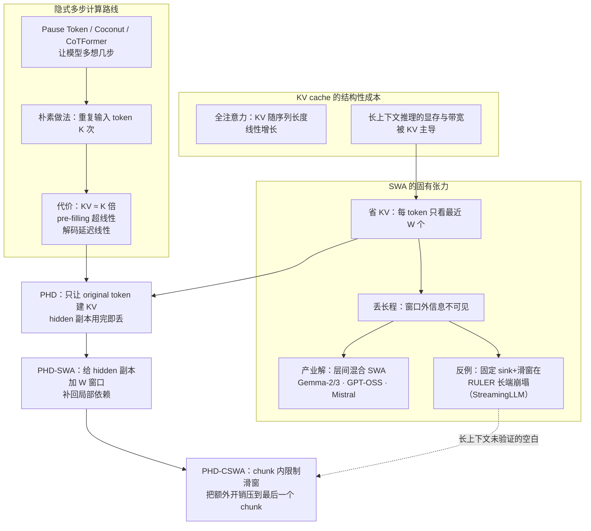
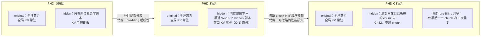
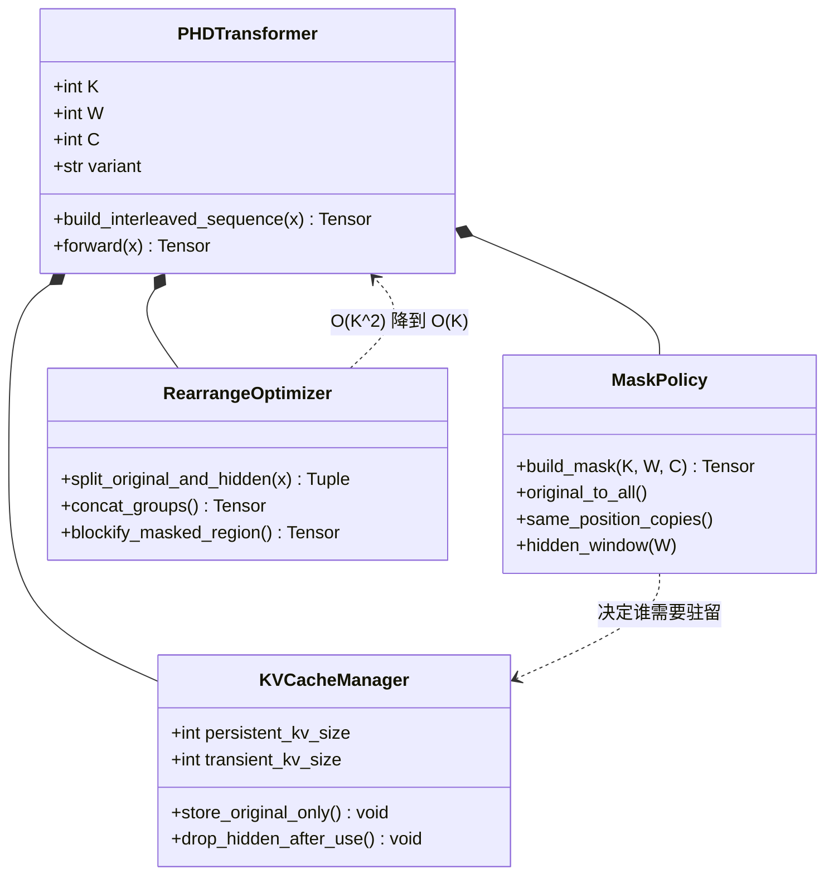
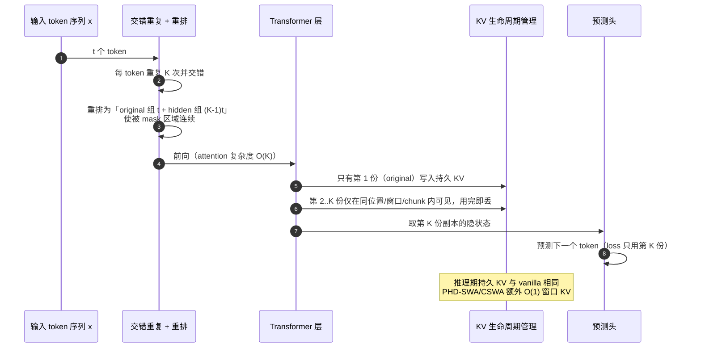
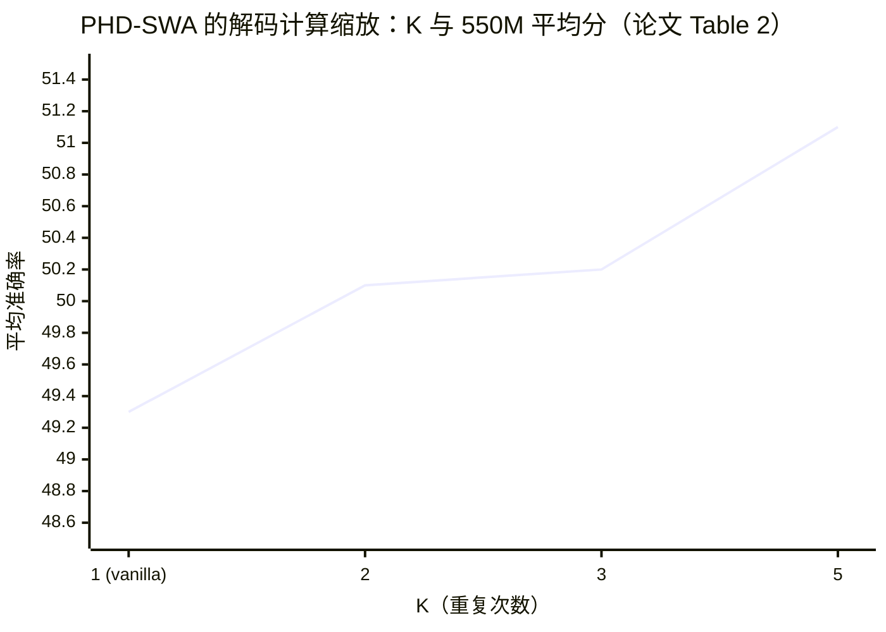
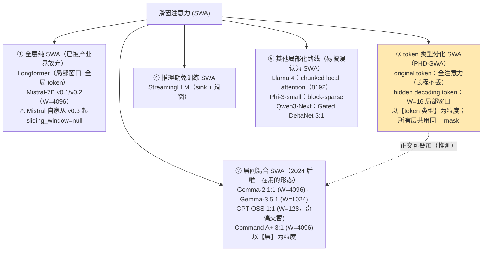
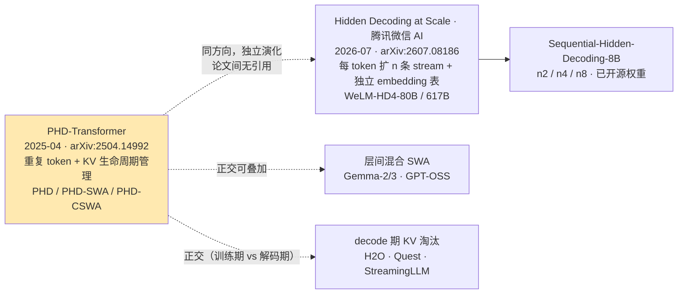

# ByteDance Seed PHD-SWA（滑窗注意力与预训练长度缩放）技术洞察

> **洞察对象**：*Efficient Pretraining Length Scaling*（PHD-Transformer，arXiv:2504.14992，v1 2025-04-21 / v2 2025-04-24）
> **机构**：1] ByteDance Seed　2] Peking University　3] Hong Kong University
> **作者**：Bohong Wu、Shen Yan、Sijun Zhang、Jianqiao Lu、Yutao Zeng、Ya Wang、Xun Zhou（通讯：bohongwu@bytedance.com / zhouxun@bytedance.com）
> **文档版本**：2026-10-14
> **系列关系**：本报告是"ByteDance Seed 技术洞察"系列的第 4 篇（前序：[VWN](Seed-VWN-技术洞察.md)、[Over-Encoding](Seed-OE-技术洞察.md)、[FlexPrefill](Seed-FlexPrefill-技术洞察.md)）。

> **⚠️ 术语澄清（重要）**：你列的"**swa**"在本篇指向 **PHD-SWA / PHD-CSWA**——一种**"token 类型分化"的滑窗注意力**：**滑窗只加在"隐藏解码 token"上，原始 token 保持全注意力**。这与业界常见的 **"层间混合 SWA"**（Mistral / Gemma-2 / Gemma-3 / GPT-OSS 等按层交替 SWA 与全注意力）**是两个正交的维度**，详见 §3.2。
>
> **诚实前置声明（本篇最重要的结论）**：PHD 论文**没有任何 32K/128K 长上下文实验**、**最大模型仅 1.2B**、**无官方开源代码与权重**、**无会议接收记录**。因此它是一篇"**方法新颖但验证范围很窄**"的工作——本报告会在 §2.9 与 §3.6 明确划出"不可外推"的边界。

> **目录与流程约定**：仓库根目录只放技术洞察文档，每个技术洞察一个文件夹；调研笔记统一收在对应文件夹的 `research/` 下，图表资产收在 `assets/` 下；调研完成后自动清理原始抓取件。

---

## 0. 结论速览（TL;DR）

| 维度 | 结论 |
| --- | --- |
| **技术定位** | 一套**预训练期的"长度/计算缩放"框架**：把每个输入 token **重复 K 次并交错排列**，用 **KV cache 管理策略**让重复副本充当"额外的隐式计算步"，而**持久 KV cache 与 vanilla 完全相同** |
| **核心洞察** | ①"让模型多算几步"**不必增加序列长度、也不必增加 KV cache**——只要让重复副本的 KV **用完即丢**；②朴素重复会带来 KV 线性膨胀 + pre-filling 超线性增长，**必须用掩码 + 重排**把它压回去 |
| **三个变体** | **PHD**（基础版：hidden KV 用完即丢）→ **PHD-SWA**（给 hidden decoding token 加 **W=16** 的局部窗口，补回局部依赖，代价是 pre-filling 超线性）→ **PHD-CSWA**（把滑窗限制在 **C=32** 的 chunk 内，把额外 pre-filling 开销压到"**仅最后一个 chunk**"） |
| **效果（论文自报）** | 1.2B / 500B tokens：Avg **54.7 → 56.2（K=2）/ 56.7（K=3）**，loss 2.601 → 2.576 / 2.567；550M：Avg **49.3 → 50.1 / 50.2 / 51.1（K=2/3/5）**，K=5 时 loss **−0.057**、"平均 +1.8%"；单点最大 **ARC-C +4.6** |
| **代价** | **FLOPs ≈ K 倍**（论文原文 "requiring K times FLOPs"）；仅在 **memory-bound** 推理下延迟开销小；**唯一量化延迟界**：K=256 时解码延迟 **≤ +20%** |
| **关键机制细节** | 重排（original 组 + hidden 组拼接）把注意力从 **O(K²) 降到 O(K)**；**loss 只用第 K 份、KV 只用第 1 份**；窗口 W=4 后收益饱和，chunk 越大越好，故取 W=16 / C=32 |
| **影响力** | **无会议接收、无官方代码/权重**（GitHub/HF `ByteDance-Seed` 组织均无）；但**这条线被工业界独立接棒**：腾讯微信 AI 的 **Hidden Decoding at Scale**（[arXiv:2607.08186](https://arxiv.org/abs/2607.08186)，WeLM-HD4-80B/617B）与 **tencent/Sequential-Hidden-Decoding-8B-n2/n4/n8**(开源权重) —— 方向一致、**但论文间无引用关系**（独立演化） |
| **关键判断** | PHD 是"**拿训练期算力换推理期长度**"的巧妙工程：它真正可复用的不是 SWA 本身，而是**"重复副本 + KV 生命周期管理"这一套显存账**。但在长上下文场景（SWA 最该发挥价值的地方）**恰恰完全没有验证**——这是采用前必须自己补做的实验 |

---

## 1. 技术背景：业界在什么场景下遇到什么问题

### 1.1 场景一：SWA 的百年老问题——KV cache 随长度线性膨胀

滑窗注意力（SWA）的动机非常直接：**把每个 token 的注意力限制在最近 W 个 token 内**，于是

| | 全注意力 | 滑窗注意力（窗口 W） |
| --- | --- | --- |
| 每 token 注意力计算 | O(L) | **O(W)**（常数） |
| KV cache 规模 | O(L)（随长度线性增长） | **O(W)**（不随长度增长） |
| 长程依赖 | 完整 | **受限于窗口，可能丢失** |

这条线从 **Longformer**（局部窗口 + 少量全局 token，[arXiv:2004.05150](https://arxiv.org/abs/2004.05150)）开始，被 **Mistral-7B** 用作推理期滚动 buffer（固定 4096 窗口），并被 **StreamingLLM**（[arXiv:2309.17453](https://arxiv.org/abs/2309.17453)）总结为"attention sink + 滑窗"的免训练推理方案。

**但 SWA 的代价始终是同一个**：**长程信息被丢弃**。这直接导致一个持续到今天的工程张力——**"省 KV" 与 "保长程" 之间没有免费午餐**。

### 1.2 场景二：产业界**放弃了"纯 SWA"**，改用"层间混合"，并持续弱化全局层

一个反直觉但证据充分的事实：**2024 年之后，没有任何主流开源模型使用"全层纯 SWA"**，全部改为**层间混合**；而且方向是让**全局层更少、窗口更小**。

| 模型 | SWA 实际配置（公开 config / 官方报告） |
| --- | --- |
| **Mistral-7B（v0.1/v0.2）** | 固定 4096 窗口 + 滚动 buffer；**但 Mistral 自家从 v0.3 起把 `sliding_window` 设为 `null`**，此后的 Nemo / Small / Large / Codestral / Mixtral / Phi-4 系列**全部回到全注意力** |
| **Gemma-2** | 局部:全局 = **1:1**（`sliding_window = 4096`） |
| **Gemma-3** | 局部:全局 = **5:1**，且**窗口缩到 1024**（即 6 层里只有 1 层全局） |
| **GPT-OSS-20B** | 局部:全局 = **1:1**，**窗口仅 128**，奇偶层严格交替；并用**可学习的 softmax 分母 bias 显式实现 attention sink** |
| **Command A+** | 局部:全局 = **3:1**（`sliding_window = 4096`） |
| **Llama 4** | ⚠️ **不是 SWA**——用的是 **chunked local attention**（`attention_chunk_size = 8192`），vLLM 官方文档单列为第三类 |
| **Qwen 系列** | ⚠️ **不用 SWA**：Qwen2.5 的 `sliding_window: 131072` 是**遗留字段**且 `use_sliding_window: false`；Qwen3 为 `null`，其技术报告检索 "sliding window" **命中 0 次**；Qwen3-Next 走 Gated DeltaNet 3:1 并明确 `use_sliding_window: false`——**绕开 SWA** |
| 其他不用 SWA 的大模型 | GLM-4.5、DeepSeek-V3.2、Kimi K2、MiniMax-M1、OLMo-2、SmolLM2、Granite-4.0（Mamba 混合）、Falcon-H1 |

**Gemma-2 → Gemma-3 的演进方向最能说明问题**：全局层占比从 **1/2 降到 1/6**、窗口从 **4096 缩到 1024**，换回来的是上下文窗口从 8K 提到 **128K**。也就是说，产业界的共识是**"尽量少用全局注意力，但绝不能不用"**。

> 上述配置来自公开 config 与官方技术报告（Gemma-2/3、GPT-OSS、Qwen 系列），**非 PHD 论文内容**——PHD 论文全文对 Gemma / GPT-OSS / Qwen 的命中数为 **0**。

### 1.3 场景三：另一条并行的线——"让模型多算几步"，但 KV 会爆

与 SWA 不同方向的另一类努力是**隐式计算 / 测试时计算**：让模型在生成下一个 token 前"多想几步"。代表工作：

| 工作 | 做法 |
| --- | --- |
| **Pause Token**（Goyal et al.） | 插入可学习的 pause token，给模型额外计算步 |
| **Coconut**（Chain of Continuous Thought） | 在隐空间做多步推理 |
| **CoTFormer** | 层间复用隐状态实现隐式多步计算 |

把这些思路落到**预训练**上，最朴素的做法就是**"把输入 token 重复几遍"**。但论文指出这会立刻撞上两堵墙：

1. **KV cache 线性膨胀**（重复 K 次 → KV 约 K 倍）；
2. **pre-filling 超线性增长**、**解码延迟线性增长**。

于是问题变成：**能不能既拿到"多算几步"的收益，又不让 KV 与 pre-filling 变贵？**

### 1.4 场景四："SWA 是否损害长上下文"已有硬数据——**纯 SWA 会归零**

这是采用任何 SWA 方案前必须知道的一组数字（**唯一直接量化该问题的一手来源是 SWAA，[arXiv:2512.10411](https://arxiv.org/abs/2512.10411)**，基于 Qwen3-4B）：

| 设定 | LongMemEval | LongBench V2 |
| --- | --- | --- |
| **全注意力基线** | **88.2** | **90.6** |
| **纯 SWA**（2K 窗口、无全注意力层、无微调） | **0.0** | **0.0** |
| **奇数层用全注意力** | **22.8** | **32.8** |
| **偶数层用全注意力** | **1.0** | **2.0** |

**三个必须记住的结论**：

1. **纯 SWA 不是"退化"，是"归零"**——长上下文检索能力直接消失（0.0/0.0）；
2. **层的位置比层的比例重要得多**：同样是"一半层用全注意力"，放在**奇数层**得 22.8 分，放在**偶数层**只有 1.0 分——**相差 20 倍**。SWAA 的解释是"特定层充当**全局路由枢纽**（global routing hubs）"；
3. 在 RULER 这类最苛刻的基准上，SWAA 的结论是"**除非启用层间交替（Interleaving Layers），否则精度几乎无法改善**"，且"检索行为可能集中在特定层，因此这些层必须保留全注意力"。

**另一个经典硬数字**（StreamingLLM，PG19 数据集）：**纯窗口的 PPL 为 5158.07，仅保留 4 个初始 token 就降到 5.40**（约 **955×** 的差距）；论文指出"**哪怕只是驱逐第一个 token 的 KV**"就会崩塌——这正是 attention sink 现象。

> ⚠️ **两个不可混淆的场景**：
> ①SWAA 是**改造场景**（拿一个已训练好的全注意力模型，把部分层替换成 SWA 并做事后处理），其"纯 SWA 归零"**不可直接外推到从头预训练**——Gemma-3 的官方报告显示**预训练好的混合模型对比例与窗口都不敏感**（perplexity 层面）；
> ②但"perplexity 不敏感"≠"检索能力不敏感"：Gemma-2 在推理期把窗口从 4096 降到 1024，**PPL 只从 1.63 变到 1.64**，而 SWAA 证明**检索层面极其敏感**。**这是做"混合比例自动搜索"时最大的认知陷阱。**

**第三点值得单独强调**：上述证据合起来解释了**为什么 PHD-SWA 不需要 attention sink 机制**——PHD 的 **original token 始终全局可见**（含第一个 token 的 KV 永久保留），sink 天然存在，因此不会出现 StreamingLLM 式的崩塌。这是"token 类型分化"相对"全层滑窗"的一个结构性优势。

### 1.5 问题图谱（汇总）



---

## 2. 技术介绍

### 2.1 一句话定义与核心洞察

**PHD-Transformer（Parallel Hidden Decoding Transformer）在预训练阶段把每个输入 token 重复 K 次并交错排列，让这些重复副本充当"额外的隐式解码步"，同时用一套注意力掩码策略保证：持久 KV cache 与 vanilla 完全相同。**

核心洞察有两句：

1. **"多算几步"可以不改序列长度**：重复副本与原 token 在**同一序列位置**并行前向，因此不增加推理时的序列长度；
2. **关键是 KV 的"生命周期"而非"数量"**：只要规定"副本的 KV 从不被后续复用"，它们就**不需要驻留**，于是"重复 K 次"在推理期几乎是免费的——**代价转移到训练期的 FLOPs 与 pre-fill 峰值显存**。

### 2.2 机制一：序列构造与 KV 管理策略（核心）

#### 2.2.1 序列构造

给定 token 序列 `x = {x₁,…,x_t}`，PHD 把每个位置**重复 K 次**并**交错**排列：

```
{ x₁¹, x₁², …, x₁ᴷ ;  x₂¹, x₂², …, x₂ᴷ ;  … ;  x_t¹, x_t², …, x_tᴷ }
  └────────────┬────────────┘
   第 1 份 = original token（原 token）
   第 2..K 份 = hidden decoding token（隐藏解码 token）
```

**必须强调的定义**：hidden decoding token **不是新采样的 token，也不是插入的可学习 token**，而是**同一批输入 token 的重复副本**。论文明确说明自己 "simply repeat the input tokens 1/2/3/4 times **without post-processing on middle layer hidden states**"——以此与 Pause Token（可学习 token）、Coconut（隐空间推理）、CoTFormer（层间隐状态复用）划清界限。

#### 2.2.2 注意力掩码（式 2）与"KV 不涨"的证明

```
             ⎧ 1,  if i = 1 and m < n        ← original token 之间：标准因果全注意力
M^{ij}_{mn} = ⎨ 1,  if i ≤ j and m = n        ← 同一位置的 K 份副本之间：互相可见
             ⎩ 0,  otherwise
```

逐项解读：

| 分支 | 含义 | 后果 |
| --- | --- | --- |
| `i=1 and m<n` | **只有 original token 生成 KV**，且对其后所有 token 全局可见 | 长程依赖**完全由 original token 承载**，一点不丢 |
| `i≤j and m=n` | 同一位置上的副本按序号有序可见 | 副本之间形成"隐式多步计算"链 |
| `0 otherwise` | 位置 m 的 hidden 副本**看不到其它位置的任何 hidden 副本** | **hidden KV 从不被复用 ⇒ 无需驻留 ⇒ "用完即丢"** |

再加上两条"对齐"设计：

- **KV 来源用第 1 份**（original token）；**预测目标用第 K 份**（最后一次副本）——即 `use the first copy of token for KV cache generation, while use the final copy of token for next token prediction`。

于是论文可以宣称：

> "Our design achieves **identical KV cache size and memory access patterns** as the original Transformer during inference."

> ⚠️ **一处必须加的限定**：这句"完全相同"严格适用于 **PHD 基础版**。一旦启用 **PHD-SWA**，需要额外驻留一个窗口的 hidden KV，论文自己的表述是 "requiring only **O(1) additional** KV cache memory"——即**常数级额外**，不是绝对相同。相对**序列长度**的增长率仍与 vanilla 相同。

#### 2.2.3 为什么需要 SWA：局部依赖不能全丢

论文的动机是**经验观察**而非理论必然：

> "However, we **empirically observe** that preserving some KV cache for hidden decoding tokens yields significant performance benefits."

于是 **PHD-SWA**：给 hidden decoding token 加一个 **W** 的局部窗口，**但 original token 仍然全局可见**：

> "the attention pattern combines **global access to original tokens** with **local access to the W most recent hidden decoding tokens**."

#### 2.2.4 三种注意力模式的对比



### 2.3 机制二：重排把 O(K²) 压到 O(K)

朴素实现下，重复 K 次会让 **attention 涨 K² 倍、FFN 涨 K 倍**。论文的关键观察是：式(2) 的注意力矩阵**极其稀疏**，且交错排列导致矩阵"**not device friendly**"（被 mask 的位置散落各处，无法用连续块高效处理）。

**解法是重排（rearrange）**：把输入**拆成两组并拼接**——第 1 组 = `t` 个 original token，第 2 组 = `(K−1)t` 个 hidden decoding token（K=3 时即 `t` + `2t`）。重排后被 mask 的位置**聚成一个连续块**，于是注意力复杂度从 **O(K²) 降到 O(K)**。

**FLOPs 与延迟的表述**：

> "While requiring **K times FLOPs**, these computations can be processed in parallel, resulting in **minimal latency overhead in memory-bound inference scenarios**."

即：**PHD 不是"省算力"，而是"把算力换成并行度"**——在 memory-bound 的推理场景里这一步几乎免费，在 compute-bound 场景里优势会削弱。

### 2.4 复杂度与显存账

符号：L 层、b batch、t 序列长度、n_kv KV 头数、d_h 头维、W 窗口、C chunk、K 重复次数。

| 指标 | Vanilla | 朴素重复（无 KV 管理） | **PHD** | **PHD-SWA** | **PHD-CSWA** |
| --- | --- | --- | --- | --- | --- |
| **持久 KV cache** | 2Lbt·n_kv·d_h | ≈ K × vanilla（**线性膨胀**） | **与 vanilla 相同** | vanilla + 2LbW·n_kv·d_h（**O(1) 额外**） | 同 PHD-SWA |
| pre-filling 时间 | T | 随 K/长度**超线性**增长 | **≈ T，且与 K 无关** | **超线性增长**（论文明确承认） | ≈ T，额外开销**仅在最后一个 chunk** |
| 解码延迟 | 1× | 随 K **线性增长** | 极小（memory-bound） | 极小 | 极小（K=256 时 **≤ +20%**） |
| FLOPs | 1× | ~K× | **≈ K×** | ≈ K× | ≈ K× |

**关键出处**（均可在论文 HTML v2 核对）：`identical KV cache size`（§2.2）；`pre-filling time is the same as the vanilla transformer and remains constant regardless of K`（§2.2）；`O(K²)→O(K)`（§2.3）；`O(1) additional KV cache memory`（§1、§2.4）；CSWA `reduces the extra pre-filling overhead to just K repetitions within the final chunk`（§2.4）。

**一处论文未报告的账**：pre-fill 阶段的**瞬时** KV 需要容纳 `(K−1)t` 个 hidden token 的 K/V，这会抬高 **pre-fill 峰值显存**——论文**未报告该峰值数字**【未找到】。

### 2.5 类图（UML）



### 2.6 训练与前向（UML 时序图）



### 2.7 实验数字

#### 2.7.1 主结果：1.2B / 500B tokens

| 模型 | loss ↓ | MMLU-V | HellaSwag | ARC-C | ARC-E | PIQA | WinoGrande | CommonsenseQA | **Avg ↑** |
| --- | --- | --- | --- | --- | --- | --- | --- | --- | --- |
| Vanilla 1.2B | 2.601 | 35.9 | 62.3 | 36.1 | 70.3 | 74.6 | 60.5 | 43.4 | **54.7** |
| PHD-CSWA-**2**-16-32 | 2.576 | 35.8 | 63.7 | 38.8 | 70.2 | 75.2 | 62.5 | 47.4 | **56.2** |
| PHD-CSWA-**3**-16-32 | 2.567 | 36.7 | 64.5 | 40.2 | 73.5 | 75.2 | 62.1 | 45.0 | **56.7** |

论文自陈：K=2 → **平均 +1.5%**、loss −0.025；K=3 → **平均 +2.0%**、loss −0.034。单点最大：**K=3 的 ARC-Challenge +4.1**、K=2 的 CommonsenseQA +4.0。

#### 2.7.2 解码计算缩放：550M（PHD-SWA，无 chunk）

| 模型 | Loss ↓ | MMLU | HellaSwag | ARC-C | ARC-E | PIQA | WinoGrande | Comm. | **Avg ↑** |
| --- | --- | --- | --- | --- | --- | --- | --- | --- | --- |
| Vanilla 550M | 2.782 | 31.4 | 51.5 | 30.1 | 62.5 | 71.9 | 56.8 | 40.6 | **49.3** |
| PHD-SWA-2-16-∞ | 2.753 | 31.6 | 52.3 | 31.5 | 64.2 | 71.5 | 56.6 | 42.7 | **50.1** |
| PHD-SWA-3-16-∞ | 2.739 | 32.1 | 53.1 | 31.5 | 64.6 | 71.5 | 56.9 | 41.7 | **50.2** |
| PHD-SWA-5-16-∞ | 2.725 | 32.7 | 54.5 | 34.7 | 65.0 | 72.3 | 56.2 | 42.6 | **51.1** |

论文自陈：K=5 时 loss 下降 "near 0.06"（核对为 **−0.057**）、"平均 **+1.8%**"（核对 49.3→51.1 = +1.8 ✓）。单点最大：**ARC-C +4.6**、HellaSwag +3.0。



**性能随 K 近似单调上升**是"解码计算缩放有效"的核心证据。

#### 2.7.3 消融结论

| 消融 | 结论 |
| --- | --- |
| **窗口 W**（∈{1,2,4,16}，K=2） | W 从 1→4 带来**显著** loss 下降；**4→16 仅边际改善** → 论文据此取 W=16 并称"小窗口即可接近最优且硬件友好" |
| **chunk C**（∈{16,32,无 chunk}） | 引入 chunk 造成的损失"**可忽略**"，且**chunk 越大越好** → 选 **C=32** |
| **K 的收益 vs 代价** | 收益随 K 上升，但 FLOPs ≈ K 倍；**仅在 memory-bound 下延迟代价小** |

### 2.8 论文内部瑕疵（引用时注意）

| # | 问题 |
| --- | --- |
| 1 | **表 1 的 Avg. 列对不齐**：`PHD-CSWA-3-16-32` 行印为 **56.7**，但该行 7 项算术平均为 **57.23** |
| 2 | **表 2 同类问题**：`PHD-SWA-3-16-∞` 印为 **50.2**，7 项算术平均为 **50.1** |
| 3 | **式(2) 符号歧义**：第二支写作 `i ≤ j`，但 `j` 同时也是**位置下标**（应为副本序号 `s`），需按图 2/图 4 理解 |
| 4 | **图 6/7 标注错位**：(a)(b) 归 Figure 6、(c)(d) 归 Figure 7，但正文同时用"图 7"说明窗口与 chunk 两个话题 |

### 2.9 局限与"不可外推"的边界（**本篇最重要的一节**）

| 项 | 状态 |
| --- | --- |
| **长上下文（32K/128K）** | ❌ **完全未验证**——全文检索 "32K/128K/128k/long context/RULER/LongBench" **命中 0**；无 needle-in-a-haystack 测试 |
| **模型规模** | ⚠️ 最大仅 **1.2B**（另有 550M、151M）；无 7B+ 验证 |
| **论文自陈的限制** | ①PHD-SWA 的 pre-filling 开销**随序列长度超线性增长**；②CSWA 用 chunk 换效率**存在性能取舍**（实测可忽略）；③CSWA 仍需"最后一个 chunk 内 K 次重复"；④窗口收益在 W=4 后饱和；⑤**FLOPs ≈ K 倍**，只在 memory-bound 下划算 |
| **未报告的数字** | pre-filling 绝对时间、KV cache **绝对显存**、训练序列长度、max_position_embeddings、GPU-hours、峰值显存 |
| **评测覆盖** | 仅 7 个常识/知识基准（ARC、HellaSwag、PIQA、WinoGrande、MMLU、CommonsenseQA）；**无 GSM8K/MATH/BBH 等推理基准**；**无 SFT/RL 后训练验证** |
| **与既有 SWA 的对比** | ❌ 只有 §4 的**文字划界**，**没有** Mistral-SWA / Gemma / StreamingLLM 的对照数字 |
| **开源** | ❌ **无官方代码/权重**（论文无 code 链接；GitHub `ByteDance-Seed` org `PHD` 搜索 total_count=0；HF `ByteDance-Seed` 59 个模型逐一核对均无） |
| **会议** | ❌ 无接收记录（arXiv 无 journal-ref/comment） |
| **kernel 实现** | ❌ 未给 kernel 伪代码；仅给重排思路 |

> **一句话**：**PHD 的核心价值在"显存生命周期管理"这一 idea，而不是它的实验结论**。任何把它用于长上下文的决定，都必须自己补做 32K/128K 的实验。

---

## 3. 技术影响

### 3.1 影响力的坐标系

| 维度 | 事实 | 判断 |
| --- | --- | --- |
| **同行评审** | 无会议接收记录 | ⚠️ 未获评审背书 |
| **开源** | ❌ 无官方代码/权重（详见 §2.9） | ❌ 复现门槛高 |
| **媒体/社区热度** | 未进入 HF Daily Papers 的显著位置（未见 #3 之类的记录）；中文侧未见专门解读 | ⚠️ 低调 |
| **工业接棒（关键）** | **腾讯微信 AI 的 Hidden Decoding 这条线独立做大**：论文 [Hidden Decoding at Scale](https://arxiv.org/abs/2607.08186)（arXiv:2607.08186）、官方博客 [Hidden Decoding: Scaling Sequence Length in Pretraining](https://welm.weixin.qq.com/en/posts/hidden_decoding/)、开源权重 **[tencent/Sequential-Hidden-Decoding-8B-n2/n4/n8](https://huggingface.co/tencent/Sequential-Hidden-Decoding-8B-n8)**（Qwen3-8B 基座、128K 上下文） | ✅ **同思想被工业界独立放大到 100B+ 规模** |

> **引用关系澄清（重要）**：腾讯的 Hidden Decoding 与 PHD **属于同一技术方向但为独立工作**（n=2 时其额外引入 1.9B embedding，机制上引入了独立 embedding 表与 KV 保留策略，与 PHD 的"纯重复副本"不同）。**不要把 tencent 的模型当作 PHD 的官方开源**。

### 3.2 影响一：为 SWA 家族补上"第三类"——token 类型分化

SWA 的谱系可以按**"以什么为粒度做稀疏"**重新分类，PHD-SWA 补上了此前少见的一类：



**为什么这是个有价值的分类**：②与③作用于**不同的轴**——

- **层间混合 SWA** 决定"**哪一层**能看多远"（粒度=层）；
- **PHD-SWA** 决定"**哪一类 token** 需要 KV 驻留"（粒度=token 类型）。

两者**理论可叠加**：例如用 Gemma-3 式的 5:1 层间混合，再对 PHD 的 hidden 副本额外加窗口——这样既省层级的 KV，又省副本的 KV。（**推测**：论文未做此实验。）

**⚠️ 一个尺度上的不可互推**：PHD-SWA 的 **W 只有 4~32（主实验 16）**，而通用 SWA 的窗口是 **1024~4096**。两者的**职责完全不同**——通用 SWA 用大窗口"逼近"全注意力以省长上下文 KV；PHD 的小窗口只是"别把 hidden 副本全扔掉"。因此**两边的窗口消融结论不可互相引用**。

**⚠️ 另一个结构性差异（PHD 的优势）**：PHD 的 original token 始终全局可见（**含第一个 token 的 KV 永久保留**），所以 **attention sink 天然存在**，不需要像 GPT-OSS 那样用可学习的 softmax 分母 bias 去显式实现 sink，也不会出现 StreamingLLM 式的崩塌。

### 3.3 影响二：把"注意力模式的稀疏性"内建到预训练阶段

PHD 属于**训练原生（training-native）**的稀疏注意力，而非 post-hoc 稀疏化：

> 论文把效率模式 "integrates efficient attention patterns during training"。

这与前序报告的 [FlexPrefill](Seed-FlexPrefill-技术洞察.md)（**免训练**、推理期动态稀疏）形成鲜明对照：

| | **PHD-SWA**（训练原生） | **FlexPrefill**（推理期免训练） |
| --- | --- | --- |
| 稀疏决策时机 | 预训练时**写死**在掩码里 | **每次前向在线**决定 |
| 优势 | 模型**适应**了稀疏模式，精度损失小 | 无需重训，可即插即用 |
| 代价 | 必须**重新预训练** | 需要自定义 kernel + 索引选择开销 |
| 交互 | 两者正交：可以先训练原生稀疏，再在推理期叠加动态稀疏（**推测**） | — |

#### 补充：SWA 的系统侧成本——"层间混合"并不免费

如果团队考虑采用 SWA（无论哪种形态），必须知道它的系统代价已有官方证据：

| 层面 | 事实 |
| --- | --- |
| **Mistral 的收益口径** | 论文原文："On a sequence length of **32k** tokens, this reduces the cache memory usage by **8×**"；W=4096 时理论注意力跨度 ≈ **131K**（32×4096）。⚠️ **但 16K 序列实测只有 2× 加速**——远低于理论值 W/L=1/4，因为 FFN 与投影的 O(L·d²) 不可压缩。**引用收益时必须带这条限定** |
| **KV 显存复算（Mistral-7B）** | 128 KiB/token：L=32K 时全注意力 4 GiB vs SWA 0.5 GiB；**L=1M 时 122 GiB vs 0.5 GiB** |
| **kernel 支持** | FlashAttention 提供 `window_size_left/right`（默认 `-1` 即全注意力）；**Mistral 论文致谢明确感谢 Tri Dao 把 SWA 加进 FlashAttention/xFormers**——SWA 的 kernel 是与 Mistral 共建的 |
| **vLLM 的复杂度** | 有 **`--disable-sliding-window`** CLI 与 `ModelConfig.get_sliding_window()`；逐层通过 `config.layer_types[layer_idx] == "sliding_attention"` 传 `per_layer_sliding_window` |
| **vLLM 官方承认的代价** | vLLM 专设 **Hybrid KV Cache Manager** 文档，开篇把 "Sliding window + full: gpt-oss, Gemma 2/3, Ministral, cohere" 列为首类，并指出两个成本：①**不同注意力类型需要分配不同的 slot**；②**prefix-cache 命中语义按层分化**（全注意力层要求全部 token 在缓存，SWA 层只需最后 W 个）。文档还给出实例：**Gemma-3-27B 有 52 个滑窗层 + 10 个全注意力层**，分组时取 `min(52,10)=10`，造成碎片化 |
| **SGLang** | 窗口由 config 解析（`sliding_window_size` / `sliding_window` / `window_size` 三键回退），有 SWA 专用 KV pool 与逐层不同窗口支持；但其 `server_args.py`（893 行）**检索不到任何 sliding/window/SWA CLI 参数**（与 vLLM 不同） |

**结论**：SWA 的"省 KV"是真实的，但**它把复杂度从"显存"搬到了"KV cache 管理器、prefix cache 语义、kernel 分层"上**。这解释了为什么 vLLM 需要专门写一篇 Hybrid KV Cache Manager 文档。

### 3.4 变种技术（一）：已经出现

| 变种 | 与 PHD 的差异 | 证据 |
| --- | --- | --- |
| **Hidden Decoding at Scale**（腾讯微信 AI） | 把"每个 token 扩成 n 条 stream"，**独立 embedding 表** + 保留中间 stream 的 KV cache 作为上下文 + **Stream-Factorized Attention**（多数层只在流内注意，少数层跨流混合）；规模到 **WeLM-HD4-80B（80B/3B）与 WeLM-HD4-617B（617B/23B）**；n=1→2→4→8 时 MMLU 85.0→86.7→87.5；4× 序列在 80B 上花 5.1×、617B 上 4.4× 训练时间 | [arXiv:2607.08186](https://arxiv.org/abs/2607.08186)｜[官方博客](https://welm.weixin.qq.com/en/posts/hidden_decoding/) |
| **tencent/Sequential-Hidden-Decoding-8B-n2/n4/n8** | **已开源权重**（Qwen3-8B 基座、128K 上下文）；n=2 额外引入 1.9B embedding | [HF](https://huggingface.co/tencent/Sequential-Hidden-Decoding-8B-n8) |
| **层间混合 SWA（Gemma-3 / GPT-OSS）** | 与 PHD 正交的"以层为粒度"方案，已在量产模型落地 | 公开 config |
| **KV 淘汰类（H2O / Quest / StreamingLLM）** | 作用在 **decode** 阶段；PHD 作用在**训练/预填充**结构上 | [H2O](https://arxiv.org/abs/2306.14048)｜[Quest](https://arxiv.org/abs/2406.10774) |



### 3.5 变种技术（二）：可能的下一批方向（分析推测）

| # | 方向 | 核心想法 | 支撑证据 | 受益场景 | 风险 |
| --- | --- | --- | --- | --- | --- |
| 1 | **PHD × 层间混合 SWA** | 层粒度（Gemma 式 5:1）+ token 类粒度（PHD-SWA）双重省 KV | 两类 SWA 作用于不同轴；两者均已在各自场景验证 | 超长上下文预训练 | 两套稀疏叠加可能同时损伤长程与局部；缺乏实验 |
| 2 | **PHD 的长上下文验证** | 补做 32K/128K + RULER/LongBench | 这是论文**最大的空白**；Hidden Decoding 已验证到 128K | 采用前的必要实验 | 越长的序列，PHD-SWA 的超线性 pre-filling 越致命 |
| 3 | **把 K 变成可调/随训练递增** | 训练早期 K=1、后期递增 K，或用 K 作为"测试时计算"旋钮 | 表 2 显示性能随 K 近似单调上升；CoTFormer 类工作也在做动态步数 | 训练成本优化、推理时按需加算力 | K 变化会改变掩码与重排布局，工程复杂 |
| 4 | **CSWA 的 chunk 边界优化** | 用滑动/重叠 chunk 或可学习边界替代固定 C=32 | 论文实测"chunk 越大越好"且损失可忽略 | 长序列预填充 | chunk 边界是硬截断，可能切断跨 chunk 依赖 |
| 5 | **PHD × 线性注意力/SSM** | 把 hidden 副本的状态交给 SSM 递推，而非注意力窗口 | PHD-SWA 的窗口本质是"局部递归"，与 SSM 形式接近 | 极长序列 | 需重构掩码与重排，且 SSM 的状态管理另有代价 |
| 6 | **与投机解码/草稿模型结合** | hidden 副本天然提供"多步预测"信号 | 论文的 loss 设计（第 K 份预测）与 MTP 思路接近 | 推理加速 | 与 MTP 的收益可能重叠 |
| 7 | **KV 生命周期管理的形式化** | 把"哪些 KV 需要驻留"作为可学习的显存预算分配问题 | PHD 的"original 驻留 / hidden 即丢"是手工规则 | 统一的显存预算框架 | 可学习策略可能破坏 kernel 的整齐并行 |
| 8 | **迁移到多模态/视频** | 时空 token 重复 + 生命周期管理 | 推测（视频 token 数更多、更 memory-bound） | 视频生成/理解 | 时空结构下"同一位置副本"的语义不同 |
| 9 | **全局层"位置"的自动搜索**（SWA 方向里动机最强的一个） | 不是搜"比例"，而是搜"**哪几层**做全局注意力" | SWAA 实测：同为一半层全局，**奇数层 22.8 vs 偶数层 1.0**（相差 20 倍）；Jet-Nemotron 的 PostNAS 第一步就是学 FA 层位置 | 任何混合 SWA 模型 | 位置搜索需与训练耦合，搜索成本高 |
| 10 | **FA→SWA 的免重训改造** | 拿一个训练好的全注意力模型，把部分层换成 SWA + 少量后处理 | SWAA 的改造路线（30%~100% 加速） | 存量模型降本 | 改造场景的结论**不可外推到从头预训练**（见 §1.4 警示） |
| 11 | **SWA × 线性注意力/SSM 混合** | 用 Gated DeltaNet / Mamba 层替代"全局层" | Qwen3-Next 3:1、Granite-4.0 9:1、Falcon-H1、Jet-Nemotron | 极长序列 | **与 SWA 是竞争关系**而非互补——可能直接跳过 SWA |
| 12 | **SWA × 动态稀疏 prefill 的冲突与调和** | 动态稀疏里"检索头/流式头"的划分（如 DuoAttention）**与"均匀滑窗"假设直接冲突** | MInference / DuoAttention（2.55× 显存降低）；本系列 [FlexPrefill](Seed-FlexPrefill-技术洞察.md) 的逐 head 自适应 | 长上下文 + 高吞吐 | 两套稀疏假设叠加时可能互相破坏 |
| 13 | **可学习 / 自适应窗口** | 让窗口长度成为可学习量 | ⚠️ **未找到**以可学习窗口为核心贡献的一手论文——属**开放方向** | 异构输入 | 与固定窗口的 kernel 假设冲突 |

### 3.6 风险与不确定性

1. **长上下文完全未验证**——这恰恰是 SWA 最该发挥价值的场景。**PHD-SWA 的 pre-filling 超线性开销在 32K/128K 下可能直接抵消收益**（论文自陈该缺陷）。
2. **规模外推风险**：最大 1.2B；K 的收益在更大模型上是否保持未知。
3. **FLOPs ≈ K 倍**：只在 memory-bound 场景划算；训练成本随 K 线性上升，**没有免费的"多想几步"**。
4. **无官方实现**：重排布局、掩码生成、KV 生命周期都要自己实现，细节错误会同时影响正确性与性能。
5. **与 MTP 的收益可能重叠**：PHD 的"用第 K 份预测"与多 token 预测（MTP）在多步监督上有交集，叠加时收益可能递减（**推测**）。
6. **评测面窄**：仅 7 个常识/知识基准，无推理/代码/长上下文；无 SFT/RL 验证。
7. **论文自身的表格与符号瑕疵**（§2.8），引用数字时需以分项为准。

### 3.7 对研发团队的启示

> 结合本仓库上下文（Ascend/NPU、TorchTitan、Qwen 实验、长上下文方向）。

| 优先级 | 建议 | 理由 |
| --- | --- | --- |
| **P0** | **先做"值不值"的判断实验**：在自有模型上用小规模（≤1B）、短序列复现 PHD-CSWA（K=2/3, W=16, C=32），确认 loss/Avg 的 +1.5%~2.0% 能否复现 | 论文规模小、无代码，**复现成本可控**；这是判断是否投入的唯一依据 |
| **P0** | **明确不把它当作长上下文方案**，除非自己补做 32K/128K 实验 | 论文在该维度是**空白**，且自陈 PHD-SWA 的 pre-filling 超线性 |
| **P1** | 复用其**最核心的抽象**："KV 生命周期管理"（哪些 KV 需要驻留）——即使不采用重复 token，也可用于设计自己的稀疏/缓存策略 | 这是论文最通用的贡献 |
| **P1** | 关注腾讯 **Hidden Decoding** 的工程细节（Stream-Factorized Attention、per-stream KV、pipeline 并行兼容性） | 同方向已被放大到 617B 并开源了 8B 权重，工程成熟度高于 PHD |
| **P2** | 评估 **PHD × 层间混合 SWA** 的双重省 KV 组合 | 两个轴正交，理论上可叠加 |
| **P2** | 在 NPU 上重点验证：**重排后的块稀疏注意力**能否高效实现（Ascend 上的块稀疏/Triton 支持） | PHD 的收益高度依赖重排后的连续块访问效率 |
| **P2** | 跟踪 `hidden decoding` 相关开源（tencent n2/n4/n8）在 vLLM/SGLang 的支持情况 | 有开源权重意味着可实测，比 PHD 更易验证 |

---

## 附录 A. 参考资料

**一手资料**

| # | 资料 | 链接 |
| --- | --- | --- |
| 1 | Efficient Pretraining Length Scaling（PHD-Transformer，arXiv:2504.14992） | https://arxiv.org/abs/2504.14992 ｜ https://arxiv.org/html/2504.14992v2 |
| 2 | PHD-Transformer 相关位置（HF Daily Papers 检索入口） | https://huggingface.co/papers?q=Parallel%20Hidden%20Decoding%20Transformer |
| 3 | 开源性核查：GitHub `ByteDance-Seed` 组织 | https://github.com/ByteDance-Seed |
| 4 | 开源性核查：HF `ByteDance-Seed` 组织（59 模型无 PHD） | https://huggingface.co/ByteDance-Seed |

**SWA 谱系**

| # | 资料 | 链接 |
| --- | --- | --- |
| 5 | Longformer（局部窗口 + 全局 token） | https://arxiv.org/abs/2004.05150 |
| 6 | StreamingLLM（attention sink + 滑窗；长端崩塌的反面证据） | https://arxiv.org/abs/2309.17453 |
| 7 | H2O（decode 期 KV 淘汰，与 PHD 正交） | https://arxiv.org/abs/2306.14048 |
| 8 | Quest（decode 期 KV 选择） | https://arxiv.org/abs/2406.10774 |
| 9 | FlexPrefill（免训练推理期稀疏，与本篇形成训练原生 vs 推理期对照） | https://arxiv.org/abs/2502.20766 |

**隐式多步计算 / 接棒工作**

| # | 资料 | 链接 |
| --- | --- | --- |
| 10 | Hidden Decoding at Scale（腾讯微信 AI，arXiv:2607.08186） | https://arxiv.org/abs/2607.08186 |
| 11 | Hidden Decoding 官方博客（WeLM） | https://welm.weixin.qq.com/en/posts/hidden_decoding/ |
| 12 | tencent/Sequential-Hidden-Decoding-8B-n8（开源权重） | https://huggingface.co/tencent/Sequential-Hidden-Decoding-8B-n8 |
| 13 | tencent/Sequential-Hidden-Decoding-8B-n2 | https://huggingface.co/tencent/Sequential-Hidden-Decoding-8B-n2 |
| 14 | Hidden Decoding 中文精译（社区） | https://github.com/oneRede/ai_model_research/blob/a1ac96b92365053850e56454b3ff9abc32285a49/works/hidden-decoding-at-scale.md |

**SWA 缺陷的量化证据与产业配置**

| # | 资料 | 链接 |
| --- | --- | --- |
| 15 | **SWAA**（唯一直接量化"SWA 是否损害长上下文"的一手来源） | https://arxiv.org/abs/2512.10411 |
| 16 | vLLM **Hybrid KV Cache Manager** 官方文档（层间混合不免费的官方证据） | https://docs.vllm.ai/en/latest/design/hybrid_kv_cache_manager.html |
| 17 | FlashAttention（`window_size_left/right` 支持） | https://arxiv.org/abs/2205.14135 |
| 18 | Gemma 2 技术报告（1:1 混合、W=4096、推理期可降至 1024 而 PPL 几乎不变） | https://arxiv.org/abs/2408.00118 |
| 19 | Gemma 3 技术报告（5:1 混合、W=1024、128K 上下文） | https://arxiv.org/abs/2503.19786 |
| 20 | GPT-OSS（1:1 混合、W=128、可学习 softmax 分母 bias 实现 sink） | https://arxiv.org/abs/2508.10925 |
| 21 | Qwen3 技术报告（**未使用 SWA**，"sliding window" 命中 0 次） | https://arxiv.org/abs/2505.09388 |
| 22 | Llama 4（**chunked local attention**，非 SWA） | https://arxiv.org/abs/2504.14053 |
| 23 | DuoAttention（retrieval/streaming head 划分，与均匀滑窗假设冲突；2.55× 显存降低） | https://arxiv.org/abs/2410.10819 |
| 24 | Jet-Nemotron（PostNAS 第一步即学 FA 层位置，与 SWA 竞争） | https://arxiv.org/abs/2508.15884 |
| 25 | Mistral 论文致谢（确认 SWA kernel 与 Tri Dao 共建） | https://arxiv.org/abs/2310.06825 |

## 附录 B. 术语表

| 术语 | 英文 / 缩写 | 含义 |
| --- | --- | --- |
| 并行隐藏解码 Transformer | PHD-Transformer | 把每个 token 重复 K 次交错排列，用 KV 生命周期管理换取隐式计算步 |
| 原 token | original token, `x_j¹` | 每个位置的**第 1 份**；承载持久 KV 与长程依赖 |
| 隐藏解码 token | hidden decoding token | 每个位置的**第 2..K 份**；KV 用完即丢，充当额外计算步 |
| 滑窗注意力 | SWA, Sliding Window Attention | 每 token 只注意最近 W 个 token |
| token 类型分化 SWA | type-differentiated SWA | 本篇对 PHD-SWA 的分类：不同**类型**的 token 用不同注意力范围 |
| 层间混合 SWA | interleaved / hybrid SWA | 以**层**为粒度交替滑窗与全注意力（Gemma/GPT-OSS） |
| 分块滑窗注意力 | PHD-CSWA | 把滑窗限制在 C=32 的 chunk 内，消除全局 pre-filling 超线性增长 |
| 重排 | rearrange | 把 original 组与 hidden 组拼接，使被 mask 区域连续，O(K²)→O(K) |
| KV 生命周期管理 | KV lifetime management | 决定"哪些 KV 需要驻留"的核心抽象 |

## 附录 C. 事实、推测与资料核查

### C.1 事实与推测的分界

| 类别 | 内容 |
| --- | --- |
| **已证实事实（一手）** | §2 的全部机制、式(2) 掩码、重排优化、复杂度与显存账、W/C/K 取值与消融结论、表 1/表 2 逐格数字（含论文自陈与核对结果），均取自 arXiv:2504.14992v2 原文；开源性核查取自 GitHub/HF API；腾讯 Hidden Decoding 的位置（论文/博客/开源权重）取自其官方页面 |
| **论文内部瑕疵（已核实）** | 表 1 Avg. 56.7 vs 分项均值 57.23；表 2 Avg. 50.2 vs 分项均值 50.1；式(2) 第二支 `i ≤ j` 的符号歧义（j 兼作位置下标）；图 6/7 标注错位 |
| **⚠️ 不可外推的边界** | **无 32K/128K 长上下文实验**（全文关键词命中 0，无 RULER/LongBench/NIAH）；**最大模型 1.2B**；**无官方代码/权重**；**无会议接收**；未报告训练序列长度、pre-filling 绝对时间、KV 绝对显存、GPU-hours、峰值显存 |
| **分析推测（文中已标注）** | §3.5 的 8 个演进方向；PHD-SWA 与层间混合 SWA"正交可叠加"；PHD 与 MTP 收益可能重叠；PHD 与 FlexPrefill 可组合；§3.7 建议优先级 |
| **明确未找到** | PHD 的官方代码/权重；PHD 与 Mistral/Gemma/StreamingLLM 的对照实验数字；PHD 的 kernel 实现细节；PHD 的 SFT/RL 验证；PHD 的引用计数（Semantic Scholar API 全程 429 限流，未能取得） |

### C.2 术语澄清

你列的"**swa**"在本篇对应 **PHD-SWA / PHD-CSWA**（**token 类型分化**的滑窗注意力），**不是**业界常见的"层间混合 SWA"（Gemma/GPT-OSS 式）。两者正交，见 §3.2。

### C.3 调研支撑文件（工作区内）

| 路径 | 内容 |
| --- | --- |
| `PHD-SWA-Sliding-Window-Attention/research/PHD-SWA-机制精读-调研笔记.md` | 逐节精读笔记（581 行，含锚点级出处、逐格数字核对、开源性核查、论文瑕疵清单） |
| `PHD-SWA-Sliding-Window-Attention/assets/` | mermaid 图表产物（`*.svg` / `*.png` / `mmd/*.mmd`）与预览页 |
