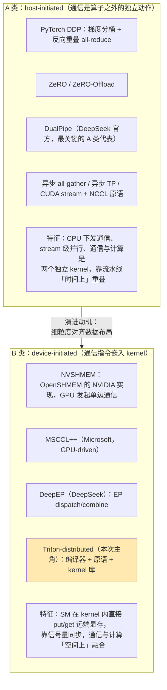
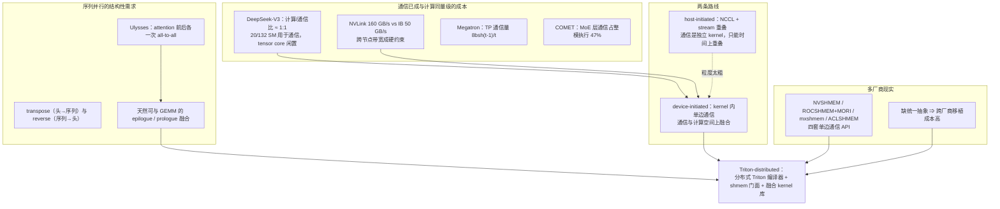
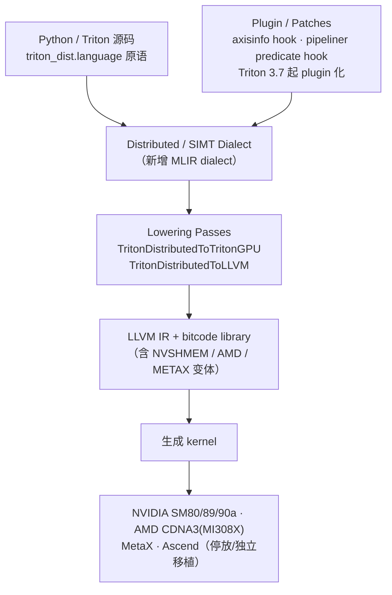
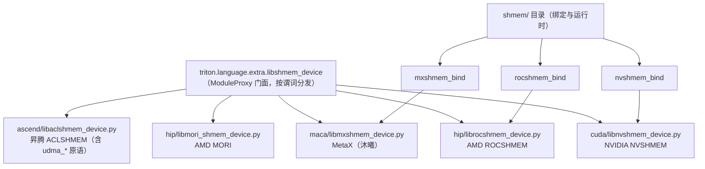
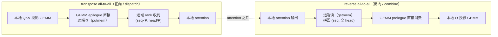
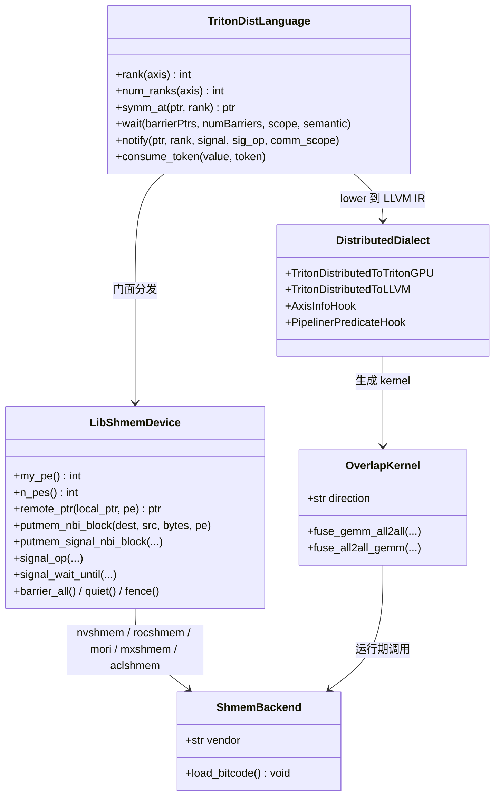
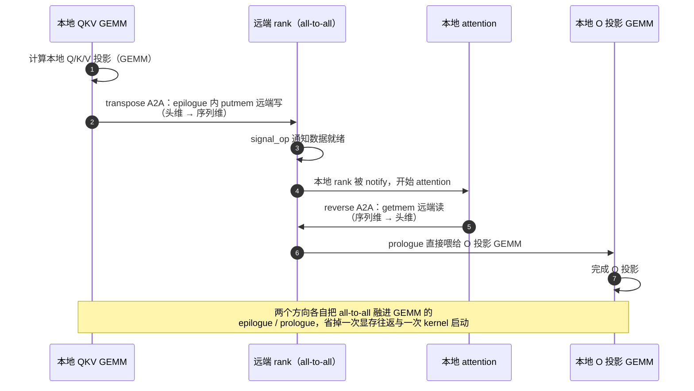
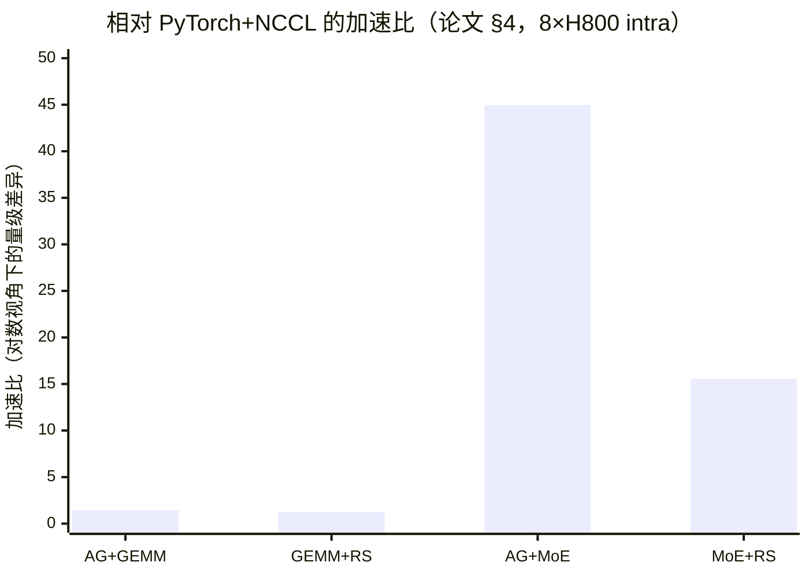

# ByteDance Seed Triton-distributed（通算融合算子与 shmem 单边通信）技术洞察

> **洞察对象**：*Triton-distributed: Programming Overlapping Kernels on Distributed AI Systems with the Triton Compiler*
> **论文**：arXiv:2504.19442（v1 2025-04-28 / v3 2025-06-05，cs.DC **技术报告，无会议 venue**）
> **代码**：[ByteDance-Seed/Triton-distributed](https://github.com/ByteDance-Seed/Triton-distributed)（MIT，**1566 ★** / 176 fork）
> **团队**：文档页脚核实为 **"© Copyright 2025 ByteDance Seed Infrastructures Team."**；论文 22 位作者（Size Zheng 等，ByteDance 邮箱）
> **文档版本**：2026-10-14
> **系列关系**：本报告是"ByteDance Seed 技术洞察"系列的第 5 篇（前序：[VWN](Seed-VWN-技术洞察.md)、[Over-Encoding](Seed-OE-技术洞察.md)、[FlexPrefill](Seed-FlexPrefill-技术洞察.md)、[PHD-SWA](Seed-PHD-SWA-技术洞察.md)）。

> **✅ 术语核对结论：你列的 4 项全部命中，且都在同一个项目里**
> | 你的说法 | 实际对应 | 核实结果 |
> | --- | --- | --- |
> | **triton-dist** | ByteDance-Seed/Triton-distributed（arXiv:2504.19442） | ✅ 见正文 |
> | **transpose_alltoall** | 昇腾移植版 `transpose-all2all.py` / `transpose-all2all-udma.py`；NV 侧等价物是 `sp_ulysess_qkv_gemm_all2all.py`、`ulysses_sp_dispatch.py`、`pre_attn_a2a.py` | ✅ **正向/dispatch**：头维切分 → 序列维切分 |
> | **reverse_alltoall** | 昇腾 `reverse-all2all.py` / `reverse-all2all-udma.py`；NV 侧等价物是 `sp_ulysess_o_all2all_gemm.py`、`post_attn_a2a.py` | ✅ **反向/combine**：序列维 → 头维 |
> | **qkv_alltoall** | `sp_ulysess_qkv_gemm_all2all.py`（Ulysses 序列并行的 **QKV GEMM + All2All** 融合） | ✅ |
> | **shemem**（应为 **shmem**） | **单边通信基座**：`shmem/`（nvshmem_bind / rocshmem_bind / mxshmem_bind）+ `triton.language.extra.libshmem_device` 多后端门面（cuda / hip / maca / **ascend=ACLSHMEM**） | ✅ |
>
> ⚠️ **一个必须写清的用词来源**：`transpose` / `reverse` 这两个词**来自昇腾移植版及其文档**——上游 NV 源码里 **`reverse` 一词零命中**，NV 侧只有 `*_all2all_*` / `pre_attn` / `post_attn` 命名。不要把这两个术语当作上游官方命名引用。
> ⚠️ **另一处拼写**：仓库里是 **`ulysess`**（少一个 l），不是 `ulysses`。

> **目录与流程约定**：仓库根目录只放技术洞察文档，每个技术洞察一个文件夹；调研笔记统一收在对应文件夹的 `research/` 下，图表资产收在 `assets/` 下；调研完成后自动清理原始抓取件。

---

## 0. 结论速览（TL;DR）

| 维度 | 结论 |
| --- | --- |
| **技术定位** | 一套**面向"通算融合（communication–computation overlap）"的分布式 Triton 编译器 + 优化 kernel 库**：让你**在 Triton kernel 内部直接发起 GPU 间的单边通信**，从而把通信与计算真正编进同一个 kernel |
| **核心洞察** | 传统方案是 **host-initiated**（NCCL 调用 + CUDA stream 重叠），通信是"算子之外的独立动作"；Triton-distributed 走 **device-initiated**（kernel 内单边通信 + 信号量同步），于是**通信的粒度、时机与数据布局都能与计算对齐** |
| **技术三支柱** | ①**对称内存（symmetric memory）** ②**信号交换（`wait`/`notify`/`consume_token`）** ③**异步任务**；原语分三组（Context Querying / Signal Control / NVSHMEM device primitives），通信原语 **lower 到 LLVM IR + bitcode library** |
| **shmem 基座** | `shmem/` 提供 **nvshmem_bind / rocshmem_bind / mxshmem_bind（沐曦）** 三后端绑定；`triton.language.extra.libshmem_device` 依谓词分发到 cuda(`libnvshmem_device`) / hip(`librocshmem_device`、`libmori_shmem_device`) / maca(`libmxshmem_device`) / **ascend(`libaclshmem_device`)**。**ACLSHMEM 属实**（华为版权 2026，库本体在 gitcode.com/cann/shmem，含 `udma_*` 原语） |
| **算子方向** | **transpose all-to-all = 正向/dispatch**（GEMM → A2A，头维→序列维）；**reverse all-to-all = 反向/combine**（A2A → GEMM，序列维→头维）。两者分别是 attention 前后与 MoE dispatch/combine 的两半 |
| **性能（论文自报）** | vs PyTorch+NCCL：AG+GEMM intra **1.42×**、GEMM+RS intra **1.28×**、**AG+MoE 44.97×**、**MoE+RS 15.55×**、inter 1.33× / 1.42×；**FlashDecode 32 卡达 1.7 TB/s HBM 带宽**（H800 峰值约 3 TB/s）；**PCIe 场景 vs NCCL 3.11×**；**vs DeepEP：dispatch 1.18× / combine 1.44×**（但 64/128 卡 DeepEP 更优）；AMD MI308X 1.09× / 1.16× |
| **生态** | **1566 ★**、39 篇引用（Semantic Scholar）、2026-09 仍有提交；**第三方采用的最硬证据**：AMD MORI 官方 README 写明 "**MORI-SHMEM powers ByteDance Triton-distributed EP dispatch/combine kernels as the backend**"（TD PR #145/#164）。**但 vLLM / SGLang / veScale 的集成未找到证据** |
| **对国产硬件的意义** | 昇腾侧有独立移植（CANN ≥ 9.1.0、Atlas A2/A3/950PR&DT，Apache-2.0），并已把 **UDMA 引擎 + `dl.wait/dl.notify/consume_token` 点对点信号量**用于 `reverse-alltoall` / `transpose-alltoall`，**替代全局 `barrier_all()`** |
| **关键判断** | 这是一篇**"编译器论文 + 生产级 kernel 库"**：它对业界的真正影响不是某个 kernel 快了多少，而是**确立了"device-initiated 通信 + 编译期重叠"这条范式**，并顺带把**跨厂商 shmem 抽象**做成现实（NVIDIA / AMD / MetaX / 昇腾四家）。**局限也很硬**：MORI/Bitcode 层面的 IBGDA 缺失让它在 64/128 卡大规模上暂时输给 DeepEP |

---

## 1. 技术背景：业界在什么场景下遇到什么问题

### 1.1 场景一：通信已经成为"与计算同量级"的成本（有官方硬数据）

| 证据 | 数字 | 来源 |
| --- | --- | --- |
| **计算/通信比** | DeepSeek-V3 官方原句：比值约 **1:1** | [DeepSeek-V3 §3.2.1](https://arxiv.org/html/2412.19437v2) |
| **通信占用的计算资源** | **132 个 SM 中有 20 个**用于通信，且原文指出 "**tensor cores remain entirely under-utilized**"；而"**仅 20 个 SM 就足以打满 IB 与 NVLink 带宽**" | DeepSeek-V3 §3.5.1 / §3.2.2 |
| **带宽不对称** | **NVLink 160 GB/s ≈ 3.2 × IB 50 GB/s**，于是"每 token 最多发往 4 个节点、每节点选 3.2 个专家"成为系统性约束 | DeepSeek-V3 §3.2.2 |
| **张量并行的通信量** | Megatron-LM 逐字给出每层每设备通信量 **`8·b·s·h·(t−1)/t`**，前向 2 次 + 反向 2 次 all-reduce；并指出 TP 度超过单节点卡数时跨节点"不可行" | [arXiv:2104.04473](https://arxiv.org/abs/2104.04473) §3 |
| **MoE 层通信占比** | **MoE 层通信占整模执行的 47%**；单层加速 1.96×、端到端 1.71× | [COMET, MLSys'25, arXiv:2502.19811](https://arxiv.org/abs/2502.19811) |
| **互联带宽是 MoE 推理的紧约束** | SwiftEP（NSDI'26）指出 "**excessive GPU SM utilization and underutilized interconnect bandwidth**"；DeepSeek 官方推理总览描述 5 级流水 + 双微批以掩盖通信 | [SwiftEP](https://www.usenix.org/conference/nsdi26)｜DeepSeek 官方推理文档 |

> ⚠️ **一处口径纠正**：常被引用的"**MoE 推理速度的上限由互联带宽决定**"**没有逐字原句**。本报告改用上述两条可核验来源。

### 1.2 场景二：两条技术路线的分野——host-initiated vs device-initiated

这是理解 Triton-distributed 的**唯一关键前提**：



| 维度 | host-initiated | **device-initiated** |
| --- | --- | --- |
| 谁发起通信 | CPU / 通信库 | **SM（kernel 内部）** |
| 重叠方式 | stream 级并发（"时间上"重叠） | **算子级融合（同一 kernel 内）** |
| 粒度 | 算子级（all-gather/all-reduce 矩阵级） | **tile 级**（可以只搬需要的块） |
| 数据布局 | 需要额外的 layout 转换（如 transpose） | **可在搬运途中完成转置** |
| 代价 | 通信是独立 kernel，需额外 SM 与启动开销 | 需要对称内存、信号量、正确性更难（易死锁） |
| 代表 | NCCL、DDP、ZeRO、DualPipe | **NVSHMEM、MSCCL++、DeepEP、Triton-distributed** |

### 1.3 场景三：序列并行天然需要"两次方向相反的 all-to-all"

**Ulysses 序列并行**（DeepSpeed-Ulysses）的机制是：把序列维切分到 P 个 rank，每个 rank 持有**全部 head 的一部分**；注意力计算的并行维度是 head，因此在 attention 前后各需要一次 all-to-all：

```
attention 前： (seq, 全 head)  →  all-to-all  →  (seq×P, head/P)     ← transpose（正向/dispatch）
attention 后： (seq×P, head/P) →  all-to-all  →  (seq, 全 head)      ← reverse（反向/combine）
```

**这就是"transpose all-to-all"与"reverse all-to-all"这两个名字的由来**——它们的本质是**在通信过程中交换 head 维与序列维的位置**（昇腾侧参考实现 docstring 明确写着 `[S, n_head, head_dim] -> [S*dsp_size, n_head/dsp_size, head_dim]`，并注明 "The key difference from forward All2All is the **dimension swap**"）。

**为什么这次 all-to-all 值得与 GEMM 融合？** 因为：

- **transpose 方向**：QKV 投影（GEMM）的输出**就是**要发的数据 → 可以把 all-to-all 的远端写**直接放进 GEMM 的 epilogue**；
- **reverse 方向**：注意力输出的 all-to-all 结果**正好是** O 投影（GEMM）的输入 → 可以把 all-to-all 的远端读**放进 GEMM 的 prologue**。

这就把"GEMM kernel + all-to-all kernel + layout 转换"三个步骤压成一个 kernel，同时消掉一次显存往返。

### 1.4 场景四：多厂商硬件使"shmem 抽象"从可选变成必需

当训练/推理集群里同时出现 NVIDIA、AMD、MetaX（沐曦）、昇腾时，**"单边通信"这件事没有统一 API**：

- NVIDIA：NVSHMEM；AMD：ROCSHMEM / MORI；MetaX：mxshmem；昇腾：**ACLSHMEM**（含 `udma_put_nbi` 等）。
- 如果 kernel 代码直接绑定某一家，跨厂商移植就要重写。

因此 Triton-distributed 把 shmem 做成了**一个门面 + 多后端**（`libshmem_device.py` 按谓词分发），这既是工程需要，也成为它最有价值的资产之一。

### 1.5 问题图谱（汇总）



### 1.6 背景要点一览

| # | 场景 | 具体问题 | 既有对策 | 残留缺口（TD 的切入点） |
| --- | --- | --- | --- | --- |
| 1 | 训练/推理通信成本 | 计算/通信比已达 1:1；20/132 SM 被通信占用 | DualPipe 等流水分级重叠 | 通信仍是独立 kernel，**无法做 tile 级对齐** |
| 2 | 带宽不对称 | NVLink 3.2× IB，跨节点是瓶颈 | node-limited routing、EP 规模调优 | 需要**边算边搬**，减少一次显存往返 |
| 3 | 序列并行 | Ulysses 每次 attention 前后各一次 all-to-all | 独立 all-to-all kernel + layout 转换 | **能否与 GEMM 融合并顺带转置** |
| 4 | 多厂商 | 四套 shmem API 各自为政 | 各写各的 kernel | 缺**统一 shmem 抽象层** |
| 5 | 编程门槛 | 写通信 kernel 需要 CUDA/NVSHMEM 专精 | 手写 CUDA | 缺**用 Triton 写分布式 kernel** 的编译器支持 |

---

## 2. 技术介绍

### 2.1 一句话定义与核心洞察

**Triton-distributed 是一个把"分布式通信"变成 Triton 一等公民的编译器扩展 + 优化 kernel 库**：它在 Triton 语言层暴露**对称内存访问、信号量同步、NVSHMEM 设备端原语**，在编译层新增 **Distributed / SIMT dialect** 并把这些原语 lower 到 LLVM IR + bitcode library，从而让开发者**用 Python/Triton 写出"通信—计算融合"的 kernel**。

核心洞察一句话：**通信不该是"算子之间的搬运"，而应该是"算子内部的一次访存"**——只要 SM 能在 kernel 内直接读写远端显存并用信号量对齐，就能把通信与计算在**空间上**融合，而不是像 NCCL 那样只能在**时间上**重叠。

### 2.2 技术三支柱与编程模型

论文 §2.1 把编程模型概括为三支柱：

| 支柱 | 含义 |
| --- | --- |
| **对称内存（symmetric memory）** | 每个 rank 上的同一块 buffer 在其它 rank 上都有对称地址，于是 kernel 可以用"本地地址 + 目标 PE"表达远端访问 |
| **信号交换（signal exchange）** | `wait` / `notify` / `consume_token` 等原语，实现对"数据已就位/槽位已空闲"的细粒度同步 |
| **异步任务（async tasks）** | 通信与计算交错的编程抽象，使 SM 可以在等待远端数据时继续做本地计算 |

**原语分三组**（源码 `python/triton_dist/language/distributed_ops.py`）：

| 组 | 原语 | 用途 |
| --- | --- | --- |
| **Context Querying** | `rank(axis)`、`num_ranks(axis)`、`symm_at(ptr, rank)` | 查询本 rank / 组大小 / 取远端对称地址 |
| **Signal Control** | `wait(barrierPtrs, numBarriers, scope, semantic)`、`notify(ptr, rank, signal, sig_op, comm_scope)`、`consume_token(value, token)` | 点对点/组内信号量同步（**这是替代全局 barrier 的关键**） |
| **NVSHMEM device primitives** | `my_pe` / `n_pes` / `int_p` / `remote_ptr` / `barrier_all*` / `sync_all*` / `quiet` / `fence` / `getmem_*` / `putmem_*` / `putmem_signal_*` / `signal_op` / `signal_wait_until` | 全套单边通信原语，**通过 `triton.language.extra.libshmem_device` 暴露给 Python** |

**一个最小示例（README 里的低延迟 AllToAll）**：

```python
# 关键调用序列（摘自 README）
libshmem_device.putmem_nbi_block(dest, source, bytes, pe)      # 单边写（非阻塞）
libshmem_device.putmem_signal_nbi_block(..., NVSHMEM_SIGNAL_SET)  # 写 + 打信号
libshmem_device.fence()
libshmem_device.signal_op(..., NVSHMEM_SIGNAL_SET)             # 通知对端
libshmem_device.signal_wait_until(..., NVSHMEM_CMP_EQ, value)  # 等待对端就绪
```

> 即：**通信指令与计算指令写在同一个 Triton kernel 里**，靠 `putmem + signal + wait` 完成握手。

### 2.3 编译器实现



**要点**：

- 通信原语**不是运行时函数调用**，而是**编译期 lower 到 LLVM IR + bitcode library**——这是它性能接近手写 CUDA 的原因；
- 通过 **axisinfo / pipeliner predicate hook** 等 patch 让 Triton 的原有优化（尤其是**软件流水线**）能跨越通信原语继续生效——这是"编译期自动重叠"的技术基础；
- **⚠️ 高层 tile-centric 原语尚未开源**（Roadmap 未勾选），当前开放的是低层原语与 kernel 库。

### 2.4 shmem 基座：一个门面 + 多后端



| 事实 | 说明 |
| --- | --- |
| `shmem/` 的绑定 | **只有三个**：`nvshmem_bind` / `rocshmem_bind` / `mxshmem_bind`——**没有 `aclashmem_bind`**；昇腾的实现走独立路径 |
| **ACLSHMEM** | ✅ 属实：华为版权（2026），库本体在 `gitcode.com/cann/shmem`，提供 `udma_put_nbi` / `udma_put_signal_nbi` / `udma_quiet` 与 `ACLSHMEMCmpOp/SignalOp/Team` 等枚举 |
| 跨厂商意义 | 这是**目前少见的"跨四家硬件的单边通信抽象"**，也是 TD 最具长期价值的资产之一 |
| 第三方采用（硬证据） | AMD **MORI 官方 README** 写明 "**MORI-SHMEM powers ByteDance Triton-distributed EP dispatch/combine kernels as the backend**"（2026/03，对应 TD PR #145/#164）——即 **AMD 反过来用 TD 作为其 shmem 的消费方** |

### 2.5 通算融合算子清单：transpose vs reverse

#### 2.5.1 方向定义（有代码级证据）

| 方向 | 语义 | 记忆点 |
| --- | --- | --- |
| **transpose all-to-all** | **正向 / dispatch**：`(seq, 全 head)` → `(seq×P, head/P)` | **头维 → 序列维**；**先 GEMM 再 A2A** |
| **reverse all-to-all** | **反向 / combine**：`(seq×P, head/P)` → `(seq, 全 head)` | **序列维 → 头维**；**先 A2A 再 GEMM** |

#### 2.5.2 数据流对比



#### 2.5.3 算子归类（NV 侧源码 → 方向）

| 方向 | NV 侧 kernel（源码路径） | 昇腾侧对应 |
| --- | --- | --- |
| **transpose（正向/dispatch）** | `sp_ulysess_qkv_gemm_all2all.py`、`ulysses_sp_dispatch.py`、`pre_attn_a2a.py`、`ulysses_sp_infer_gemm_a2a.py`、`ep_all2all_fused.py` 的 dispatch 侧 | `transpose-all2all.py`、`transpose-all2all-udma.py`、`qkv-all2all.py`、`moe-dispatch-udma.py` |
| **reverse（反向/combine）** | `sp_ulysess_o_all2all_gemm.py`、`post_attn_a2a.py`、`all_to_all_single_gemm.py` | `reverse-all2all.py`、`reverse-all2all-udma.py`、`moe-combine-udma.py`、`reverse-a2a-norm-matmul*.py` |

> **关键实现细节**：QKV 侧融合是"**GEMM 远端 epilogue**"（含 `kernel_persistent_tma_gemm_notify`），O 侧融合是"**GEMM 远端 prologue**"（内联 PTX `ld/st.global.v4.b32`）。这正是"transpose 在搬运途中完成"的落地方式。

#### 2.5.4 其他配套 kernel（部分）

| kernel | 用途 |
| --- | --- |
| `gemm_allreduce.py` / `gemm_reduce_scatter.py` / `allgather_gemm.py` / `allgather_group_gemm.py` | TP 场景的 GEMM 与 AllReduce/RS/AG 融合 |
| `low_latency_all_to_all.py` / `_v2` | 推理期低延迟 all-to-all（对标 DeepEP） |
| `ep_all2all_fused.py` | EP 的 dispatch+combine 融合 |
| `moe_reduce_ar.py` / `moe_reduce_rs.py` | MoE 输出与 AllReduce/RS 融合 |
| `flash_decode.py` + `sp_ag_attention_*.py` | 分布式 Flash-Decode 与序列并行 attention |
| `layers/`（`tp_attn`、`tp_mlp`、`tp_moe`、`pp_block`、`ulysses_sp_a2a_layer`、`sp_flash_decode`、`ep_ll_a2a_layer`…） | 面向模型层的封装 |

### 2.6 类图（UML）



### 2.7 序列并行通算融合（UML 时序图）



### 2.8 性能数字

#### 2.8.1 论文 §4（8–64 GPU，H800 + MI308X）

| 基准 | 硬件 | 对比基线 | 结果 |
| --- | --- | --- | --- |
| AG+GEMM（intra） | 8×H800 | PyTorch+NCCL / FLUX | **1.42×** vs NCCL；1.09× vs FLUX（Triton GEMM 约为 cuBLAS/CUTLASS 的 **95%**） |
| GEMM+RS（intra） | 8×H800 | 同上 | **1.28×** vs NCCL；1.30× vs FLUX |
| **AG+MoE（intra）** | 8×H800 | PyTorch+NCCL | 平均 **44.97×**（注意：基线是 Python 循环 GroupGEMM，作者自认为弱基线） |
| **MoE+RS（intra）** | 8×H800 | PyTorch+NCCL | 平均 **15.55×** |
| AG+GEMM（inter） | 16×H800 | NCCL / FLUX | 平均 **1.33×** vs NCCL；达 FLUX 的 **95.60%** |
| GEMM+RS（inter） | 16×H800 | 同上 | 平均 **1.42×** vs NCCL；达 FLUX 的 **96.36%** |
| AG+MoE / MoE+RS（inter） | 16×H800 | PyTorch+NCCL | **26.50×** / **5.16×**（**MoE+RS 跨节点扩展不佳**，作者归因于缺专用 RS kernel） |
| **Distributed Flash-Decode** | 8→32×H800 | 自身弱扩展 | 32 GPU、每 GPU 32K KV 时达 **1.7 TB/s** HBM 带宽（H800 峰值约 3 TB/s）；全局 KV < 256K 时加卡无收益 |
| **Low-latency AllGather（PCIe）** | 8×L20 / 16×L20 | NVSHMEM `fcollect` / NCCL | vs NVSHMEM **1.40×/1.48×**；**vs NCCL 3.11×/3.00×**（单机） |
| **Low-latency AllToAll（推理 EP）** | 8→64×H800 | **DeepEP** | dispatch 平均 **1.18×**、combine 平均 **1.44×**；⚠️ **64 GPU dispatch 上 DeepEP 更快，128 GPU 规模 DeepEP 仍最好**（因 **NVSHMEM bitcode 不支持 IBGDA**） |
| AG+GEMM / GEMM+RS（intra） | **8×MI308X（AMD）** | AMD PyTorch+RCCL | **1.09× / 1.16×** |



#### 2.8.2 仓库/文档中的数字

| 项 | 数字 |
| --- | --- |
| 低延迟 all-to-all（README） | 32×H800 上 **137 µs vs DeepEP 182 µs** |
| `ep_ll_a2a_layer` | 8 卡约 **202 µs**、32 卡约 **137 µs** |
| `low_latency_a2a_v2` | 76 µs / 126 µs |
| `ep_all2all_fused` | 通信量 **−30%** |

### 2.9 昇腾移植版：UDMA + 点对点信号量替代全局 barrier

**`gitcode.com/Ascend/Triton-distributed-ascend`**（华为侧独立移植）：

| 项 | 内容 |
| --- | --- |
| 环境要求 | **CANN ≥ 9.1.0**；支持 **Atlas A2 / A3 / 950PR & 950DT**；Apache-2.0；依赖 **AscendNPU-IR** 与 `3rdparty/shmem` 构建 **ACLSHMEM** |
| 活跃度 | master HEAD `f259f6a`（2026-10-14）仍在合并 |
| 关键 PR | **PR #114**："feat: add wait-notify for **reverse-alltoall** and **transpose-alltoall** udma"，**merged 2026-08-29**（created 2026-08-14，作者 weilinquan，分支 release/3.2.2） |
| **机制** | 用 **UDMA 引擎**（`ash.OpEngineType.UDMA`）做跨卡搬运，**Vector Core 级** producer/consumer 双缓冲；用 **`dl.wait` / `dl.notify` / `dl.consume_token` + `fence()` 的逐任务点对点信号量**，**替代原先的全局 `libshmem_device.barrier_all()`** |
| 信号内存布局 | 两段式：Region A 存 `[num_blocks_s, rank_size]` 的跨 rank UDMA 就绪标志；Region B 存 `[buffer_num, tasks_per_block]` 的本地自拷贝双缓冲标志；用 `SIG_STRIDE=8` 填充**避免缓存行伪共享** |
| 收益 | 任务**只等待其实际依赖的 `(block, rank)`**，而非全局同步 |

> ⚠️ **文件名核实**：`tutorials/ascend/06-ascend-reverse-all2all-udma.py` 这个**精确文件名在任何历史版本都不存在**——真实文件是 `tutorials/ascend/reverse-all2all-udma.py`（旧名 `04-...`；带 `-autotune` 的 `06-` 版本曾存在后改名）。引用时请用实际文件名。
> ⚠️ **UDMA 的缩写全称未找到**（不要臆造展开）。

### 2.10 局限与风险

| # | 局限 | 出处/性质 |
| --- | --- | --- |
| 1 | **IBGDA 缺失**：当前 NVSHMEM bitcode library 不支持 IBGDA，导致 **64/128 卡的 all-to-all DeepEP 更优** | 论文 §4.2 自陈 |
| 2 | **MoE+RS 跨节点扩展差**（16 卡上仅 5.16×，作者归因于缺专用 RS kernel，"left for future"） | 论文 §4.2 |
| 3 | **Triton GEMM 约为 cuBLAS/CUTLASS 的 95%**——融合收益部分被 GEMM 本身的质量差距抵消 | 论文 §4.1 |
| 4 | **用显存换性能**（对称内存 + 双缓冲） | 论文自陈 |
| 5 | **高层 tile-centric 原语未开源**（Roadmap 未勾选），当前只有低层原语 + kernel 库 | 仓库 Roadmap |
| 6 | **构建/AOT 复杂**：需要特定 NVSHMEM 版本与 bitcode 编译流程 | 仓库文档 |
| 7 | **正确性易错**：信号量需 int32、barrier stride 需 64B 对齐等；分布式死锁难以调试 | 源码/文档 |
| 8 | **昇腾不在 Triton 3.7 plugin 路径上**（主仓的 ascend/ 处于停放状态，实际走独立移植仓） | 仓库结构 |
| 9 | **无会议 venue**（技术报告），peer-review 背书缺失 | arXiv 元信息 |
| 10 | **第三方框架集成未找到证据**：vLLM / SGLang / veScale 集成 TD **未找到**；`triton-inference-server/triton_distributed` 仓库现返回 **404**（不可引用） | 调研核实 |

---

## 3. 技术影响

### 3.1 影响力的坐标系

| 维度 | 事实 | 判断 |
| --- | --- | --- |
| **开源热度** | **1566 ★ / 176 fork / 56 open issues**，MIT；created 2025-04-02，**pushed 2026-09-18**（2026-09 仍有 19 次提交） | ✅ 活跃且被广泛关注 |
| **同行评审** | ❌ 无会议 venue（技术报告）；⚠️ 文档里提到的 "MLSys 2025 paper" 指的是 **TileLink（arXiv:2503.20313）**，**不是本工作** | ⚠️ 缺评审背书 |
| **学术引用** | **39 篇**（Semantic Scholar，2026-10-14；influential 5），且**施引多为 2026 年的 megakernel / 重叠编译器论文** | ✅ 已成为该子领域的引用基座 |
| **第三方采用（最硬证据）** | **AMD MORI 官方 README**："MORI-SHMEM **powers ByteDance Triton-distributed** EP dispatch/combine kernels as the backend"（2026/03，TD PR #145/#164） | ✅ **硬件厂商反向采用** |
| **跨厂商覆盖** | NVIDIA（SM80/89/90a）、AMD（CDNA3/MI308X）、MetaX（沐宸，**无性能数字**）、昇腾（独立移植 + ACLSHMEM） | ✅ 四家 |
| **框架集成** | ❌ vLLM / SGLang / veScale 集成**未找到**证据 | ⚠️ 尚未进入主流服务栈 |

> **与系列前四篇的对比**：这是本系列里**唯一"系统/编译器"类**的技术洞察，也是**星标最高、工程活跃度最高**的一篇；它的影响力不体现在模型指标上，而体现在**"别人拿它当基座"**（MORI）与**"论文被后续重叠编译器引用"**上。

### 3.2 影响一：把 device-initiated 通信从"专有技巧"变成"可编程范式"

在 TD 之前，kernel 内单边通信基本是**专有实现**（NVSHMEM 手写 CUDA、DeepEP 内部实现）。TD 的贡献是把它**接入了一个通用编译器**：

- 用 **Triton**（而不是 CUDA）写分布式 kernel，**降低了门槛**；
- 通过 **axisinfo / pipeliner hook** 让 Triton 原有的流水线优化**跨通信原语继续生效**——这是"编译期自动重叠"的雏形；
- 通信原语 **lower 到 LLVM IR + bitcode**，性能接近手写。

**这直接催生了一个可观测的科研方向**：39 篇引用中大量是 2026 年的 **megakernel / 重叠编译器**工作，说明"**把通信写进 kernel**"已经成为编译器社区的一个独立课题。

### 3.3 影响二：跨厂商 shmem 抽象层成为稀缺资产

在"NVIDIA + AMD + 国产加速器"混合集群成为常态的背景下，**TD 的 shmem 门面是少数能同时覆盖四家的抽象**：

| 厂商 | 后端 | TD 中的路径 |
| --- | --- | --- |
| NVIDIA | NVSHMEM | `shmem/nvshmem_bind`、`libnvshmem_device.py` |
| AMD | ROCSHMEM / **MORI** | `shmem/rocshmem_bind`、`librocshmem_device.py`、`libmori_shmem_device.py` |
| MetaX（沐曦） | mxshmem | `shmem/mxshmem_bind`、`libmxshmem_device.py` |
| **昇腾** | **ACLSHMEM** | `libaclshmem_device.py`（库本体在 `gitcode.com/cann/shmem`） |

**判断**：随着超节点（NVL72、**UB-Mesh**）与国产集群规模扩大，**"统一单边通信抽象"会越来越像当年的"统一集合通信库（NCCL/RCCL/HCCL）"**——TD 在这个位置上占了先机。

### 3.4 影响三：序列并行算子的"融合方向"被标准化

TD 把 attention 序列并行的两次 all-to-all 明确成 **transpose（正向）** 与 **reverse（反向）** 两个方向，并给出对应的融合方式（epilogue 融合 / prologue 融合）。这套术语与实现已经**被昇腾移植版沿用**（`transpose-all2all.py` / `reverse-all2all.py`），说明它具备跨硬件的可移植性。

### 3.5 变种技术（一）：已经出现

| 变种 | 与 TD 的关系 | 证据 |
| --- | --- | --- |
| **DeepEP**（DeepSeek） | 同为 device-initiated 的 EP dispatch/combine；TD 在 8–64 卡上 dispatch 1.18×/combine 1.44×，但 **64/128 卡 DeepEP 更优**。⚠️ **时效修正：DeepEP 已到 V2.5，其 NVSHMEM 后端被完全移除、改用 NCCL Gin（device-side）**——"DeepEP 基于 NVSHMEM"仅对 V1 成立 | [DeepEP](https://github.com/deepseek-ai/DeepEP) |
| **MORI-SHMEM**（AMD） | **反向采用 TD 作为其 EP kernel 的消费方** | MORI README |
| **FlashComm**（TD 仓库内） | CUDA 通信库 + EP overlap + TMA 支持，含 CuteDSL 的 dispatch/combine/group-gemm 融合 kernel | TD 仓库 `FlashComm/` |
| **MegaTritonKernel**（TD 仓库内） | 把整个模型层（如 `tp_attn`/`tp_mlp`）编成 megakernel | TD 仓库 `mega_triton_kernel/` |
| **SwiftEP**（腾讯，NSDI'26） | 同问题域的系统工作 | NSDI'26 |
| **NVSHMEM / MSCCL++** | 上游基础与竞争路线 | — |
| **TileLink**（ByteDance，arXiv:2503.20313） | 与 TD 同源生态的 GPU tile 抽象工作（**常被误当成 TD 的会议版本**） | arXiv:2503.20313 |

### 3.6 变种技术（二）：可能的下一批方向（分析推测）

| # | 方向 | 核心想法 | 支撑证据 | 受益场景 | 风险 |
| --- | --- | --- | --- | --- | --- |
| 1 | **EP × GroupGEMM 全面 megakernel 化** | 把 dispatch + GroupGEMM + combine 压进单 kernel | TD 已有 `ep_all2all_fused`（通信量 −30%）与 MegaTritonKernel | MoE 训练/推理 | 寄存器与 SMEM 压力、可调试性差 |
| 2 | **decode 阶段低延迟 all-to-all 专用化** | 极低延迟、小消息优化 | `low_latency_all_to_all_v2`（76/126 µs）、README 的 137 µs vs DeepEP 182 µs | 线上推理 | IBGDA 缺失导致大规模落后 |
| 3 | **通信 + 量化联合** | 搬运过程中顺便做量化/压缩 | 社区已有 FP8 all-to-all 类工作（本系列 OE 报告曾见证据） | 跨节点带宽受限场景 | 量化误差与 kernel 复杂度叠加 |
| 4 | **跨厂商 shmem 抽象标准化** | 把 TD 的门面做成事实标准（类似 NCCL 之于集合通信） | 已有四家后端 + MORI 反向采用 | 混合集群、国产替代 | 各家语义差异（内存序、信号语义）难以完全对齐 |
| 5 | **编译期自动重叠** | 不靠手写，编译器自动识别可重叠的通信与计算 | TD 的 axisinfo/pipeliner hook 是雏形；39 篇引用多为此方向 | 通用框架 | 自动化的收益上限与正确性验证 |
| 6 | **超节点（NVL72 / UB-Mesh）下的新并行策略** | 在超大 NVLink/UB 域内重新设计并行度与通信模式 | UB-Mesh（arXiv:2503.20377，IEEE Micro 2025） | 下一代集群 | 需要硬件与编译协同设计 |
| 7 | **AFD / PD 分离（attention-FFN disaggregation）** | 把 attention 与 FFN 放到不同资源池，通信变成池间流 | 社区已有 AFD 讨论；TD 的层封装（`tp_attn`/`tp_mlp`）是基础 | 异构推理集群 | 池间带宽成为新瓶颈 |
| 8 | **通信感知调度 + DMA offload** | 用专用 DMA 引擎（如昇腾 UDMA / TMA）卸载搬运，SM 专注计算 | 昇腾 PR #114 的 UDMA 实践、TD 对 TMA 的支持 | 释放 SM 算力 | 引擎与 kernel 的同步复杂度 |

### 3.7 风险与不确定性

1. **大规模劣势是结构性的**：**NVSHMEM bitcode 不支持 IBGDA** 导致 64/128 卡 all-to-all 输给 DeepEP；这不是调优问题而是后端能力问题。
2. **GEMM 质量仍是短板**：Triton GEMM 约为 cuBLAS/CUTLASS 的 **95%**，融合收益会被部分抵消。
3. **门槛高**：需要理解对称内存、信号量语义、bitcode 构建；**分布式死锁难以调试**。
4. **正确性风险面大**：信号类型（int32）、barrier stride（64B）、内存序（fence/quiet）都有硬约束。
5. **高层抽象缺位**：tile-centric 原语未开源，用户仍需手写低层 kernel。
6. **框架集成缺位**：vLLM/SGLang/veScale 集成未找到证据；`triton-inference-server/triton_distributed` 已 404——**它更像"基座"而非"即插即用组件"**。
7. **无同行评审**，且引用生态高度集中在 2026 年的编译器圈子，**长期方向取决于是否能进入主流训练/推理栈**。
8. **昇腾路径分裂**：主仓 `ascend/` 停放、实际维护在 gitcode 独立仓，**版本与上游可能漂移**。

### 3.8 对研发团队的启示

> 结合本仓库上下文（**Ascend/NPU**、TorchTitan、Qwen 实验、序列并行与投机解码方向）——这一篇与本团队的匹配度最高。

| 优先级 | 建议 | 理由 |
| --- | --- | --- |
| **P0** | **先读昇腾移植版**（`gitcode.com/Ascend/Triton-distributed-ascend`）而非只看上游：它是唯一带 CANN/Atlas 适配与 UDMA 实践的版本，且 PR #114 给出了"点对点信号量替代全局 barrier"的可复用范式 | 与团队硬件直接对应，落地成本最低 |
| **P0** | **优先做两件事的收益测算**：①`transpose/reverse all-to-all` 与 GEMM 融合能省掉几次显存往返；②`gemm_allreduce` / `gemm_reduce_scatter` 在自有 TP 配置下的收益 | 这两类是收益最确定、与模型结构耦合最小的部分 |
| **P1** | **把 shmem 抽象层当作独立资产**评估：即使不用 TD 的 kernel，其"门面 + 多后端"设计也可用于统一团队内部的跨厂商通信代码 | 避免 kernel 代码绑定单一厂商 |
| **P1** | 验证 **ACLSHMEM 的成熟度**（`gitcode.com/cann/shmem`：`udma_put_nbi`/`udma_quiet` 的语义、内存序、可用性） | 单边通信是 TD 一切优化的前提 |
| **P1** | 关注 **IBGDA / 大规模扩展**的进展——若集群规模 ≥64 卡，当前 TD 并非最优选择 | 论文自陈的硬限制 |
| **P2** | 评估 **MegaTritonKernel** 与 **FlashComm**（TD 仓库内）能否用于自有 MoE 层 | 这两个子项目直接面向模型层，落地路径短 |
| **P2** | 跟踪 **UB-Mesh / 超节点**下的并行策略变化 | 团队若使用 Atlas 超节点，拓扑与最优并行度都会变 |
| **P2** | 把"通信感知调度 + DMA offload"作为长期方向（UDMA 已在昇腾侧验证） | SM 专注计算、DMA 负责搬运是明确的架构趋势 |

---

## 附录 A. 参考资料

**一手资料（Triton-distributed）**

| # | 资料 | 链接 |
| --- | --- | --- |
| 1 | 论文（arXiv:2504.19442，"Programming Overlapping Kernels…"） | https://arxiv.org/abs/2504.19442 ｜ https://arxiv.org/html/2504.19442v3 |
| 2 | 仓库（ByteDance-Seed/Triton-distributed，MIT，1566★） | https://github.com/ByteDance-Seed/Triton-distributed |
| 3 | 官方文档（primitives / kernels / layers / tutorials） | https://triton-distributed.readthedocs.io/en/latest/ |
| 4 | 原语清单（Primitives Provided by Triton-distributed） | https://triton-distributed.readthedocs.io/en/latest/primitives.html |
| 5 | 低延迟 all-to-all 教程 | https://triton-distributed.readthedocs.io/en/latest/getting-started/tutorials/04-deepseek-infer-all2all.html |
| 6 | 昇腾移植版（gitcode） | https://gitcode.com/Ascend/Triton-distributed-ascend |
| 7 | 昇腾移植 PR #114（reverse-alltoall / transpose-alltoall udma + wait-notify） | https://gitcode.com/Ascend/Triton-distributed-ascend/pull/114 |
| 8 | ACLSHMEM 库本体（CANN） | https://gitcode.com/cann/shmem |

**背景与谱系**

| # | 资料 | 链接 |
| --- | --- | --- |
| 9 | DeepSeek-V3 技术报告（计算/通信比 1:1、20/132 SM、NVLink 3.2× IB） | https://arxiv.org/html/2412.19437v2 |
| 10 | Megatron-LM at Scale（TP 通信量公式 `8bsh(t−1)/t`） | https://arxiv.org/abs/2104.04473 |
| 11 | COMET（MLSys'25，MoE 层通信占 47%） | https://arxiv.org/abs/2502.19811 |
| 12 | DeepEP（DeepSeek，EP dispatch/combine；**V2.5 已移除 NVSHMEM 后端、改用 NCCL Gin**） | https://github.com/deepseek-ai/DeepEP |
| 13 | MORI（AMD，README 明写其为 TD 的 EP kernel 后端） | https://github.com/ROCm/mori |
| 14 | NVSHMEM（OpenSHMEM 的 NVIDIA 实现） | https://developer.nvidia.com/nvshmem |
| 15 | MSCCL++（Microsoft，GPU-driven 通信） | https://github.com/microsoft/mscclpp |
| 16 | UB-Mesh（超节点互联，IEEE Micro 2025） | https://arxiv.org/abs/2503.20377 |
| 17 | TileLink（ByteDance，**常被误认为 TD 的会议版本**） | https://arxiv.org/abs/2503.20313 |
| 18 | Ulysses（DeepSpeed 序列并行） | https://arxiv.org/abs/2309.14509 |
| 19 | FlashMLA（**纯计算侧融合，不含通信**，勿归为通算融合代表） | https://github.com/deepseek-ai/FlashMLA |
| 20 | DeepGEMM（其 **Mega MoE** 才明确含 overlapped communication） | https://github.com/deepseek-ai/DeepGEMM |

## 附录 B. 术语表

| 术语 | 英文 / 缩写 | 含义 |
| --- | --- | --- |
| 通算融合 | communication–computation overlap / fused | 把通信与计算放进同一个 kernel |
| 单边通信 | one-sided / RMA communication | 只由一方发起的远端内存读写，无需对端参与 |
| 对称内存 | symmetric memory | 各 rank 上同一 buffer 具有对称地址，便于远端寻址 |
| host-initiated | — | 由 CPU/通信库发起的通信（NCCL + stream 重叠） |
| device-initiated | — | 由 SM 在 kernel 内发起的通信（NVSHMEM/DeepEP/TD） |
| transpose all-to-all | 正向 / dispatch | 头维 → 序列维；GEMM **然后** A2A |
| reverse all-to-all | 反向 / combine | 序列维 → 头维；A2A **然后** GEMM |
| Ulysses | DeepSpeed-Ulysses | 按 head 切分的序列并行，attention 前后各一次 all-to-all |
| shmem | NVSHMEM / ROCSHMEM / MORI / mxshmem / ACLSHMEM | 各家单边通信库；TD 用门面统一 |
| UDMA | （全称未找到） | 昇腾侧的跨卡搬运引擎 |
| megakernel | — | 把多个算子合并成单个大 kernel |

## 附录 C. 事实、推测与资料核查

### C.1 事实与推测的分界

| 类别 | 内容 |
| --- | --- |
| **已证实事实（一手）** | §2 的项目信息（1566★/MIT/推送时间/后端）、原语清单、编译器实体、shmem 三绑定与五门面、算子清单与方向归类（含代码级证据）、性能数字（论文 §4 + 仓库文档）、昇腾移植与 PR #114 机制；§1 的量化痛点（DeepSeek-V3 原句、Megatron 公式、COMET 47%）；§3 的 MORI 采用证据、39 篇引用、框架集成缺位的核实结论 |
| **⚠️ 需纠错/不宜引用的说法** | ①`transpose`/`reverse` 术语**源自昇腾移植**，NV 上游源码 `reverse` 零命中；②文件名 `tutorials/ascend/06-ascend-reverse-all2all-udma.py` **从未存在**（实为 `reverse-all2all-udma.py`）；③仓库拼写是 **`ulysess`**；④"MoE 推理上限由互联带宽决定"**无逐字原句**；⑤**DoublePipe 未找到可靠出处**（只写 DualPipe）；⑥文档中的 "MLSys 2025 paper" 指 **TileLink**，非本工作；⑦**DeepEP 基于 NVSHMEM 仅对 V1 成立**（V2.5 已改用 NCCL Gin）；⑧`triton-inference-server/triton_distributed` 已 **404**；⑨**FlashMLA 不含通信**；⑩"融合省 2× HBM 流量"属分析，无量化论文 |
| **分析推测（文中已标注）** | §3.6 的 8 个演进方向；NV 侧 kernel 的 transpose/reverse 归类（依据数据流注释推断）；"PHD/其他工作与 TD 组合"类判断；§3.8 建议优先级 |
| **明确未找到** | vLLM / SGLang / veScale 集成 TD 的证据；UDMA 缩写全称；NVSHMEM 与 LoongTrain 的准确 arXiv 编号；MetaX 后端的性能数字；论文完整机构列表 |

### C.2 术语核对结论（回答"是否存在相关技术点"）

**你列的 4 项全部命中**（`triton-dist`、`transpose_alltoall`、`reverse_alltoall`、`qkv_alltoall`、`shmem`），且都落在**同一个项目**（Triton-distributed）内；其中 `shemem` 应为 **shmem**（单边通信），`qkv_alltoall` 对应 `sp_ulysess_qkv_gemm_all2all.py`。**没有需要反馈"无相关技术点"的条目。**

### C.3 调研支撑文件（工作区内）

| 路径 | 内容 |
| --- | --- |
| `TD-Triton-Distributed/research/TD-机制精读-调研笔记.md` | 项目/原语/编译器/shmem/算子/性能/昇腾移植逐条精读（372 行） |
| `TD-Triton-Distributed/research/TD-背景与影响-调研笔记.md` | 背景痛点量化、通算融合谱系、Ulysses 机制、变种方向与采用证据（836 行） |
| `TD-Triton-Distributed/assets/` | mermaid 图表产物（`*.svg` / `*.png` / `mmd/*.mmd`）与预览页 |
