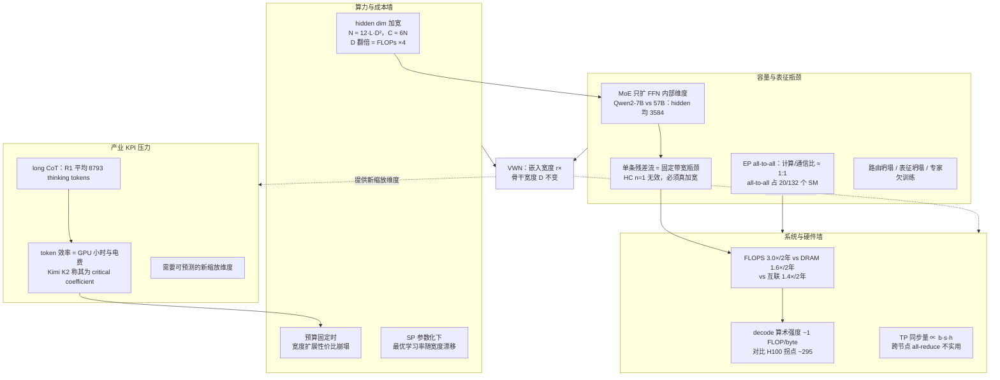
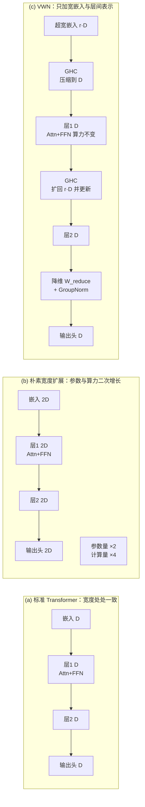
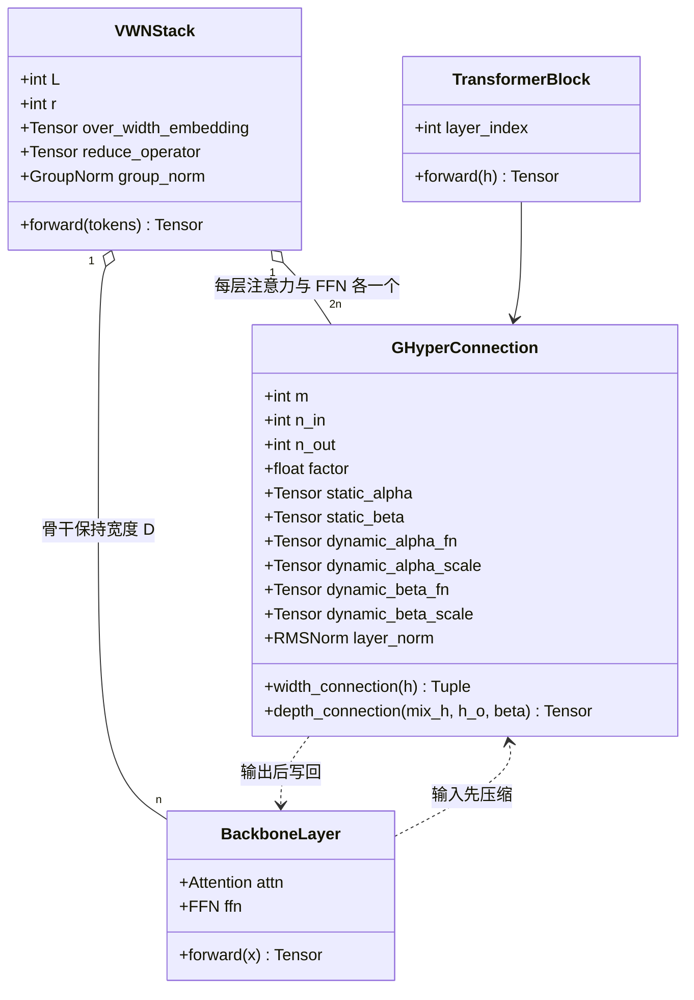
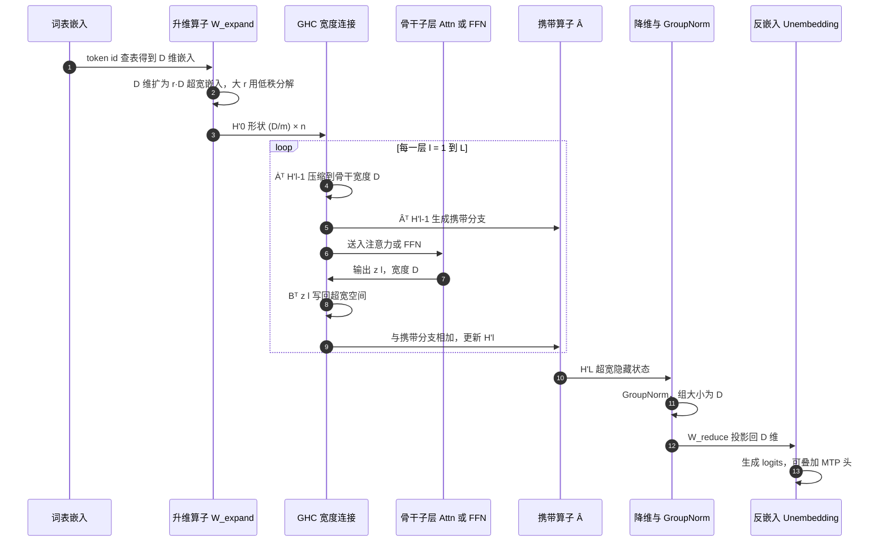
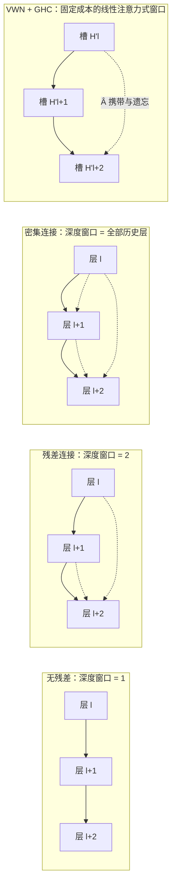
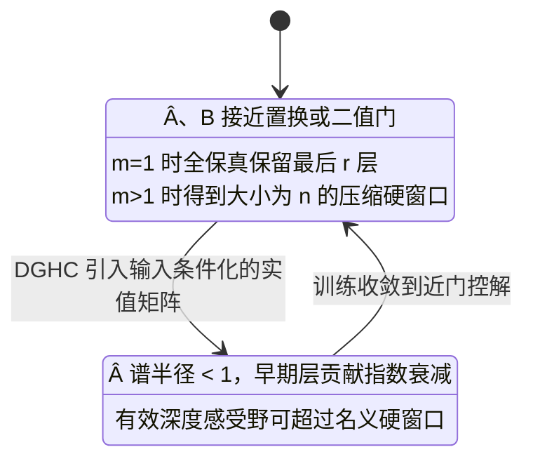
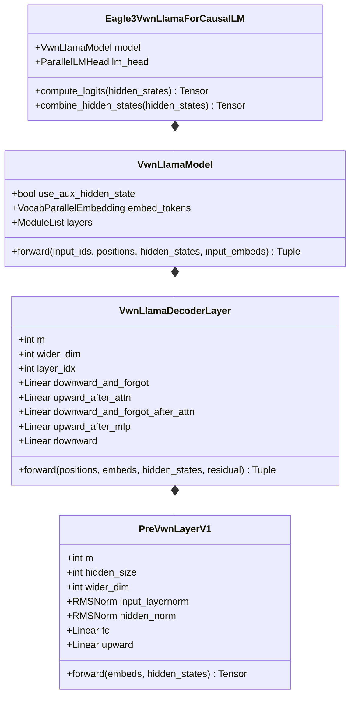
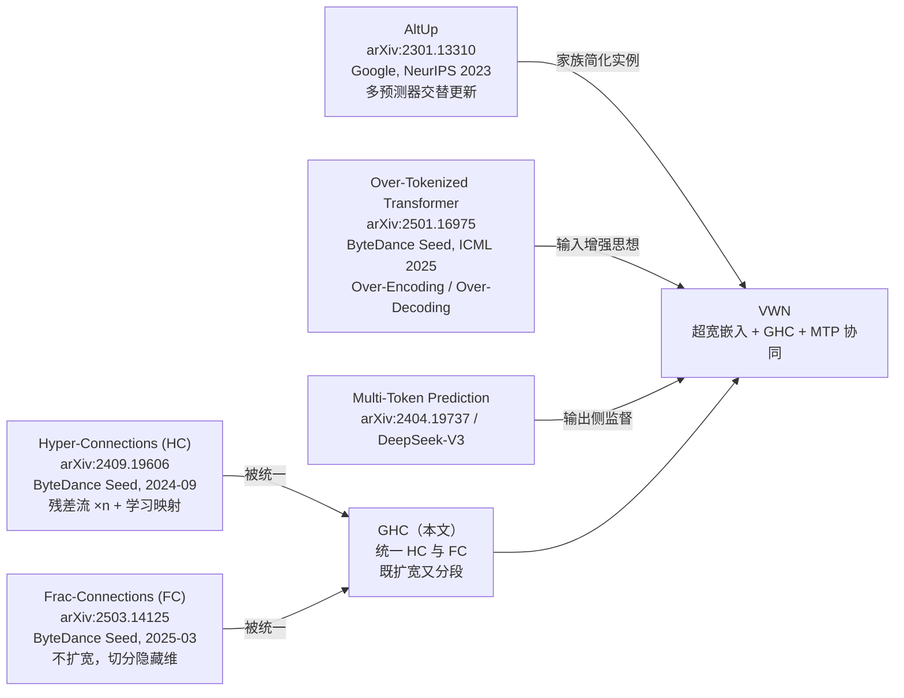
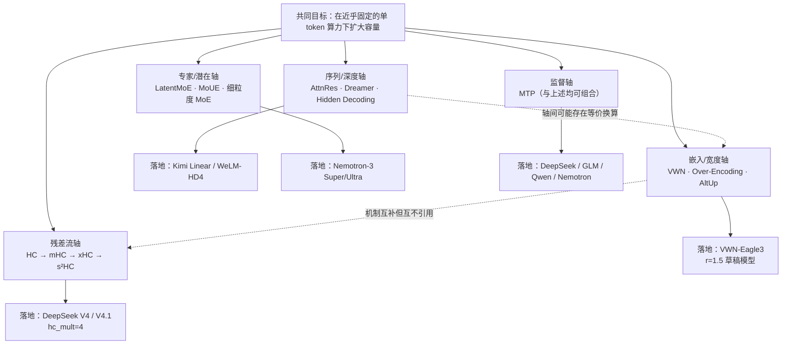
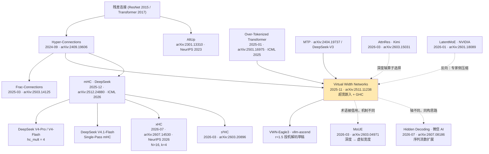

# Seed 团队 VWN（Virtual Width Networks）技术洞察

> **洞察对象**：ByteDance Seed 团队论文 *Virtual Width Networks*（arXiv:2511.11238；v1 2025-11-14，v2 2025-11-17；**论文仍在更新**，引用请注明版本）
> **文档版本**：2026-10-13
> **关键词**：虚拟宽度、超宽嵌入（Over-Width Embedding）、广义超连接（GHC）、残差流、MoE、多 token 预测（MTP）、token 效率、缩放定律
> **资料来源**：arXiv 一手全文（abs + HTML + ar5iv）、HF Papers、vLLM / vllm-ascend 代码与 PR、ICML/NeurIPS 2026、Sebastian Raschka 架构库、中文科技媒体与社区精译；**所有事实性结论附链接，分析推测显式标注**（见附录 C）。
> **系列关系**：本报告是"Seed 扩容新维度"系列的第 1 篇。第 2 篇为 [Seed-OE-技术洞察.md](Seed-OE-技术洞察.md)——**Over-Encoding 放大"输入词表规模"**，与本篇"放大每 token 向量维度"正交；VWN 论文明确引用 OE 的 Over-Encoding / Over-Decoding 作为依据。

---

## 0. 结论速览（TL;DR）

| 维度 | 结论 |
| --- | --- |
| **技术定位** | 把 **token 嵌入宽度**与 **Transformer 骨干宽度**解耦：嵌入扩到 `r×`（如 8×）而骨干算力几乎不变，层间用**广义超连接（GHC）**在"超宽隐藏状态"与"骨干隐藏状态"之间上下投影 |
| **解决什么问题** | ①加宽 hidden dim 带来 **O(D²)** 的算力/参数爆炸；②MoE 只扩 FFN 内部维度、扩不了表征宽度；③单条残差流是十年未变的**固定宽度瓶颈**；④超宽激活撞上内存墙与通信墙 |
| **效果（论文自报）** | MoE-A3.3B 上 8× 虚拟宽度：达到基线下一 token 损失所需 token 少 **2.5×**、下 2-token 少 **3.5×**；虚拟宽度因子与损失近似**对数线性**（每翻倍 ≈ −0.0069 loss，R²=0.9986）；下游平均准确率峰值 **+2.16** 点 |
| **代价（论文自报）** | 计算增量以"每 token 数十~数百 FLOPs"计（m=2,n=3 时归一化+动态参数+宽度连接共 **42D**、深度连接 **6D** FLOPs）；额外激活显存 **≈8.8%**；**真正瓶颈是 I/O 与通信，而非 FLOPs** |
| **学术影响** | **低**。截至 2026-10-13 Semantic Scholar 仅记录 **3 篇**引用（其中 1 篇疑为跨领域误引）；HF 论文页 `linkedModels`/`linkedDatasets` 为空，**无官方开源代码/权重**；无会议接收记录（仅 arXiv 预印本） |
| **热度** | HF Daily Papers 2025-11-17 **当日 #3 / 39 upvotes / 仅 3 条评论**；中文传播主要靠至顶 AI 实验室（澎湃号 + 公众号原文）与社区自发全文精译；Twitter/X、Reddit 未见专门讨论；机器之心/量子位未见专门报道 |
| **工程影响（最硬的证据）** | vllm-ascend 已合入 **VWN-Eagle3** 投机解码草稿模型（PR #10042 / commit `f6a737c`，`vllm_ascend/models/llama_eagle3_vwn.py`），配置 `vwn_m=4, vwn_r=1.5`，对 Qwen3-30B-A3B 的接受长度基线 **0.75 / 0.50 / 0.30**，优于标准 EAGLE3 的 **0.68 / 0.40 / 0.18** |
| **同族技术（已出现）** | 残差流轴：**mHC**（DeepSeek，arXiv:2512.24880，ICML 2026；V4-Pro/Flash `hc_mult=4`，V4.1 用 Single-Pass mHC）→ **xHC**（arXiv:2607.14530，NeurIPS 2026，N=16/k=4）→ **s²HC**（arXiv:2603.20896）；深度轴：**AttnRes**（Kimi，arXiv:2603.15031）、**Dreamer**（arXiv:2601.21582）；专家轴：**LatentMoE**（NVIDIA，arXiv:2601.18089，Nemotron-3 Super/Ultra 采用）；序列轴：**Hidden Decoding**（微信 AI，arXiv:2607.08186）；专家复用轴：**MoUE**（arXiv:2603.04971） |
| **关键判断** | VWN 是**"高工程相关性、低学术引用影响"的方法论输出**。它把 HC/FC 家族统一进"虚拟宽度"叙事并提出"虚拟宽度作为新缩放维度"这一可检验命题；实际影响体现在 ①被推理栈采纳为草稿模型的嵌入拓宽方案；②与 mHC/xHC/Hidden Decoding/LatentMoE 共同确认了"**固定主干扩容**"这一 2026 年主战场——**但 VWN 自己并未成为该战场的引用枢纽**（同族工作全文 0 次提及 VWN，属并行演化） |

---

## 1. 技术背景：业界在什么场景下遇到什么问题

### 1.1 场景一：预训练想"加宽"，但宽度是二次成本

Transformer 的参数与算力对 hidden dim `D` 是二次的。Kaplan 等给出的非嵌入参数量近似为

```
N ≈ 2 · d_model · n_layer · (2 · d_attn + d_ff) = 12 · n_layer · d_model²   （标准设定 d_attn = d_ff/4 = d_model）
每 token 训练算力 C ≈ 6N
```

推论：**D 翻倍 → 参数量与训练 FLOPs ×4**（[Kaplan et al., 2020, §3.1](https://arxiv.org/html/2001.08361v1)）。GPT-3 的配置佐证了 `N ∝ n_layer·d_model²`：从 125M（12 层/768）到 175B（96 层/12288），参数放大 ~1400× 中，宽度贡献 16×、深度仅 8×（[GPT-3](https://arxiv.org/abs/2005.14165)）。

**"宽 vs 深"的争论值得注意其分寸**：

- Kaplan 原始结论是**形状不敏感**——固定参数量下宽深比可变化 40 倍而 loss 仅微变（该 40× 论述在正文 §3.1 图 5 图注，不在摘要）。
- **MobileLLM 用同等参数预算直接反驳**：~125M 档，4 层/dim 1280（163.2M）8 任务平均 **43.3**，而 30 层/dim 512（135.0M）达 **44.8**、62 层/dim 384（134.3M）达 **44.7**；~350M 档 5 层/dim 2048（388.0M）平均 **47.1**，32 层/dim 896（380.3M）达 **49.8**。原句："Contradictory to the scaling law (Kaplan et al., 2020), we demonstrate that **depth is more important than width** for small LLMs"，亚十亿模型最优深度约 30 层（[MobileLLM](https://arxiv.org/html/2402.14905v2)）。
- **CompleteP 反向修正**（作者自报、非独立复现）：认为"深度不划算"部分源于参数化假象，1.5B 非嵌入参数下最优宽深比可从 μP 的 N:L=38.7 放宽到 **11.8**（仍在最优 loss 1% 内），报告 **12–34%** 算力效率提升（[CompleteP](https://arxiv.org/abs/2505.01618)）。

**工程侧还有一层隐性代价**：标准参数化（SP）下最优学习率随宽度漂移，μP/μTransfer 才能让超参对宽度稳定（从 40M 迁移即超过 GPT-3 6.7B，调参成本约预训练的 7%，[Tensor Programs V](https://arxiv.org/abs/2203.03466)）。

> **本场景要回答的问题**：在不付出二次成本的前提下，能否获得"更宽表征"的收益？

### 1.2 场景二：MoE 解耦了"容量/算力"，但没有解开"宽度瓶颈"

**MoE 不动 `d_model`，这是最干净的事实。** Qwen2 提供了同族对照：**Qwen2-7B 与 Qwen2-57B-A14B 的 Hidden Size 完全相同（均 3584）、层数同为 28**，MoE 版只是把 FFN 换成 64 路由专家（每专家 Intermediate 仅 2560）+ 8 共享专家，参数 7B→57B，**表征宽度零变化**（[Qwen2, Table 1](https://arxiv.org/html/2407.10671v4)）。DeepSeek-V3 同样如此：61 层、hidden dim **7168**，每层 1 共享 + 256 路由专家、每专家中间维度仅 **2048**（远小于 dense 常规 4×7168），671B 参数几乎全由"专家数 × 专家隐层"堆出（[DeepSeek-V3](https://arxiv.org/html/2412.19437v2)）。Mixtral 的表述同源："an expert is a standard feedforward block"（[Mixtral](https://arxiv.org/abs/2401.04088)）。

**但 MoE 的系统代价真实且被官方量化**（均为 DeepSeek-V3 官方数据）：

| 瓶颈 | 官方数字 |
| --- | --- |
| 计算/通信比 | 跨节点专家并行下恶化到约 **1:1** |
| 并行规模 | 训练用 16-way PP + **64-way EP（跨 8 节点）** + ZeRO-1 DP；解码最小部署单元 40 节点/320 GPU |
| all-to-all 开销 | 占用 H800 的 **132 个 SM 中的 20 个** |
| 带宽不对称 | NVLink ≈ 160 GB/s ≈ IB 50 GB/s 的 3.2×，故限制每 token 最多发往 4 个节点 |
| 推理上限 | 按 400Gbps CX7 IB 折算，61 层 all-to-all 合计 **14.76 ms** TPOT ≈ 67 tok/s，结论是"**MoE 推理速度的上限由互联带宽决定**" |
| H800 的妥协 | NVLink 被限到 400 GB/s 后，V3 **在训练中明确规避张量并行**（"Avoidance of Tensor Parallelism"） |

来源：[DeepSeek-V3 技术报告](https://arxiv.org/html/2412.19437v2)｜[Insights into DeepSeek-V3](https://arxiv.org/html/2505.09343v2)

**负载不均衡与坍塌风险**（引语归属已逐篇核实）：V3 引用 Shazeer 2017 指出"unbalanced expert load will lead to routing collapse"，故采用 **auxiliary-loss-free** 的专家 bias 调节；[Expert Choice Routing](https://arxiv.org/abs/2202.09368) 指出糟糕路由会让专家欠训练/过特化（收敛时间改善 >2×）；[Representation Collapse of Sparse MoE](https://arxiv.org/abs/2204.09179) 论证路由促使 token 向专家质心聚集、存在表征坍塌趋势。[ST-MoE](https://arxiv.org/abs/2202.08906) 的贡献是 all-to-all 定义、容量因子与 α=10⁻² 的辅助损失。

**推理期低 batch 也是真问题**：V3 自述解码阶段"每专家 batch 通常 ≤256 token，瓶颈是访存而非计算"；第三方实测在 SGLang+EP 服务 Mixtral 时，最热专家造成等斜滞，GPU 空转最高占 GPU 时间 **70%**（[AMoE](https://arxiv.org/html/2505.08944v2)）。

> **本场景要回答的问题**：能不能扩"表征宽度"，而不是扩"专家数量"？

### 1.3 场景三：残差连接/残差流是十年未动的固定宽度瓶颈

**经典论断（Anthropic Transformer Circuits）**：残差流的维度"become something like 'memory' or 'bandwidth'"；单个 MLP 层通常有 **4×** 残差流维度的神经元，故 50 层模型的第 25 层前后各要面对约 **100×** 自身维度的神经元，只能以 superposition 通信；作者称这类张量为 **"bottleneck activations"**（[A Mathematical Framework for Transformer Circuits](https://transformer-circuits.pub/2021/framework/index.html)，无 arXiv 编号）。

**HC 的 motivation 直指"连接强度被预先写死"**：

> "The key issue is that residual connections, including both Pre-Norm and Post-Norm variants, **predefine the strength of connections** between the output and input within a layer."
> —— [Hyper-Connections, arXiv:2409.19606](https://arxiv.org/html/2409.19606v3)

HC 把 hidden state 复制成 n 份（H ∈ R^{n×d}，n 即 **expansion rate**），副本间通过 width-connection 交换信息，而 **attention/FFN 仍在原宽度计算**；可核验开销极小：OLMo-1B-DHC×4 额外 FLOPs 仅 **+0.200%**、参数 **+0.0335%**。关键消融：**n=1 时 HC 反而劣于 baseline**（V2 Eval Loss 2.819 vs 2.811），说明"可学习的连接强度"本身不足，**必须真正扩张残差流**；n=4 最优，n=8 收益回落。

**同族的独立证据链**：

- **DenseFormer**（NeurIPS 2024）：48 块 DenseFormer 的 perplexity 需 72 块标准 Transformer 才能匹敌，而后者参数量与显存**大 45%**；关键消融显示**仅给 skip connection 加可学习缩放（Skips with Gains）不能复现收益**——瓶颈不是"缩放残差强度"，而是**缺乏对早期层的直接访问**（[DenseFormer](https://arxiv.org/abs/2402.02622)）。
- **RMT**（ICML 2025，*Residual Matrix Transformers: Scaling the Size of the Residual Stream*）：把残差流定义为 "a memory bus where transformer layers both store and access features"，结论是**残差流尺寸可独立于计算量和模型规模缩放**；相同 loss 下比 Transformer 少用 **58% FLOPs、25% 参数、41% 训练 token**（[RMT](https://arxiv.org/abs/2506.22696)）。

> **⚠️ 一处必须写清的限定**：常被表述为"Pre-Norm 导致表示坍塌"的说法**属于工程经验性关联**。严格结论来自 [Attention is Not All You Need (arXiv:2103.03404)](https://arxiv.org/abs/2103.03404)：它证明的是**禁用 skip connection 与 MLP 的纯自注意力**以 doubly exponential 收敛到 rank-1，且**明确证明 LayerNorm 不缓解 rank collapse**；skip connection 与 MLP 正是阻止退化的因素。（另注：`2105.02723` 是 "Do You Even Need Attention?"，`2203.00555` 是 DeepNet，均与 rank collapse 无关。）

### 1.4 场景四：系统侧的真实瓶颈是内存墙、I/O 与通信

**内存墙是 20 年尺度的结构性趋势**，有硬数字（[AI and Memory Wall, IEEE Micro](https://arxiv.org/abs/2403.14123)）：

| 指标 | 每 2 年增速 | 20 年累计 |
| --- | --- | --- |
| 峰值服务器 FLOPS | **3.0×** | +60,000× |
| DRAM 带宽 | **1.6×** | +100× |
| 互联带宽 | **1.4×** | +30× |
| 单 GPU 显存（同期对比） | **2×** | —（LLM 参数量 410×/2年、训练算力 750×/2年） |

**硬件拐点（算术强度门槛 = 密集算力 ÷ 带宽）在 150–330 FLOP/byte 区间，两代之间几乎原地踏步**（据官方规格相除推导，非厂商原文）：A100 BF16 312 TFLOPS / 2,039 GB/s ≈ **153**；H100 SXM5 BF16 989.4 TFLOPS / HBM3 ≈3 TB/s ≈ **295–330**；B200 FP16 2.2 PFLOPS 密集 / 7.7 TB/s ≈ **286**。而 decode 的实际算术强度只有 **~1 FLOP/byte**，相差两个数量级——NVIDIA 官方直言 decode "like a matrix-vector operation that underutilizes the GPU compute ability"，延迟由**权重/激活从内存搬运的速度**主导（[NVIDIA 推理优化博客](https://developer.nvidia.com/blog/mastering-llm-techniques-inference-optimization/)）。

**超宽激活会同时放大三类系统代价**：

1. **kernel 与访存**：FlashAttention 的立论前提就是必须做 IO-aware 优化；decode 时 query length=1，若 batch 小于 SM 数（A100 为 108），"**With a batch size of 1, FlashAttention will use less than 1% of the GPU**"（[FlashAttention](https://arxiv.org/abs/2205.14135)）。
2. **张量并行同步量**：Megatron-LM 每层 forward 2 次 all-reduce、backward 2 次，**通信量与 activation 张量大小 b×s×h 成正比**——h 越宽，每层同步字节越多（[Megatron-LM](https://arxiv.org/abs/1909.08053)）。
3. **跨节点断崖**：TP 每层每设备通信量 = **8·b·s·h·(t−1)/t**；当 TP 度超过单节点 GPU 数时，all-reduce 必须走慢得多的跨服务器链路，"the overhead of performing tensor model parallelism across slower inter-node links can be **impractical**"，经验法则是 TP 不超过单节点 8 卡（[Megatron-LM at Scale](https://arxiv.org/abs/2104.04473)）。NVIDIA 实测：单次 Llama 3.1 70B 请求（8K 输入 + 256 输出）**每张 GPU 需传输多达 20 GB 的 TP 同步数据**（[NVLink/NVSwitch 博客](https://developer.nvidia.com/blog/nvidia-nvlink-and-nvidia-nvswitch-supercharge-large-language-model-inference/)）。

**这正是 VWN 在结论里承认的现实**：算法增益能否转化为生产效率取决于系统；随隐藏宽度增长，通信与内存访问开销不可忽略，当代硬件对**非常宽的激活和跨设备路由**并不友好（[VWN §6](https://arxiv.org/html/2511.11238v2)）。

### 1.5 场景五：产业 KPI 从"参数规模"转向"token 效率"

- **Chinchilla 把 token 效率变成与参数量并列的核心指标**：compute-optimal 下参数量与训练 token 等比例增长（约 **20 tokens/param**，1B→20.2B、175B→3.7T、1T→21.2T）（[Chinchilla](https://arxiv.org/abs/2203.15556)）。
- **产业界主动偏离 compute-optimal，理由正是推理预算**：Llama 2 对 7B/13B/34B/70B **一律训 2.0T tokens**（最小模型超配近 14×）；Llama 3 明文写出策略："**we also train our smaller models for much longer than is compute-optimal. The resulting models perform better than compute-optimal models at the same inference budget.**"（[Llama 3](https://arxiv.org/abs/2407.21783)）
- **长上下文的成本被 KV cache 直接量化**：13B 模型在 A100 40GB 上约 **65%** 显存给权重、近 **30%** 给动态状态（含 KV cache），个 token 的 KV cache 需 **800 KB**（[vLLM/PagedAttention](https://arxiv.org/abs/2309.06180)）。
- **long CoT 把推理成本推到新量级**：DeepSeek-R1 以平均 **8,793 thinking tokens/题**取得 61.8% Pass@1，而同题集 GPT-4o 0513 平均只生成 **711** output tokens（"an order of magnitude less"）；训练中最大采样长度不得不从 32,768 提到 **65,536**（[DeepSeek-R1](https://arxiv.org/html/2501.12948v2)）。
- **Kimi K2 直接把 token 效率称为缩放的关键系数**："Given the increasingly limited availability of high-quality human data, we posit that **token efficiency is emerging as a critical coefficient in the scaling of large language models**"，并以 MuonClip 在 15.5T tokens 上零 loss spike 预训练（[Kimi K2](https://arxiv.org/abs/2507.20534)）。
- **Qwen3 把 token 消耗做成可调旋钮**（thinking budget），在极长输入上设为 8192 tokens 以抑制过度冗长推理（[Qwen3](https://arxiv.org/abs/2505.09388)）。

VWN 的定位正是"**新增一个可预测的效率缩放维度**"：虚拟宽度因子 r 与 loss 降低近似对数线性（r 每翻倍平均降低约 0.0069 loss，R²=0.9986）。

### 1.6 问题图谱（汇总）



### 1.7 背景要点一览

| # | 场景 | 具体问题（含量化） | 业界既有对策 | 残留缺口（VWN 的切入点） |
| --- | --- | --- | --- | --- |
| 1 | 预训练算力规划 | D 翻倍 → FLOPs ×4；MobileLLM 证明小模型"深优于宽" | 深度优先、数据配比优化、μP 超参迁移 | 缺"便宜的表征宽度" |
| 2 | 容量扩展 | MoE 不动 d_model；EP 计算/通信比 1:1 | 增加专家数 / 更细粒度专家 / 无辅助损失均衡 | 专家扩展的系统开销；表征瓶颈未解 |
| 3 | 残差连接 | 单条残差流预定义连接强度、带宽有限 | HC（n=4 拐点）/ FC / DenseFormer / RMT | HC 破坏恒等映射、训练不稳、访存开销 |
| 4 | 训练与推理系统 | DRAM 1.6×/2年 vs FLOPS 3.0×/2年；decode ~1 FLOP/byte | kernel 融合、重计算、并行切分、EPLB | 需要设计时就"对硬件友好"的加宽方式 |
| 5 | 产业 KPI | token 效率、KV cache、long CoT 成本 | Chinchilla 式缩放定律、thinking budget | 缺新的、可预测的效率缩放维度 |

---

## 2. 技术介绍

### 2.1 一句话定义与核心洞察

**VWN 是一套把"表示宽度"与"骨干网络宽度"解耦的框架**：输入 token 的嵌入被扩展成 `r×` 宽（*Over-Width Embedding*，超宽嵌入），层间状态因此变成 *Over-Width Hidden States*（超宽隐藏状态）；每层通过轻量的 **GHC（Generalized Hyper-Connections，广义超连接）** 把超宽状态**压回骨干宽度**送入 Attention/FFN，再把输出**扩回超宽**并更新超宽状态；最后用降维算子（+ 组归一化）回到原宽度做反嵌入。

核心洞察一句话：**嵌入查找只占整体计算量的极小一部分，所以"把嵌入做宽"几乎是免费的**；而 Attention/FFN 的计算量与宽度强耦合、才是二次成本的主要来源。二者解耦之后，"更宽的表征"不再等于"更贵的骨干"。

### 2.2 三种宽度范式对比



> 对应论文图 2（[论文 HTML](https://arxiv.org/html/2511.11238v2)）。

### 2.3 关键概念与符号

| 符号 | 含义 | 论文典型取值 |
| --- | --- | --- |
| `D` | 骨干（hidden）宽度 | 4096（示例） |
| `m` | **分数率 / 分段数**：把 hidden 向量切成 m 段，每段宽 `D/m` | 2、4、8 |
| `n` | 超宽空间的段数（`n > m`），每段宽 `D'/n = D/m` | 3、16、32、64 |
| `D'` | 超宽维度，`D' = (n/m)·D` | 4096×8 = 32K |
| `r = n/m` | **虚拟宽度因子** | 1.5、2、4、8 |
| `H'^l` | 第 l 层超宽隐藏状态，形状 `(D/m) × n`（n 个槽） | — |
| `A^l, B^l` | GHC 路由矩阵（`Â`：携带/遗忘；`Ȧ`：压缩；`B`：写回） | 见 §2.4 |
| `W_expand / W_reduce` | 升维/降维算子（大 r 时可低秩分解） | — |

两个要点：

1. **r 不必是整数**。论文用 `(m,n)=(2,3)` 实现 **1.5× 分数扩展**并验证有效。
2. **m 与 n 有明确的"内存预算"语义**：以 D 为单位，深度信息的内存预算恰为 `r = n/m`。`m=1`＝"用全 D 保真度存 r 层"；`m>1`＝"存 n=rm 层、每层压缩到 D/m"。`m` 控制每层压缩率，`n` 控制名义深度窗口，`r` 固定总预算。

### 2.4 广义超连接 GHC：统一 HC 与 FC 的超宽状态路由器

#### 2.4.1 形式化定义

第 l 层的 GHC 是一个轻量变换矩阵 `GHC^l ∈ R^{2m × (m+n)}`：

```
GHC^l = [   0(m×m)     B^l(m×n) ]       0   : 不回写到自身
        [   A^l(n×(m+n))         ]       B^l : 骨干输出 → 写回超宽槽
                                         A^l : 再分为 Ȧ^l（压缩/读取）与 Â^l（携带/遗忘）
```

层更新公式（论文式 10）：

```
H'^l = (B^l)ᵀ · T^l( (Ȧ^l)ᵀ · H'^{l-1} )  +  (Â^l)ᵀ · H'^{l-1}
        └──── 本层骨干变换后的写入 ────┘     └── 历史槽信息的携带/遗忘 ──┘
```

其中 `T^l` 是注意力或 FFN 子层。三段式直觉：

- `Ȧ^l`：**压缩/读取** —— 从 n 个超宽槽线性组合出一个 D 维骨干输入；
- `T^l`：**骨干计算** —— 在标准宽度 D 上跑注意力/FFN（算力不变）；
- `B^l`：**写回** —— 把骨干输出写回超宽空间；
- `Â^l`：**携带/遗忘** —— 按学习到的（可输入相关的）权重传递上一层超宽槽，类似深度方向上的"线性注意力 KV 缓存"，实现固定成本的深度上下文。

#### 2.4.2 动态 GHC（DGHC）

变换矩阵由输入表征 `H'` 自适应生成（归一化 → 线性 → tanh → 小可学习矩阵缩放 → 与静态矩阵相加）：

```
B(H') = S_β ∘ tanh( norm(H')·W_β / τ )ᵀ + B
A(H') = S_α ∘ tanh( norm(H')·W_α / τ ) + A        τ = sqrt(D/m)
```

- 动态参数 `W_β, W_α` **初始化为 0**（初始时退化为静态 GHC），静态成分**不使用 weight decay**，动态成分使用。
- 静态 `B` 按**循环模式**初始化（`B[i,j]=1 当 i ≡ j (mod m)`），静态 `A` 初始化为**块矩阵**（前 m 列两个单位块，其余单位块安排在尾部，`r = n−m`）。
- 论文特别说明：**没有做专门初始化调优，仍有改进空间**。

#### 2.4.3 类图（UML）



> 与论文附录算法 2/3 的 PyTorch 伪代码一一对应：`width_connection` 负责压缩 + 生成 β，`depth_connection` 负责写回 + 携带。

#### 2.4.4 VWN 前向传播（UML 时序图）



### 2.5 与 MTP 的协同（以及为什么必须用块级线性）

论文把 VWN 与**多 token 预测（MTP）**结合，同时优化下一 token 目标与辅助 n-gram 损失。直觉：**更密集的 MTP 监督会"锻炼"扩展出的虚拟空间**，而 VWN 提供的额外表征自由度改善短程组合建模，二者协同。

一个关键工程细节：DeepSeek-V3 式 MTP 用单个稠密线性融合"隐藏态 + 上一 token 嵌入"（`M_k ∈ R^{d×2d}`，`h'_i^k = M_k[RMSNorm(h_i^{k-1}); RMSNorm(Emb(t_{i+k}))]`，Eq.21；**注意 V3 §2.2 原文写的是"D 个顺序 MTP 模块"，"只训 1 个模块"属官方工程实现细节，不是论文正文表述**）。在 VWN 下这会变成 **2rD → rD**，r=8 时参数与 FLOPs 都不可承受。解法是**块级线性**：把 rD 维向量切成 n = r×m 段、每段 D/m 维，对每段施加相同的 `(2D/m) → (D/m)` 小线性并跨段共享投影器——**保持更宽表征的收益，把混合成本压回 r=1 量级**。

### 2.6 反嵌入、组归一化与稳定性

- 反嵌入前需 `W_reduce ∈ R^{D×D'}` 把超宽状态投影回 D，且**在降维算子之前加归一化**以稳定训练。
- r 较大（D'=32K 量级）时**不在全部 D' 维上归一化，而用 Group Normalization，组大小 = 原始 hidden 尺寸 D**。
- 1.5× 配置下论文**省略了**降维前的 GroupNorm。

### 2.7 成本分析（论文 §3.5）

| 项目 | 公式 | m=2, n=3 示例 |
| --- | --- | --- |
| 归一化（RMSNorm 等） | `4·(n/m)·D` FLOPs/token | — |
| 动态参数 A、B 生成 | `2·((2m+n)n/m)·D` FLOPs/token | — |
| 宽度连接 | `2·((m+n)n/m)·D` FLOPs/token | 三者合计 **42D FLOPs** |
| 深度连接 | `2nD` FLOPs/token | **6D FLOPs** |
| 额外激活显存（训练） | `4η·(n/m)·D` 字节 | η=0.5 时 **3D 字节 ≈ 普通层 34D 的 8.8%** |
| 推理额外开销 | 仅来自新增参数 | "可忽略" |

**关键判断**：这些 FLOPs 对 GPU 训练/推理系统"很小"，**真正的瓶颈是与激活相关的内存访问 I/O**。工程对策：把归一化、动态参数计算、宽度连接**融合进单个 GPU kernel**，并让宽度连接与后续 LayerNorm 融合。另注：**m > 4 后收益递减**（论文图 6）。

### 2.8 "沿深度方向的注意力"：一个有用的心智模型

论文第 4 节把层的堆叠视为"深度序列"，层索引类似 token 位置，隐藏状态充当"垂直 KV 缓存"：



展开递推式后（论文式 17），`H'^l` 是对**更早层骨干特征的线性聚合**，通过"携带算子" `Â` 传播、每步通过 `B` 写入——**正是线性注意力在"压缩的深度缓存"上的精神**。论文谨慎界定类比边界：GHC **不使用相似度打分或 softmax**，而是用学习的（静态或输入条件化的）路由矩阵以固定成本携带/压缩/写入信息。

**硬路由 vs 软路由**（可用状态机理解）：



例：`(m,n)=(8,64)` 时维护 64 个宽 D/8 的槽——硬路由下当前层可利用最近 64 层，软路由下更早层信息可带着衰减继续存活。

### 2.9 实验结果

| 实验 | 配置 | 结果 |
| --- | --- | --- |
| 大规模验证（图 1） | MoE-A3.3B，`(m,n)=(8,64)` → r=8 | 达到基线下一 token 损失所需 token 少 **2.5×**、下 2-token 少 **3.5×**（摘要口径为"加速 2× 以上 / 3× 以上"）；NTP gap 由早期 Δ=0.025 增至 3T token 时 Δ≈0.032，next-2 由 Δ=0.049 增至 0.056；下游峰值 **+2.16** 点 |
| 虚拟宽度缩放律（图 7/8） | MoE-A0.8B，固定 m=8，r∈{2,4,8}，500B token | NTP loss Δ = 0.020 / 0.028 / 0.035；next-2 Δ = 0.030 / 0.045 / 0.058；下游准确率 +3.2 / +3.5 / **+4.16** 点 |
| 拟合缩放律 | — | `y = −0.0069·log₂(x) + 1.6212`，**R² = 0.9986**（仅 3 个数据点、单一模型，外推需谨慎） |
| 分项下游增益（0.8B，r=8，500B token） | — | DROP **+8.92**、TriviaQA +7.45、MMLU-Pro +5.25、MATH +4.20、MMLU +3.95、HumanEval +2.44 |
| 分数率 m 消融（图 6） | MoE-A0.8B | **m>4 后收益基本饱和**；更大模型需要更高 m 才能维持虚拟容量 |
| 1.5× 与 MTP 组合 | MoE 0.4B/4B、2.5B/25B | VWN 降 NTP loss；VWN+MTP 在 2.5B/25B 上全程最高准确率 |

**两个反直觉**：①优势**随训练放大**（loss gap 与收敛加速比同时增大），不是早期免费午餐；②**长依赖任务收益最大**（DROP、TriviaQA），作者归因于扩展依赖建模与多句证据聚合从扩大嵌入空间获益最多。

### 2.10 工程落地版：vllm-ascend 的 VWN-Eagle3

这是本洞察中**最具产业意义的证据**：VWN 已以**投机解码草稿模型**形态进入 vLLM-Ascend 代码库。

- PR：[vllm-ascend #10042 "[Feature] Virtual Width Network Eagle3"](https://github.com/vllm-project/vllm-ascend/pull/10042)（commit `f6a737c`）
- 新增文件：`vllm_ascend/models/llama_eagle3_vwn.py`（`PreVwnLayerV1`、`VwnLlamaDecoderLayer`、`VwnLlamaModel`、`Eagle3VwnLlamaForCausalLM`）
- 配置项：`vwn_m`、`vwn_r`（单测参数化 `(m,r) ∈ {(4,1.5), (1,1.0)}`）
- 测试模型：`vllm-ascend/Qwen3-30B-A3B-vwn-eagle-model`（主模型 `Qwen/Qwen3-30B-A3B`；HF 上该草稿模型页当前不可公开访问）
- **接受长度 golden 对比**（num_speculative_tokens=3）：

| 方案 | step1 | step2 | step3 |
| --- | --- | --- | --- |
| 标准 EAGLE3 | 0.68 | 0.40 | 0.18 |
| **VWN-Eagle3** | **0.75** | **0.50** | **0.30** |

> 值得注意：工程方选择的 **r=1.5 恰好落在论文自述的"1.5×–4× 才现实"区间**，等于为论文的可行性边界提供了工程侧背书。

#### 2.10.1 落地版如何"折叠"论文机制

| 论文组件 | 落地实现 | 说明 |
| --- | --- | --- |
| `W_expand`（超宽嵌入） | `PreVwnLayerV1`：`fc(2D→D)` 融合 embeds 与 hidden，再 `upward(D/m → wd/m)` 升维 | 对应论文把"更宽嵌入"与"输入增强"结合 |
| `Ȧ`（压缩）+ `Â`（携带/遗忘） | `downward_and_forgot(wd/m → (D+wd)/m)`，输出 split 为 `[hidden, res]` | **一次线性同时产出骨干输入与携带残差** |
| `B`（写回） | `upward_after_attn / upward_after_mlp(hs/m → wd/m)` 再与 res 相加 | 注意力与 FFN 各一次 |
| `W_reduce` | `downward(wd/m → hs/m)` | 第 0 层结束时回到骨干宽度 |
| 层选择 | 仅 `layer_idx == 0` 走 VWN 路径 | 草稿模型极浅，VWN 用在最需要表征带宽处 |



> **解读**：论文级的"通用超宽表征 + 深度连接"在推理场景被特化为**"单层 VWN 草稿头"**——用更宽的嵌入空间换取更强的草稿预测能力。投机解码的瓶颈是"草稿便宜 + 接受率高"，VWN 恰好满足：额外的 `upward/downward` 只是若干小矩阵，FLOPs 极低，而超宽嵌入提升预测质量。
> **推测**：这可能是 VWN 最现实的第一个产品化形态（草稿模型/小模型），而非主干大模型。

### 2.11 与相关工作的关系（谱系已逐篇核实）



| 方法 | 扩什么 | 与 VWN 的关系（含关键数值） |
| --- | --- | --- |
| **HC**（arXiv:2409.19606） | 残差流宽度（`n` 即 expansion rate） | VWN 视 HC 为"VWN 家族的简化实例"；VWN 批评 HC"在大隐藏空间下 under-utilize 扩张表示，因为每个扩展只用少数标量权重更新"。**HC 论文只给 n∈{1,2,4,8} 消融，没有"推荐 n=4"的原文主张**（n=4 只是 loss 与下游的经验拐点：V3 Eval Loss 2.781→2.514、下游 62.5→63.8；n=8 下游回落至 62.8） |
| **FC**（arXiv:2503.14125） | 不扩宽，把隐藏维切段做连接（frac-rate `m = 1/n`，纯压缩省显存） | GHC 把"扩宽"与"切段"合并：既扩 n 段，又按 m 做结构化子状态。**FC 未给出单一推荐 m 值**，只有 DFC×2/×4 消融（OLMoE-1.3B-DFC×4 loss 降约 0.014） |
| **AltUp**（arXiv:2301.13310） | 多组低秩预测器交替更新（K=2 或 4；同精度最高 87% 加速） | 论文明确把 AltUp 归入更广的 VWN 家族。差异：AltUp 用**标量** `p_{i,j}`/`g_i` 做 predict-correct，VWN 用**矩阵** `A`/`B` 且可输入条件化 |
| **Over-Tokenized**（arXiv:2501.16975） | 输入侧多 gram 分词扩**词表维度**（每 token 仍是 D 维） | VWN 引用其"输入增强"与"OD≈MTP"思想。**关键差异：OE 放大词表维度，VWN 放大每 token 的向量维度**（同词表，`D'=(n/m)·D`），二者理论可叠加 |
| **MTP**（arXiv:2404.19737；DeepSeek-V3） | 额外的下一 token 监督 | VWN 与之协同；但必须改用**块级线性**避免 2rD→rD 爆炸 |

### 2.12 论文自陈的局限

1. **系统现实约束**：随隐藏宽度增长，通信与内存访问开销不可忽略；当代硬件对极宽激活与跨设备路由不友好；极宽配置工程支持有限，**限制了可部署性**。
2. **实践可行区间**：当前技术栈上 **1.5×–4×** 更可行；更大扩展需要**软件、内存布局与互连策略的协同设计**。
3. **增益幅度"适度"**：缩放律系数 −0.0069/翻倍，论文自评 "modest but systematic"，且**仅 3 个数据点、单一模型**。
4. **初始化未调优**：作者明说没有做专门初始化调整。
5. **规模边界**：最大验证规模为 3.3B 激活参数的内部 MoE，**无百 B 级公开验证**；无官方代码/权重。

### 2.13 "虚拟维度"横向对照

| 工作 | 虚拟化的对象 | 时间 | 备注 |
| --- | --- | --- | --- |
| **VWN**（本文） | 表征宽度（嵌入轴） | 2025-11 | 嵌入扩宽 + GHC 连接；r=1.5、2、4、8 |
| [Virtual Logic Depth](https://arxiv.org/abs/2506.18233) | 逻辑深度 | 2025-06 | 先于 VWN，讨论"深度"能否虚拟化 |
| [mHC](https://arxiv.org/abs/2512.24880) | 残差流（宽而稳） | 2025-12 | 把混合矩阵约束到双随机流形，恢复恒等映射 |
| [LatentMoE](https://arxiv.org/abs/2601.18089) | 专家隐空间（反向） | 2026-01 | 路由前压到低秩 latent；Nemotron-3 已采用 |
| [AttnRes](https://arxiv.org/abs/2603.15031) | 深度轴（softmax） | 2026-03 | Kimi，Block AttnRes，已集成 Kimi Linear 48B/3B |
| [MoUE](https://arxiv.org/abs/2603.04971) | 专家（深度→虚拟宽度） | 2026-03 | 跨层复用通用专家池 |
| [Hidden Decoding](https://arxiv.org/abs/2607.08186) | 序列流数（每 token n 条 stream） | 2026-07 | 微信 AI，WeLM-HD4-617B |
| [xHC](https://arxiv.org/abs/2607.14530) | 残差流（N=16 稀疏 k=4） | 2026-07 | NeurIPS 2026，18B 上比 mHC +4.0 分 |

---

## 3. 技术影响：对业界意味着什么，会不会出现变种技术

### 3.1 先给一个准确的坐标系：高工程相关性、低学术引用影响

这是本次调研中**最重要的纠偏结论**，直接影响对 VWN 影响力的判断：

| 影响维度 | 证据 | 判断 |
| --- | --- | --- |
| 学术引用 | Semantic Scholar 截至 2026-10-13 仅 **3 篇**引用：`2609.33895`（残差流负担/扩散 Transformer，可能是真引用）、`2608.13809`（无线通信领域，**疑为误引**）、`2605.06501`（Cubit: Token Mixer with KRR） | **极低**；VWN 未成为被引用的技术基石 |
| 开源生态 | HF 论文页 `linkedModels`/`linkedDatasets` 均为空；无官方代码/权重 | **无直接复现入口** |
| 会议 | 无会议接收记录，仅 arXiv 预印本 | 尚未经同行评审背书 |
| 同族工作引用 | 对 mHC、xHC、Hidden Decoding、Dreamer 全文检索 `Virtual Width` / `Over-Width` / `2511.11238`，**命中数全部为 0** | **并行演化，而非被继承** |
| 工程落地 | vllm-ascend VWN-Eagle3 已合入并带 CI golden | **有真实落地**，但目前仅一处 |
| 公开热度 | HF 当日 #3 / 39 upvotes / **仅 3 条评论**；X、Reddit 无专门讨论；机器之心/量子位未见报道 | **热度衰减快**，中文传播靠至顶 AI 实验室与社区精译 |
| 后续工作 | MoUE 明确借用 "Virtual Width" 术语，但机制完全不同（跨层专家复用） | 概念被借用，**技术未被引用** |

> 需要诚实标注的缺口：知乎存在相关提问页（至少 4 个回答）但正文与 API 均返回 403 `need_login`，**无法引用其具体观点或质疑**；除论文自述局限外，**未检索到针对 VWN 的公开技术批评**——这更可能是关注度不足，而非结论无争议。另：部分中文自媒体稿件含明显夸大（如"已开源核心代码""1–2 年内商业化"），不建议引用。

### 3.2 影响一：被推理栈采纳——VWN 的第一个产品化形态是草稿模型

vllm-ascend 的 VWN-Eagle3（§2.10）是最硬的影响证据。它的意义有三层：

1. **验证了"宽嵌入 + 轻量连接"在推理侧的经济性**：接受长度从 0.68/0.40/0.18 提升到 0.75/0.50/0.30，而增加的计算只是若干小矩阵（论文成本分析中的几十 FLOPs/token 量级）。
2. **验证了分数扩展（r=1.5）是工程首选**，与论文"1.5×–4× 才现实"的自述一致。
3. **说明该方法可以"局部启用"**：只在草稿模型第 0 层启用 VWN 路径即可获益，无需改造主干。这大大降低了采纳门槛。

上游 vLLM 侧也有间接信号：PR #47953 专门为 EAGLE 草稿"草稿用自己的隐藏宽度消费输入嵌入"加了共享守卫（[vLLM #47953](https://github.com/vllm-project/vllm/pull/47953)）——说明**"草稿嵌入宽度 ≠ 主干宽度"这件事正在推理栈里变成常见需求**。

### 3.3 影响二：与同期路线共同确认"固定主干扩容"主战场，但 VWN 不是引用枢纽

2026 年的架构竞赛出现了清晰的四条轴，VWN 只占其中一条：

| 轴 | 代表工作 | 工业落地 |
| --- | --- | --- |
| **嵌入/宽度轴** | **VWN**、Over-Encoding、AltUp | **vllm-ascend VWN-Eagle3（r=1.5）** |
| **残差流轴** | HC → **mHC**（arXiv:2512.24880）→ **xHC**（N=16, k=4）→ **s²HC**（arXiv:2603.20896） | **DeepSeek-V4-Pro/Flash `hc_mult=4`**（V4.1 用 Single-Pass mHC）；vLLM 主仓含混元侧 `hy_v4/nvidia/hc` |
| **序列/深度轴** | **AttnRes**（Kimi，48B/3B，1.4T token）、**Dreamer**、**Hidden Decoding**（微信 AI） | Kimi Linear；WeLM-HD4-80B/617B |
| **专家/潜在轴** | **LatentMoE**（NVIDIA，arXiv:2601.18089） | **Nemotron-3 Super/Ultra 已采用** |
| （配套）**MTP** | DeepSeek-V3/V4、GLM-4.5、Qwen3-Next、Nemotron-3 Super（MTP head 共享权重，~3× 生成加速） | 至少 4 家落地 |



**几个值得记录的同构对照**：

- **xHC 的两个瓶颈与 VWN 自述瓶颈同源**：xHC 指出"单个 write-back 向量要供应越来越多流，新增流逐渐冗余"（信息供给瓶颈）与"residual-mixing 生成成本 O(N³C)"；VWN 指出"扩展表征需要更好的利用机制"与"内存访问成为瓶颈"——**同一类工程问题的不同侧面**。xHC 用稀疏更新（k=4）把 O(N³C) 降到 O(k³C)，规模化到 N=16，18B 上比 mHC 平均 **+4.0** 分。
- **Hidden Decoding 与 VWN 机制最"同构"**：两者都以"复制/拓宽嵌入表"为手段、都在固定主干下换容量、都撞上 KV/内存带宽墙、都给出 **1.5×–4×** 的现实可行区间。差别是 **VWN 加宽"每 token 的向量维度"，Hidden Decoding 加宽"每 token 的序列流数"**（n 条 stream + 独立 embedding 表 + 保留中间 stream 的 KV cache 作为上下文 + Stream-Factorized Attention 把注意力成本降为近似线性，n=1→2→4→8 时 MMLU 85.0→86.7→87.5）。**且 HD 全文 0 次提及 VWN**。HD 额外解决了 VWN 未处理的**流水线并行兼容性**（深度循环不兼容 PP，序列扩展兼容）。
- **LatentMoE 与 VWN 方向相反、目标同构**：VWN 在**输入侧**把宽度放大 r 倍（低秩 expand），LatentMoE 在**专家侧**把宽度压缩（低秩 compress，同样推理成本调用 4× 专家）。两者都是"用低秩瓶颈把表示容量与算力解耦"。
- **VWN 的"连接性视角"与 Kimi AttnRes 是同一问题的两种算子选择**：VWN 用学习路由矩阵（固定成本、无 softmax，O(n²·L)），Kimi 用真正的深度 softmax 注意力（O(L·d)）。VWN 论文明确声明其类比"并不意味着层间连接通过相似度分数构建"，这是关键分歧点。

### 3.4 影响三：把"连接结构"确立为一等设计维度

过去十年 Transformer 的架构创新集中在注意力机制、归一化位置与 MoE 结构上，而**残差连接基本没变**。VWN 与 mHC/xHC/s²HC 一起把"层间如何连接、表示流有多宽"推到了台前。Raschka 的评价是：mHC"现代化了残差连接的设计，令人耳目一新，因为架构改动通常集中在注意力与 MoE 上"（[Architecture gallery](https://sebastianraschka.com/llm-architecture-gallery/mhc/)）。

具体影响：

- 新模型的架构图将不再只有 attention/MoE 两个方块，而会出现 **pre-mix / res-mix / post-mix / head** 之类的连接组件（DeepSeek V4-Pro 的架构图即如此，4 条并行残差流围绕每个子层）。
- "**深度序列 = 注意力 KV 缓存**"的心智模型正在被广泛使用：VWN 的硬/软窗口、mHC 的流形约束、AttnRes 的深度 softmax、Hidden Decoding 的序列流扩展、[Residual Stream Duality](https://arxiv.org/abs/2603.16039) 对"深度因果残差注意力 = 序列 ShortSWA"的算子级证明。
- **"虚拟 X"成为叙事范式**：虚拟宽度（VWN）、虚拟逻辑深度、虚拟专家宽度（MoUE）。

### 3.5 影响四：把系统设计重心从 FLOPs 推向 I/O 与融合

VWN 的成本分析给出一条可能被低估的结论：**这类方法的 FLOPs 增量小到可忽略，真正决定成败的是内存访问、kernel 融合与通信**。

| 层面 | 影响 |
| --- | --- |
| Kernel | 需把"归一化 + 动态系数生成 + 宽度/深度连接"融合成单 kernel；编译器需认识这类新 pattern（vllm-ascend 已用 `@support_torch_compile` 声明动态维度） |
| 显存 | 超宽激活必须靠重计算摊薄（论文 η=0.5 时把额外开销压到 ~8.8%） |
| 并行 | 超宽激活的 TP/EP 切分与路由通信模式需重新设计；论文直言"跨设备路由不友好"；xHC 用 xHC-Flash 跨连续子层共享全状态运算以降内存流量 |
| 量化 | 超宽激活的量化误差、小矩阵（D/m 级）的量化收益需单独评估（Nemotron-3 已走 FP8/NVFP4 + latent MoE 路线） |
| 推理引擎 | 已出现特化实现（vllm-ascend），上游 vLLM 仅在修兼容性 |

**判断**：VWN 类方法的竞争壁垒会**从算法转向系统**——谁能把超宽激活的 I/O 压下去、把通信绕开，谁就能把 r 开大。这与论文"1.5×–4× 可行、更大需软硬件协同设计"的结论一致。

### 3.6 变种技术（一）：已经出现且有论文/代码佐证



| 变种 | 虚拟化的对象 | 核心机制 | 关键数字 | 证据 |
| --- | --- | --- | --- | --- |
| **mHC**（DeepSeek） | 残差流 | 把 HC 混合矩阵投影到**双随机矩阵流形**恢复恒等映射；Sinkhorn 迭代；pre/post 映射非负有界 | V4 用 **20 次 Sinkhorn**；训练开销 **+6.7%**（n=4，含融合/重计算/流水调度优化） | [arXiv:2512.24880](https://arxiv.org/abs/2512.24880)｜[ICML 2026](https://icml.cc/virtual/2026/poster/61870) |
| **Single-Pass mHC** | 残差流 | 用上一层产生的 pre-mixing 权重，把 residual update + input mixing + 系数预测压到一次访存 | V4.1-Flash | [V4.1 技术报告](https://huggingface.co/deepseek-ai/DeepSeek-V4.1-Flash/blob/main/DeepSeek_V41_Tech_Report.pdf) |
| **xHC** | 残差流 | 稀疏更新（每次只更新 k 条流）+ causal depthwise conv + xHC-Flash | N=16/k=4；O(N³C)→O(k³C)；18B 比 mHC **+4.0**，28B **+3.1** | [arXiv:2607.14530](https://arxiv.org/abs/2607.14530)｜[代码](https://github.com/aHapBean/xHC) |
| **s²HC** | 残差流 | 指出 mHC 双随机的三缺陷（恒等退化、非负不能做减法、参数化低效），改用谱范数球约束 | — | [arXiv:2603.20896](https://arxiv.org/abs/2603.20896) |
| **AttnRes**（Kimi） | 深度轴 | 用 softmax attention 替掉固定单位权重残差累加，缓解 PreNorm dilution；Block AttnRes 分块降内存/通信 | 已集成 Kimi Linear 48B/3B，1.4T token | [arXiv:2603.15031](https://arxiv.org/abs/2603.15031) |
| **Dreamer** | 深度轴 | 序列注意力 + 深度注意力 + 稀疏专家注意力组合 | 同精度省 **2–8×** 训练 token | [arXiv:2601.21582](https://arxiv.org/abs/2601.21582) |
| **Hidden Decoding**（微信 AI） | 序列流数 | 每 token 扩 n 条 stream + 独立 embedding 表 + 保留中间 stream KV + Stream-Factorized Attention | WeLM-HD4-80B/617B；n=1→2→4→8 时 MMLU 85.0→86.7→87.5；4× 序列仅花 4.4–5.1× 训练时间 | [arXiv:2607.08186](https://arxiv.org/abs/2607.08186) |
| **LatentMoE**（NVIDIA） | 专家隐空间（反向） | 路由前压到低秩 latent，专家在压缩维上算，再投回全维 | Nemotron-3 用 4× 压缩；同推理成本调用 **4× 专家** | [arXiv:2601.18089](https://arxiv.org/abs/2601.18089) |
| **MoUE**（中科院+百度） | 专家（深度→虚拟宽度） | 跨层复用通用专家池 + 交错旋转拓扑 + UELB + 轨迹状态路由器 | 宽度扩展 +1.3%、深度扩展 +2.5%；checkpoint 转换平均 +4.2% | [arXiv:2603.04971](https://arxiv.org/abs/2603.04971) |
| **VWN-Eagle3** | 草稿模型表征 | VWN 特化为单层草稿头，`downward_and_forgot` 折叠 α/β | 接受长度 0.75/0.50/0.30 vs 0.68/0.40/0.18 | [vllm-ascend #10042](https://github.com/vllm-project/vllm-ascend/pull/10042) |

### 3.7 变种技术（二）：可能的下一批方向（分析推测）

> 以下为**推测**，每条给出核心想法、支撑证据、受益场景与风险，用于研发方向判断，不代表已发表成果。

| # | 方向 | 核心想法 | 支撑证据 | 受益场景 | 风险 |
| --- | --- | --- | --- | --- | --- |
| 1 | **VWN 机制下沉到草稿模型嵌入层** | 把 over-width embedding 作为 EAGLE/Medusa 类草稿头的标准配置 | **已实现**（vllm-ascend，r=1.5） | 低延迟推理、投机解码 | 收益受主干与草稿的接受率上限约束 |
| 2 | **VWN × mHC/xHC 复合加宽** | 输入侧 r× + 残差侧 N× 双轴容量扩展，复用 xHC 稀疏更新压 O(N³C) | VWN 自称 HC/AltUp 为家族简化实例；V4 已用 hc_mult=4；xHC 达 N=16 | 需要极强表征容量的小/中型模型 | 两套机制同时放大激活内存与通信；**mHC/xHC 均未引用 VWN**，组合有效性无公开证据 |
| 3 | **约束化 GHC（"mGHC"）** | 把 A/B 约束到双随机或正交流形 + 初始化即恒等 | mHC 的成功路径；VWN 自陈"初始化未做专门调优" | 大规模训练稳定性 | 可能牺牲表达力（s²HC 已指出双随机的表达力瓶颈） |
| 4 | **虚拟宽度并入缩放律** | 把 r 作为与深度/宽度/数据并列的可规划维度 | 论文 `y=−0.0069·log₂(x)+1.6212`，R²=0.9986 | 算力预算规划 | 仅 3 个数据点、单一模型，外推风险高 |
| 5 | **轴间等价换算** | 宽度轴 ↔ 序列轴 ↔ 深度轴的近似等价与互相折叠（训练用序列扩展、推理折叠回宽度） | VWN 的连接性视角；Hidden Decoding 的序列流对比；[Residual Stream Duality](https://arxiv.org/abs/2603.16039) 的算子级证明 | 长上下文、流水线并行友好 | 已知硬约束：深度循环不兼容 PP；等价性尚无论文验证 |
| 6 | **低秩 expand/reduce 能力补丁** | 只改 embedding/unembedding 的 `W_expand`/`W_reduce`，不动骨干 | 论文 §3.2 显式给出；Hidden Decoding 的循环复制初始化（E_{n+k} ← E_k）佐证平滑扩展 | 低成本能力补丁、模型热升级 | 收益上限受限于骨干的表达能力 |
| 7 | **与 LatentMoE 的对称配对** | 入口加宽 + 专家前压缩（宽表征 + 窄专家） | LatentMoE 已被 Nemotron-3 Super/Ultra 采用；两文都强调硬件-软件协同设计 | 高吞吐 MoE 推理 | 两者叠加后的低秩瓶颈可能成为新瓶颈 |
| 8 | **GHC → 真深度 softmax 注意力** | 把学习路由矩阵换成对层输出的 softmax 注意力 | VWN 明确声明其类比"不使用相似度分数/softmax"；Kimi AttnRes 已验证 Block 化可扩展 | 内容自适应的深度复用 | AttnRes 仍需 Block 化与缓存式流水通信，与宽嵌入叠加会放大开销 |
| 9 | **多模态/视频专用虚拟宽度** | 视频/世界模型时空 token 稀疏、上下文极长，超宽嵌入价值可能更大 | 推测；Seed 团队本身有视频生成积累 | 视频生成、世界模型 | 无公开证据；多模态下"宽度"的语义可能变化 |

### 3.8 影响评估矩阵

| 维度 | 短期（0–6 个月） | 中期（6–18 个月） | 长期（18 个月+） |
| --- | --- | --- | --- |
| 主干模型 | 观望，1.5×–4× 小范围试验 | 与残差流改造（mHC/xHC 类）**合并**进主干设计 | "连接结构"成为与 attention/MoE 并列的标准设计维度 |
| 小模型/草稿模型 | **已落地**（VWN-Eagle3） | 成为投机解码草稿的标准选项之一 | 推理栈原生支持 over-width embedding |
| 训练系统 | kernel 融合 + 重计算 | 并行与通信布局针对超宽激活重设计 | 编译器/硬件出现"宽激活友好"抽象 |
| 学术生态 | 概念被借用（MoUE） | 出现约束化 GHC、动态 r 等改进版 | "虚拟维度"形成独立子领域 |
| 引用影响力 | 保持低位 | 取决于是否被主干模型采用 | 若被采用则引用滞后上升；否则停留在"工程参考" |
| 硬件 | 无明显变化 | 内存布局/互连协同设计需求上升 | 若收益被证实，可能影响下一代加速器显存层次设计 |

### 3.9 风险与不确定性

1. **规模外推风险**：最大公开验证为 3.3B 激活参数，**无百 B 级公开验证**；缩放律基于 3 个数据点与单一模型。
2. **系统收益可能被吃掉**：I/O 与通信是自述瓶颈。真实大规模训练中若超宽激活引入额外 all-gather/reduce-scatter，**端到端加速可能显著低于理论收益**。
3. **与残差流路线的竞争**：如果 mHC/xHC 类"约束化残差流"能以更低系统开销拿到同等收益（DeepSeek V4 已量产验证这条路），VWN 的 8× 宽嵌入可能只在特定场景胜出。
4. **可复现性**：实验基于内部 MoE 与内部数据集，超参敏感性未完全公开，且**无官方代码/权重**；复现门槛高。
5. **同行评审缺失**：VWN 目前仅 arXiv 预印本（对比 mHC 有 ICML 2026、xHC/s²HC 有 NeurIPS 2026 接收）。
6. **概念混淆**：MoUE 等后续工作使用同一术语 "Virtual Width" 但指代**完全不同的机制**（专家跨层复用 vs 嵌入扩宽），技术选型时须严格区分。
7. **版本漂移**：VWN 论文在持续更新（HTML 页眉与引用文献显示晚于 v2 的修订痕迹），引用数值必须注明版本。

### 3.10 对研发团队的启示

> 结合本仓库上下文（Ascend/NPU、TorchTitan、Qwen 实验、投机解码方向）给出的可执行建议。

| 优先级 | 建议 | 理由 |
| --- | --- | --- |
| **P0** | 在**草稿模型/EAGLE 类**场景复现 VWN（r=1.5、m=4） | 已有 vllm-ascend 先例与 golden 数据，投入小、验证快、直接改善接受长度 |
| **P0** | 把 `downward_and_forgot` 这类"压缩+携带融合线性"作为 kernel 融合目标 | 论文明确 I/O 是瓶颈；融合质量决定实际收益 |
| **P1** | 跟踪并评估 **mHC / Single-Pass mHC / xHC** 与 VWN 的组合与替代关系 | 残差流轴已在 DeepSeek V4 量产验证；与 VWN 同处"宽度"主轴，必须明确取舍 |
| **P1** | 建立**超宽激活的显存与通信成本模型**（含 η 重计算比例、TP/EP 切分） | 论文只给 FLOPs 与激活字节估算，真实并行下的通信账要自己算 |
| **P2** | 试验**动态 r / 分层 r** 与**约束化 GHC（双随机 A/B）** | 论文自陈初始化未调优、m 存在饱和点，改进空间明确 |
| **P2** | 关注 **LatentMoE 与 VWN 的正交叠加**（宽嵌入 + 窄专家） | 分别作用于嵌入/残差与专家子网，具备组合可能性 |
| **P2** | 借鉴 **Hidden Decoding 的流水线并行友好性**做轴间选型 | 深度循环不兼容 PP 是硬约束；序列轴扩展对 PP 友好 |

---

## 附录 A. 参考资料

**一手资料（VWN）**

| # | 资料 | 链接 |
| --- | --- | --- |
| 1 | Virtual Width Networks（arXiv:2511.11238，ByteDance Seed） | https://arxiv.org/abs/2511.11238 ｜ https://arxiv.org/html/2511.11238v2 |
| 2 | Hugging Face Papers（2025-11-17 当日 #3，39 upvotes） | https://huggingface.co/papers/2511.11238 |
| 3 | Mixed 中文精译（oneRede/ai_model_research） | https://raw.githubusercontent.com/oneRede/ai_model_research/40694067786f7fdf9ab96133910b6a765a350341/works/virtual-width-networks-translation.md |
| 4 | vllm-ascend PR #10042 "Virtual Width Network Eagle3" | https://github.com/vllm-project/vllm-ascend/pull/10042 |
| 5 | vLLM PR #47953（EAGLE 草稿嵌入宽度共享守卫） | https://github.com/vllm-project/vllm/pull/47953 |
| 6 | Semantic Scholar 引用记录（3 篇） | https://api.semanticscholar.org/graph/v1/paper/arXiv:2511.11238/citations |

**技术谱系（HC / FC / AltUp / Over-Tokenized / MTP）**

| # | 资料 | 链接 |
| --- | --- | --- |
| 7 | Hyper-Connections（arXiv:2409.19606，ByteDance Seed） | https://arxiv.org/abs/2409.19606 ｜ https://arxiv.org/html/2409.19606v3 |
| 8 | Frac-Connections（arXiv:2503.14125，ByteDance Seed） | https://arxiv.org/abs/2503.14125 |
| 9 | AltUp（arXiv:2301.13310，Google，NeurIPS 2023） | https://arxiv.org/abs/2301.13310 |
| 10 | Over-Tokenized Transformer（arXiv:2501.16975，ByteDance Seed，ICML 2025） | https://arxiv.org/abs/2501.16975 ｜ https://dl.acm.org/doi/10.5555/3780338.3781371 |
| 11 | Multi-Token Prediction（Gloeckle et al., arXiv:2404.19737） | https://arxiv.org/abs/2404.19737 |
| 12 | DeepSeek-V3 技术报告（MTP 实现，§2.2） | https://arxiv.org/abs/2412.19437 ｜ https://arxiv.org/html/2412.19437v2#S2.SS2 |

**残差流 / 深度轴**

| # | 资料 | 链接 |
| --- | --- | --- |
| 13 | A Mathematical Framework for Transformer Circuits（bottleneck activations） | https://transformer-circuits.pub/2021/framework/index.html |
| 14 | DenseFormer（NeurIPS 2024） | https://arxiv.org/abs/2402.02622 |
| 15 | Residual Matrix Transformers: Scaling the Size of the Residual Stream（ICML 2025） | https://arxiv.org/abs/2506.22696 |
| 16 | Attention is Not All You Need（rank collapse 严格结论） | https://arxiv.org/abs/2103.03404 |
| 17 | On Layer Normalization in the Transformer Architecture | https://arxiv.org/abs/2002.04745 |
| 18 | mHC: Manifold-Constrained Hyper-Connections（arXiv:2512.24880） | https://arxiv.org/abs/2512.24880 |
| 19 | mHC @ ICML 2026 poster | https://icml.cc/virtual/2026/poster/61870 |
| 20 | Raschka：Manifold-constrained hyper-connections（含 DeepSeek V4/V4.1 细节） | https://sebastianraschka.com/llm-architecture-gallery/mhc/ |
| 21 | xHC: Expanded Hyper-Connections（arXiv:2607.14530，NeurIPS 2026） | https://arxiv.org/abs/2607.14530 ｜ https://github.com/aHapBean/xHC |
| 22 | s²HC: Spectral-Sphere-Constrained Hyper-Connections（arXiv:2603.20896） | https://arxiv.org/abs/2603.20896 |
| 23 | Attention Residuals（Kimi，arXiv:2603.15031） | https://arxiv.org/abs/2603.15031 |
| 24 | Depth-Recurrent Attention Mixtures / Dreamer（arXiv:2601.21582） | https://arxiv.org/abs/2601.21582 |
| 25 | Residual Stream Duality in Modern Transformer Architectures（arXiv:2603.16039） | https://arxiv.org/abs/2603.16039 |
| 26 | Beyond Parameters: Exploring Virtual Logic Depth for Scaling Laws（arXiv:2506.18233） | https://arxiv.org/pdf/2506.18233 |
| 27 | Mixture of Universal Experts（MoUE，arXiv:2603.04971） | https://arxiv.org/abs/2603.04971 ｜ https://ar5iv.labs.arxiv.org/html/2603.04971 |
| 28 | LatentMoE（NVIDIA，arXiv:2601.18089） | https://arxiv.org/abs/2601.18089 |
| 29 | Raschka：Latent MoE（Nemotron 3 / Kimi K3） | https://sebastianraschka.com/llm-architecture-gallery/latent-moe/ |
| 30 | Hidden Decoding at Scale（微信 AI，arXiv:2607.08186） | https://arxiv.org/abs/2607.08186 ｜ https://arxiv.org/html/2607.08186v1 |

**缩放定律 / MoE / 系统 / 产业 KPI**

| # | 资料 | 链接 |
| --- | --- | --- |
| 31 | Kaplan et al., Scaling Laws（N ≈ 12·L·D²） | https://arxiv.org/html/2001.08361v1 |
| 32 | GPT-3 | https://arxiv.org/abs/2005.14165 |
| 33 | MobileLLM（深优于宽的实证） | https://arxiv.org/html/2402.14905v2 |
| 34 | Tensor Programs V / μP / μTransfer | https://arxiv.org/abs/2203.03466 |
| 35 | CompleteP | https://arxiv.org/abs/2505.01618 |
| 36 | Qwen2 技术报告（Table 1：hidden size 不变） | https://arxiv.org/html/2407.10671v4 |
| 37 | Mixtral of Experts | https://arxiv.org/abs/2401.04088 |
| 38 | Insights into DeepSeek-V3（通信/带宽分析） | https://arxiv.org/html/2505.09343v2 |
| 39 | AMoE（EP 推理实测） | https://arxiv.org/html/2505.08944v2 |
| 40 | Expert Choice Routing | https://arxiv.org/abs/2202.09368 |
| 41 | Representation Collapse of Sparse MoE | https://arxiv.org/abs/2204.09179 |
| 42 | ST-MoE | https://arxiv.org/abs/2202.08906 |
| 43 | AI and Memory Wall（IEEE Micro） | https://arxiv.org/abs/2403.14123 |
| 44 | FlashAttention | https://arxiv.org/abs/2205.14135 |
| 45 | Megatron-LM | https://arxiv.org/abs/1909.08053 |
| 46 | Megatron-LM at Scale（TP 通信公式） | https://arxiv.org/abs/2104.04473 |
| 47 | NVIDIA：NVLink/NVSwitch 与 LLM 推理 | https://developer.nvidia.com/blog/nvidia-nvlink-and-nvidia-nvswitch-supercharge-large-language-model-inference/ |
| 48 | NVIDIA：LLM 推理优化（decode memory-bound） | https://developer.nvidia.com/blog/mastering-llm-techniques-inference-optimization/ |
| 49 | Chinchilla | https://arxiv.org/abs/2203.15556 |
| 50 | Llama 2 | https://arxiv.org/abs/2307.09288 |
| 51 | Llama 3 Herd of Models | https://arxiv.org/abs/2407.21783 |
| 52 | vLLM / PagedAttention（KV cache 成本） | https://arxiv.org/abs/2309.06180 |
| 53 | DeepSeek-R1（thinking token 成本） | https://arxiv.org/html/2501.12948v2 |
| 54 | Kimi K2（token efficiency 原句） | https://arxiv.org/abs/2507.20534 |
| 55 | Qwen3 技术报告（thinking budget） | https://arxiv.org/abs/2505.09388 |

**工业落地与中文解读**

| # | 资料 | 链接 |
| --- | --- | --- |
| 56 | DeepSeek V4-Pro 配置（`hc_mult=4`, `hc_sinkhorn_iters=20`） | https://huggingface.co/deepseek-ai/DeepSeek-V4-Pro/blob/main/config.json |
| 57 | DeepSeek V4.1-Flash 技术报告（Single-Pass mHC） | https://huggingface.co/deepseek-ai/DeepSeek-V4.1-Flash/blob/main/DeepSeek_V41_Tech_Report.pdf |
| 58 | Nemotron-3 Super（Latent MoE + MTP 落地） | https://developer.nvidia.com/blog/introducing-nemotron-3-super-an-open-hybrid-mamba-transformer-moe-for-agentic-reasoning/ |
| 59 | 至顶网《字节跳动虚拟宽度网络》(2025-11-18) | https://www.zhiding.cn/zd-ai-lab/2025/1118/3174028.shtml |
| 60 | 澎湃《虚拟宽度网络：不扩张主干也能拥有更强大脑的秘密》 | https://m.thepaper.cn/newsDetail_forward_31990258 |
| 61 | 新京报贝壳财经：DeepSeek mHC 报道 | https://news.qq.com/rain/a/20260102A05AJL00 |

## 附录 B. 术语表

| 术语 | 英文 / 缩写 | 含义 |
| --- | --- | --- |
| 虚拟宽度网络 | VWN, Virtual Width Networks | 把表示宽度与骨干宽度解耦的框架 |
| 超宽嵌入 | Over-Width Embedding | 扩到 `r×D` 的输入嵌入 |
| 超宽隐藏状态 | Over-Width Hidden States | 层间传递的 `(D/m) × n` 状态 |
| 广义超连接 | GHC, Generalized Hyper-Connections | 统一 HC 与 FC 的连接算子 |
| 动态 GHC | DGHC | A/B 矩阵随输入自适应 |
| 分数率 | fraction rate `m` | 隐藏维分段数，控制每层压缩率与深度窗口 |
| 虚拟宽度因子 | `r = n/m` | 表示宽度的扩展倍数 |
| 多 token 预测 | MTP | 辅助的 n-gram 监督目标 |
| 双随机矩阵 | doubly stochastic matrix | 非负且行列和均为 1（mHC 的流形约束） |
| 残差流 | residual stream | 层间传递的主信息通路；HC 家族加宽的对象 |
| 深度窗口 | depth window | 以层为"token 位置"时，当前层可访问的历史层范围 |
| 潜在 MoE | LatentMoE | 路由前把 token 压到低秩 latent 空间再送入专家 |
| 投机解码 | speculative decoding | 用便宜草稿模型预测多 token，再由主模型校验 |

## 附录 C. 事实、推测与资料核查

### C.1 事实与推测的分界

| 类别 | 内容 |
| --- | --- |
| **已证实事实** | 论文全部技术细节与实验数字；vllm-ascend PR 的代码、配置与接受长度 golden；mHC 论文/ICML 2026 收录/DeepSeek V4 `hc_mult=4`/V4.1 Single-Pass mHC；xHC、s²HC、AttnRes、Dreamer、Hidden Decoding、LatentMoE、MoUE 的存在与关键数字；Semantic Scholar 的 3 篇引用；HF/媒体的热度数据；第 1 章的缩放定律、MoE、内存墙、token 效率量化数据 |
| **分析推测（文中已标注）** | §3.6 变种表之后的方向 1–9；"VWN 首个产品化形态是草稿模型"的推断；§3.7 影响矩阵的时间窗判断；§3.9 风险权重；§3.10 建议优先级 |

### C.2 资料核查：本次修正的错误与不引用来源

| # | 问题 | 修正 |
| --- | --- | --- |
| 1 | Over-Tokenized Transformer 的 arXiv 编号 | `2502.12962` **错误**（实为 *Infinite Retrieval*），正确为 **arXiv:2501.16975**（Huang Hongzhi、Defa Zhu 等，ByteDance Seed，ICML 2025） |
| 2 | AltUp 编号 | 补正为 **arXiv:2301.13310**（Google Research，NeurIPS 2023） |
| 3 | DeepSeek-V3 的 MTP 模块数量 | V3 §2.2 原文为"**D 个顺序模块**"，"只训 1 个"属工程实现细节，**不是论文正文表述** |
| 4 | "HC 常用扩张率 4" | **非原文主张**。HC 论文只给 n∈{1,2,4,8} 消融表，n=4 是经验拐点 |
| 5 | FC 的推荐 m 值 | FC 未给出单一荐值，只有 DFC×2/×4 消融与 `n=1/2` 示例 |
| 6 | MoE 负载不均衡引语归属 | "专家欠训练/过特化"出自 [Expert Choice Routing](https://arxiv.org/abs/2202.09368)；"token 向质心聚集/表征坍塌"出自 [arXiv:2204.09179](https://arxiv.org/abs/2204.09179)；[ST-MoE](https://arxiv.org/abs/2202.08906) 只贡献 all-to-all 定义、容量因子、α=10⁻² |
| 7 | rank collapse 编号 | `2105.02723`（Do You Even Need Attention?）与 `2203.00555`（DeepNet）**均错配**；正解为 [arXiv:2103.03404](https://arxiv.org/abs/2103.03404) |
| 8 | "Pre-Norm 导致表示坍塌" | **属过度解读**。原文证明的是禁用 skip connection 与 MLP 的纯自注意力收敛到 rank-1，且 LayerNorm 不缓解 |
| 9 | RMT 标题 / Kaplan 40× 位置 | RMT 全称含 "*Scaling the Size of the Residual Stream*"（ICML 2025）；Kaplan 的 40× 在 §3.1 Fig.5 图注，**不在摘要** |
| 10 | "宽度二次成本"的独立论文 | **不存在专门论文**。最合适的一手引用是 [AltUp §3.1](https://arxiv.org/abs/2301.13310)（attention O(N²d)、FFN O(Nd²)）与 [VWN §3.1](https://arxiv.org/html/2511.11238v2) |
| 11 | OpenAI o1/o3 的推理成本与 thinking token 数 | **未找到一手权威来源**，故本文不做任何数字断言 |
| 12 | 部分中文自媒体稿件 | 含明显夸大（"已开源核心代码""标准硬件即可运行""1–2 年内商业化"），**建议不引用** |
| 13 | 知乎相关提问页 | 页面存在（≥4 个回答）但正文与 API 均 403 `need_login`，**无法引用其观点** |

### C.3 调研支撑文件（工作区内）

> **目录与流程约定**：
> ① 本仓库根目录只放技术洞察文档，**每个技术洞察一个文件夹**（如本报告的 `VWN-Virtual-Width-Networks/`）。
> ② 调研笔记统一收在对应文件夹的 `research/` 下，图表资产收在 `assets/` 下。
> ③ **调研完成后自动清理原始抓取件**（网页 HTML / JSON 等），只保留「笔记中的来源链接 + 本报告附录 A 的参考资料」，不保留 raw 副本。

| 路径 | 内容 |
| --- | --- |
| `VWN-Virtual-Width-Networks/research/VWN-技术调研笔记.md` | 技术谱系逐篇核实笔记（HC/FC/AltUp/Over-Tokenized/MTP/缩放定律），365 行、45 条来源链接 |
| `VWN-Virtual-Width-Networks/research/第1章_技术背景_调研笔记.md` | 第 1 章背景事实核查笔记（5 节 + 49 条来源链接 + 来源核实说明） |
| `VWN-Virtual-Width-Networks/research/VWN_技术影响_调研笔记.md` | 影响与变种调研笔记（引用记录、4 大技术轴、8 个演进方向），425 行、65 条来源链接 |
| `VWN-Virtual-Width-Networks/assets/` | mermaid 渲染产物（`*.svg` / `*.png` / `mmd/*.mmd` 源文件）与 `预览.html` |
