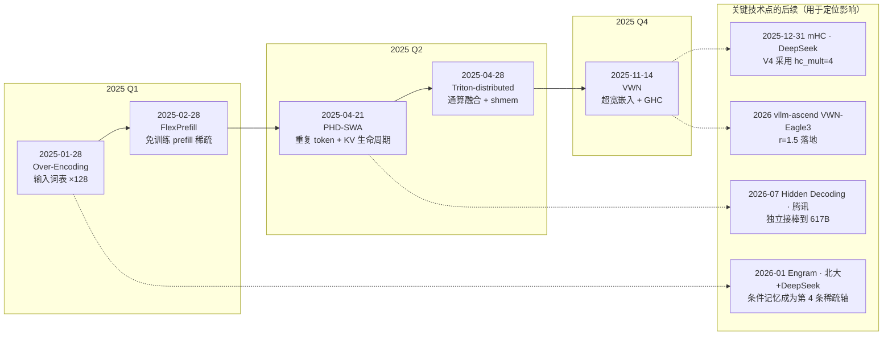

# 技术洞察总览（tech-insight）

> **本文件是本仓库的 README**，同时充当各技术点的总览：汇总核心结论、**技术点提出时间**与相互关系，便于快速选读与横向比较。
> **汇总日期**：2026-10-14　｜　**时间口径**：一律采用 **arXiv v1 首次投稿时间**（UTC），已在 §一 表中标注。
> **详细报告**：各技术点的完整三章（技术背景 / 技术介绍 / 技术影响）+ 附录见对应 md 文件。

**仓库结构**（一级目录 = 公司/实验室，逐家扩展）：

```
tech-insight/
├── README.md                     ← 本文件（总览 / 导航）
├── .agents/skills/tech-insight/  ← 产出此类洞察的 skill
└── ByteDanceSeed/                ← 当前已收录；每篇洞察一个文档 + 一个同名文件夹
    ├── Seed-<技术点>-技术洞察.md
    └── <技术点缩写>-<技术点名>/{research,assets}
```

**当前收录**：**ByteDance Seed** —— VWN（虚拟宽度网络）、Over-Encoding（OE）、FlexPrefill、PHD-SWA、Triton-distributed，共 5 个技术点。

---

## 一、一览表

| # | 技术点 | 提出时间（arXiv v1） | 编号 / 会议 | 一句话定位 | 最硬的一个数字 | 详细报告 |
| --- | --- | --- | --- | --- | --- | --- |
| 1 | **Over-Encoding（OE）** | **2025-01-28** | arXiv:2501.16975 ／ **ICML 2025** | 把**输入词表**当缩放维度：n-gram 哈希嵌入把词表放大 128× | 400M 的 OE 模型**匹配 1B 基线** | [Seed-OE-技术洞察.md](ByteDanceSeed/Seed-OE-技术洞察.md) |
| 2 | **FlexPrefill** | **2025-02-28** | arXiv:2502.20766 ／ **ICLR 2025 Oral** | **免训练**的 prefill 稀疏注意力：运行时逐 head 决定稀疏模式与预算 | γ=0.95 时**精度反超全注意力且快 2.43×** | [Seed-FlexPrefill-技术洞察.md](ByteDanceSeed/Seed-FlexPrefill-技术洞察.md) |
| 3 | **PHD-SWA** | **2025-04-21** | arXiv:2504.14992 ／ 无会议 | 重复 token 换"隐式计算步"：**滑窗只加在隐藏副本上** | 1.2B 平均分 **54.7 → 56.7** | [Seed-PHD-SWA-技术洞察.md](ByteDanceSeed/Seed-PHD-SWA-技术洞察.md) |
| 4 | **Triton-distributed** | **2025-04-28** | arXiv:2504.19442 ／ 无会议 | **device-initiated 通信**：把 all-to-all 融进 GEMM 的 epilogue/prologue | AG+MoE **44.97×** vs PyTorch+NCCL | [Seed-Triton-distributed-技术洞察.md](ByteDanceSeed/Seed-Triton-distributed-技术洞察.md) |
| 5 | **VWN（虚拟宽度网络）** | **2025-11-14** | arXiv:2511.11238 ／ 无会议 | 把**嵌入宽度**与骨干宽度解耦：r× 超宽嵌入 + 广义超连接 | 8× 虚拟宽度下**少 2.5× / 3.5× token** | [Seed-VWN-技术洞察.md](ByteDanceSeed/Seed-VWN-技术洞察.md) |

> 前四篇集中在 **2025 年 1–4 月**（约 3 个月内），第五篇 VWN 在 **2025 年 11 月**——这一节奏本身就是 Seed 在"扩容新维度"上密集下注的证据。

## 二、时间线



## 三、逐项摘要

### 1. Over-Encoding（OE）— 2025-01-28

**本系列最早、也最"零算力"的一篇。** 核心洞察是把被绑在一起的两件事拆开：**输入词表只花"查表"成本，输出词表才花"softmax"成本**，因此只放大输入侧几乎免费。做法是在既有 BPE 分词器上**叠加 1/2/3-gram 哈希嵌入**（低秩切片、层次化求和、模数 m 与词表 V 互质），把输入词表从 10 万级扩到 **1280 万级（128×）**；输出侧用**乘积分解**实现 OD，并把多 token 预测视为其近似。效果：400M 的 OE 模型**匹配 1B 基线**，OLMo2-1B 的 loss 收敛快 **5.7×**，且 loss 与 log₁₀m 呈**对数线性**（m 每放大 4×，loss 降 0.015）。代价：FLOPs 仅 +0.5%，但训练吞吐 −4.6%~−8.3%，embedding 参数量从 51M 涨到 **13.1B**。**影响**：约 45–48 篇引用，并催生了"条件记忆"这条线——美团 LongCat-Flash-Lite 论文原文把自己的层标注为 "Over-Encoding (Huang et al., 2025)"，Qwen3.8-Flash-Next 更把 **51.2B** 参数放在 n-gram 表上。工程门槛不在算法而在**词表并行**：论文用 embedding 专用张量并行 + all-to-all 把吞吐损失从 −25% 压到 <5%，否则 FSDP 下 m>5×10⁶ 就容易 OOM。

### 2. FlexPrefill — 2025-02-28（ICLR 2025 Oral）

**解决"长上下文 prefill 太贵"，且坚持免训练。** 核心洞察：稀疏模式**不止一种**（跨 query 一致的"竖线+斜线"结构化模式，与随 query 变化的"查询相关"模式），且**最优稀疏率随输入变化**。做法是用 **JS 散度**（阈值 τ=0.1）判断"便宜的池化估计能否代表真实注意力"来决定用哪种模式；再用**累计注意力阈值 γ** 最小化要计算的索引集合（论文以对偶与 KKT 证明 γ 就是拉格朗日乘子阈值）；两种模式最终**统一成同一份 block 索引**，交给单个 FlashAttention 风格 kernel。效果：γ=0.95 时 RULER 平均分 **89.18 > 全注意力 88.70**，128K 上下文快 **2.43×**；γ 压到 0.6 可换 **9.81×**。**边界与反证**：138 篇引用（influential 35），但 HF upvote 仅 1、SGLang 集成 PR 未合并、**无生产模型背书**；The Sparse Frontier（2504.17768）在 **τ=0** 条件下独立复现，结论是"matches or underperforms Vertical-Slash"。工程侧边界较硬：官方实现里 **batch=1 是硬断言、仅支持 bf16、prefill-only、不支持 MLA**，且 τ 调大即掉点。

### 3. PHD-SWA — 2025-04-21

**把"让模型多算几步"做成不涨 KV 的形式。** 做法是把每个 token **重复 K 次并交错**：第 1 份（original token）承载持久 KV 与全部长程依赖，第 2..K 份（hidden decoding token）充当额外计算步且**用完即丢**——**持久 KV 与 vanilla 完全相同**；再用**重排**把被 mask 的区域聚成连续块，注意力复杂度从 O(K²) 压到 O(K)。**PHD-SWA** 给隐藏副本加 **W=16** 局部窗口以补回局部依赖（original 仍全注意力，**故不需要 attention sink**）；**PHD-CSWA** 把窗口限制在 **C=32** 的 chunk 内，把额外 pre-filling 开销压到"仅最后一个 chunk"。效果：1.2B 平均分 **54.7→56.7（K=3）**，550M **49.3→51.1（K=5）**，单点最大 ARC-C +4.6。**边界**：FLOPs ≈ K 倍、**完全没有 32K/128K 实验、最大模型仅 1.2B、无开源、无会议**。腾讯 Hidden Decoding 独立接棒到 617B（两篇无互引）。窗口收益在 **W=4 之后即饱和**，选 W=16 是性价比折中；唯一量化延迟界是 **K=256 时解码延迟 ≤+20%**。

### 4. Triton-distributed — 2025-04-28

**本系列唯一的系统/编译器类技术点，也最贴合国产硬件。** 要解决的是：MoE 与序列并行下**通信已与计算同量级**（DeepSeek-V3 官方给出计算/通信比 ≈1:1、132 个 SM 里 20 个用于通信），而传统 host-initiated 方案（NCCL + stream 重叠）只能**在时间上**重叠、粒度太粗。它走 **device-initiated**：让 SM 在 kernel 内直接发起单边通信，靠**对称内存 / 信号交换 / 异步任务**三支柱，并把原语 lower 到 LLVM IR + bitcode；`shmem` 门面统一了 **NVSHMEM / ROCSHMEM+MORI / mxshmem（沐曦）/ ACLSHMEM（昇腾）** 四家。序列并行的两次 all-to-all 被定名为 **transpose（头维→序列维，融进 GEMM epilogue）** 与 **reverse（序列维→头维，融进 GEMM prologue）**。性能：AG+MoE **44.97×**、分布式 FlashDecode 1.7 TB/s、PCIe 场景 vs NCCL 3.11×、vs DeepEP 1.18×/1.44×（但 **64/128 卡 DeepEP 更优**，因缺 IBGDA）。**影响**：1566★、39 篇引用、**AMD MORI 官方采用它作为 EP 内核后端**。昇腾侧的独立移植（CANN ≥ 9.1.0）已用 **UDMA 引擎 + `dl.wait/dl.notify` 点对点信号量**替代全局 barrier；不过**高层 tile-centric 原语尚未开源**。

### 5. VWN（Virtual Width Networks）— 2025-11-14

**把"宽度"从物理维度变成可路由的虚拟维度。** 洞察是：嵌入查找只占极少算力，**扩宽嵌入几乎是免费的**，只有注意力/FFN 与宽度二次相关——于是把**嵌入宽度扩到 r×D**（4096→32K）而骨干宽度不变，层间用**广义超连接（GHC）**把超宽状态压回骨干、算完再扩回并携带（GHC 统一了此前的 HC 与 FC）。缩放律：loss 与 log₂r 近似线性（**r 每翻倍降约 0.0069**）；MoE-A3.3B 上 8× 虚拟宽度使达到同等 loss **少用 2.5×（下一 token）/ 3.5×（下 2-token）token**。代价：每 token 多几十到数百 FLOPs、激活显存 +8.8%，**真正的瓶颈是 I/O 而非算力**（论文自陈 1.5×–4× 才现实）。**影响两极**：论文本身仅 3 篇引用、无官方代码，但同族路线已成主流——DeepSeek 的 mHC 被 V4-Pro/Flash 采用（`hc_mult=4`）；**vllm-ascend 已把 VWN 落成 VWN-Eagle3（r=1.5）**，接受长度 0.75/0.50/0.30 优于 EAGLE3 的 0.68/0.40/0.18。另外，OE→VWN 这条线（含此前的 HC、FC）与 FlexPrefill、PHD-SWA **共享同一批作者**（Xun Zhou 出现在其中 4 篇），是同一条内部路线的产物。

## 四、横向对比：两半江山

| | **模型架构侧（第 1、2、3、5 篇）** | **系统侧（第 4 篇）** |
| --- | --- | --- |
| 关心的问题 | 如何在**同等算力**下拿到更多容量/能力 | 如何让**通信不再吃掉算力** |
| 主要手段 | 哈希嵌入扩词表、动态稀疏、重复 token、超宽嵌入 | kernel 内单边通信、算子融合、编译器 lowering |
| 验证方式 | 训练 loss / 下游 benchmark | 加速比 / 带宽 / 端到端延迟 |
| 落地形态 | 改模型结构（需重训）或推理期插件 | 改训练/推理栈（可渐进采用） |
| 成熟度信号 | OE 与 FlexPrefill 已有第三方接棒 | 已被 AMD MORI 反向采用 |

## 五、系列关系与两条值得注意的共性

**① 同一批作者构成了"Seed 扩容"的作者内核。** 交叉核对 5 篇的作者列表可以发现：**Xun Zhou 出现在其中 4 篇**（OE、FlexPrefill、PHD-SWA、VWN），**Defa Zhu / Yutao Zeng / Banggu Wu / Qiyang Min / Hongzhi Huang** 覆盖 OE 与 VWN，**Yiyuan Ma / Jianqiao Lu** 分别覆盖 FlexPrefill 与 PHD-SWA。同一条内部链清晰可见：**HC（2024-09）→ FC（2025-03）→ OE（2025-01）→ VWN（2025-11）**。**Triton-distributed 是例外**，来自 Seed Infrastructures Team（Size Zheng 等 22 人），与前四篇无作者重叠。

**② 方法论高度一致：把"静态超参"变成"运行时/可规划的决策"。** OE 把词表大小变成可缩放维度并给出对数线性律；FlexPrefill 把稀疏率变成运行时旋钮 γ（并证明它是对偶变量）；VWN 把 r 变成可预测的缩放维度；PHD 把"KV 是否驻留"变成生命周期策略；Triton-distributed 把通信从"算子外的调用"变成"kernel 内的一次访存"。**五篇共享同一个母题：为已被当作固定超参的设计维度，寻找可解释、可规划、可组合的表达方式。**

## 六、未决事项与阅读建议

| 项 | 说明 |
| --- | --- |
| ⏳ **待你确认的一处修订** | [Seed-FlexPrefill-技术洞察.md](ByteDanceSeed/Seed-FlexPrefill-技术洞察.md) 的 §3.1/§3.7 尚未补入两项内容：①The Sparse Frontier 的独立反证（τ=0 条件下不如均匀 Vertical-Slash）；②引用坐标系（138 篇 vs MInference 487 / NSA 551 / MoBA 221，且 HF upvote 仅 1）。本文 §三.2 已按最新口径陈述，但那份详细报告仍待打补丁。 |
| 想快速判断"值不值得做" | 先读每篇的 **TL;DR 表** + **§3 技术影响**；篇内的"未找到/不可外推"小节是最容易被忽略、也最关键的部分。 |
| 与国产硬件最相关 | 第 4 篇（Triton-distributed，含昇腾移植与 UDMA 实践）。 |
| 最容易踩坑的两处 | ①PHD-SWA 常被当成"通用 SWA"，实际是**token 类型分化 SWA**且**无长上下文验证**；②"flex attention"常被混为 PyTorch 的 `flex_attention`，与 FlexPrefill **无同源、无互引、无代码依赖**。 |
